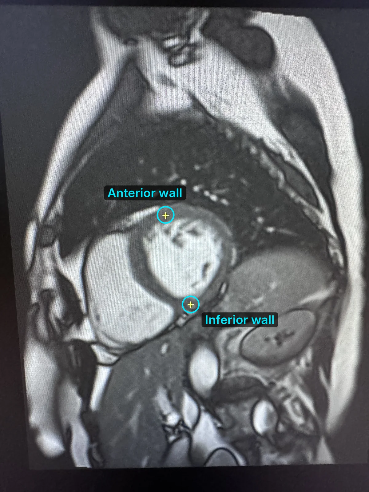
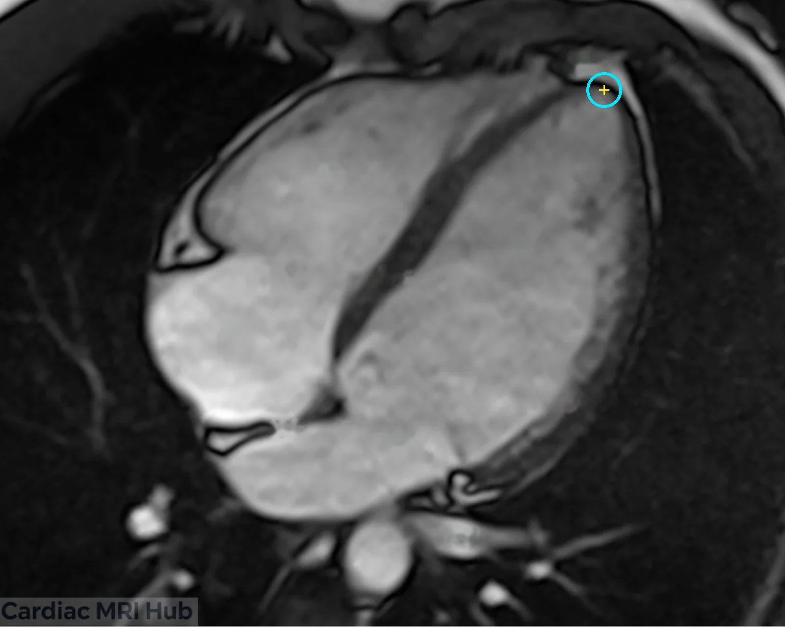
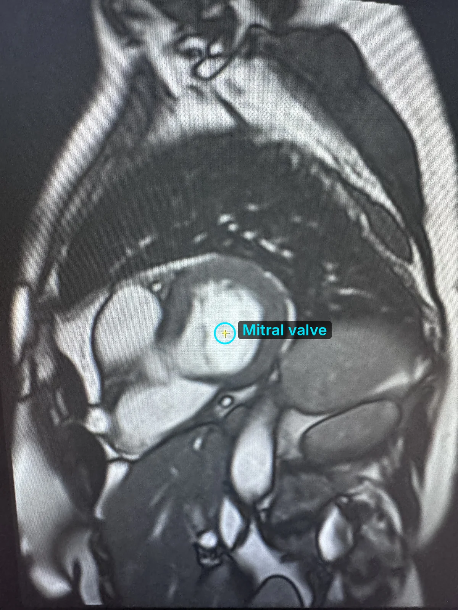
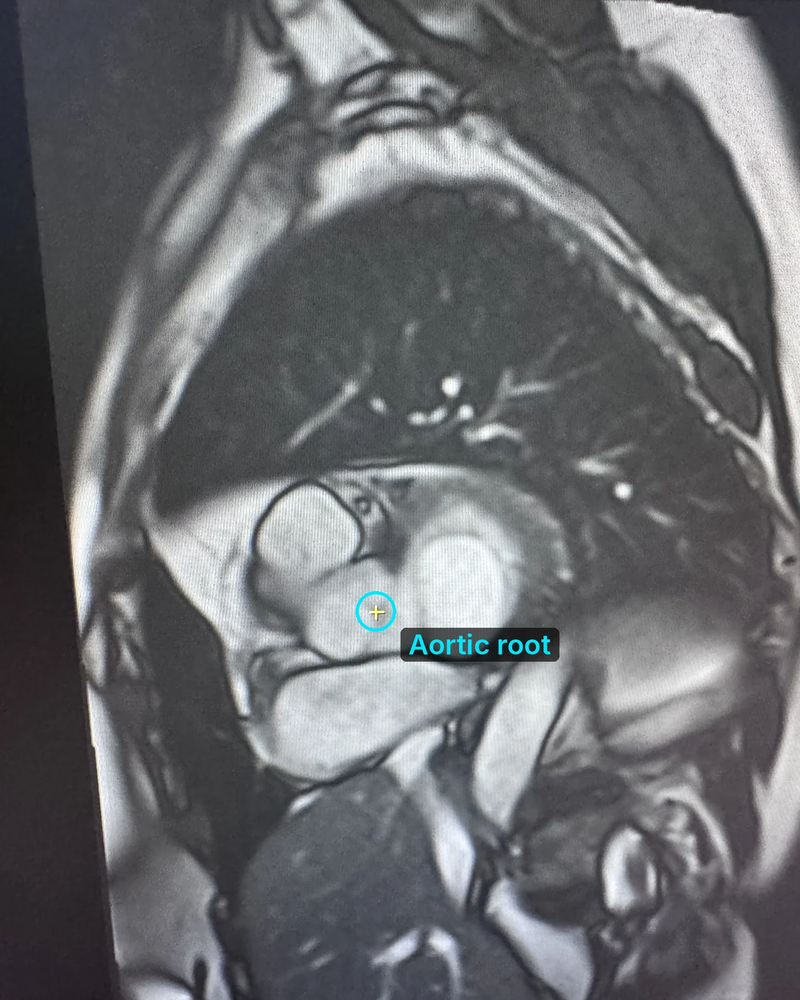
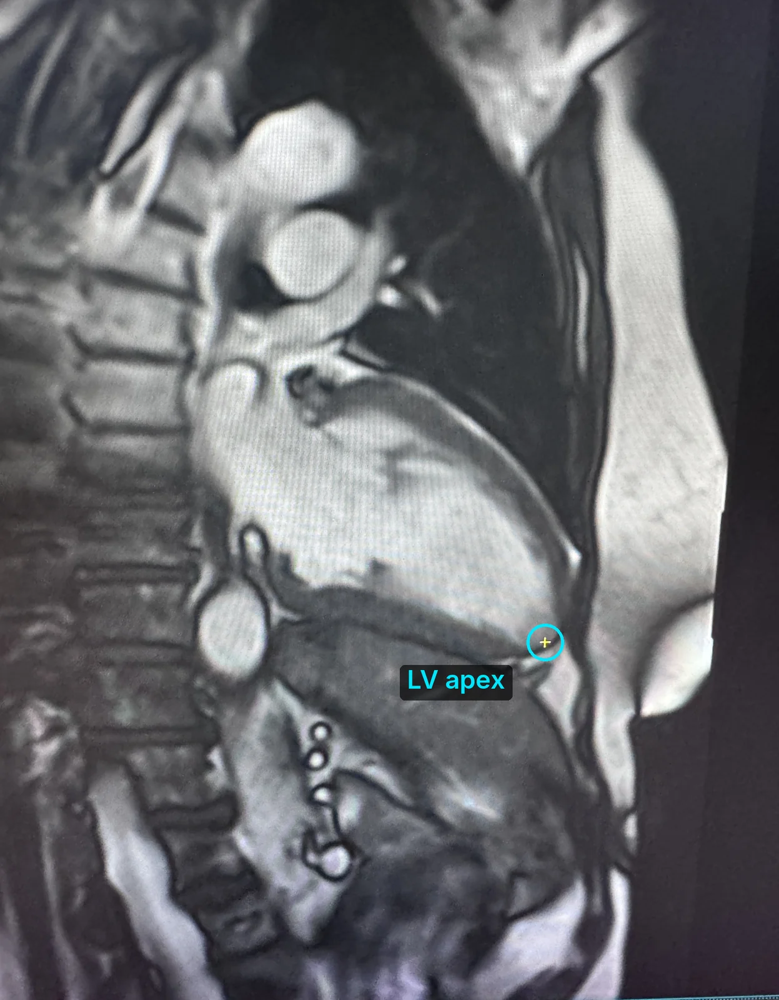
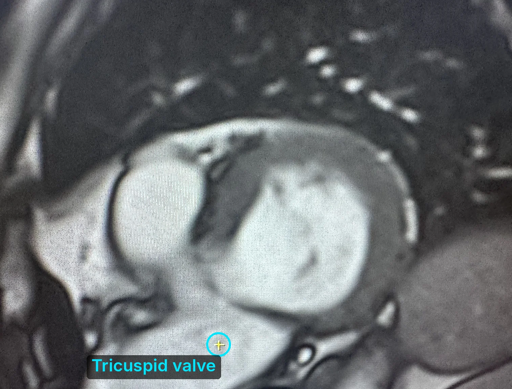
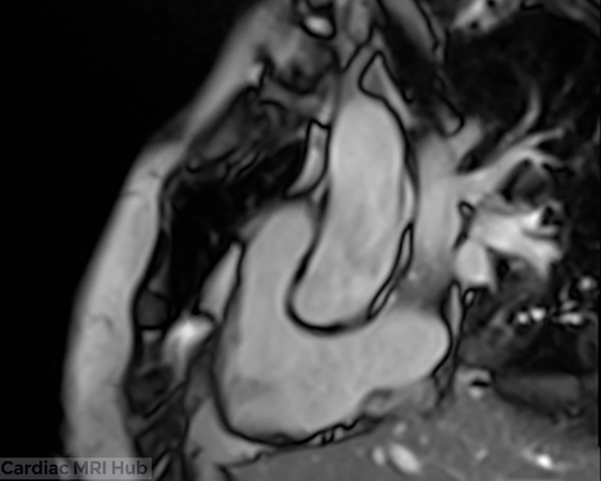
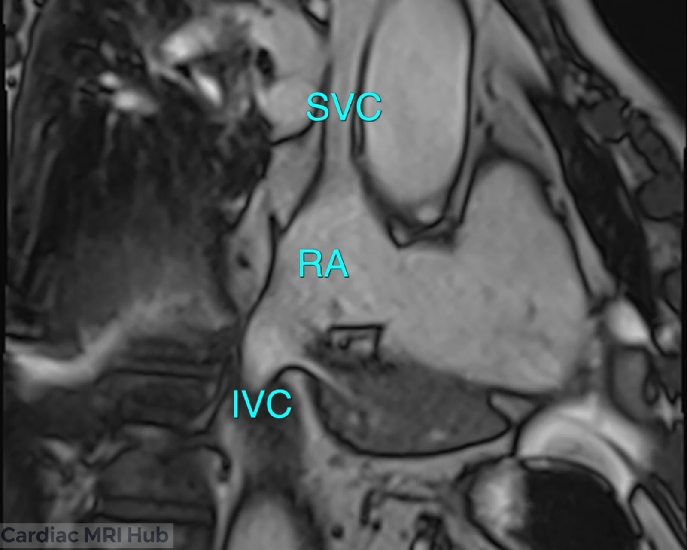
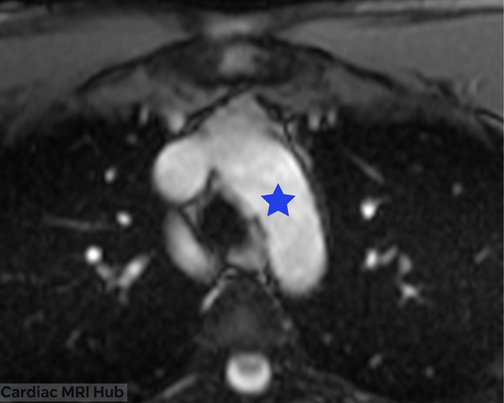
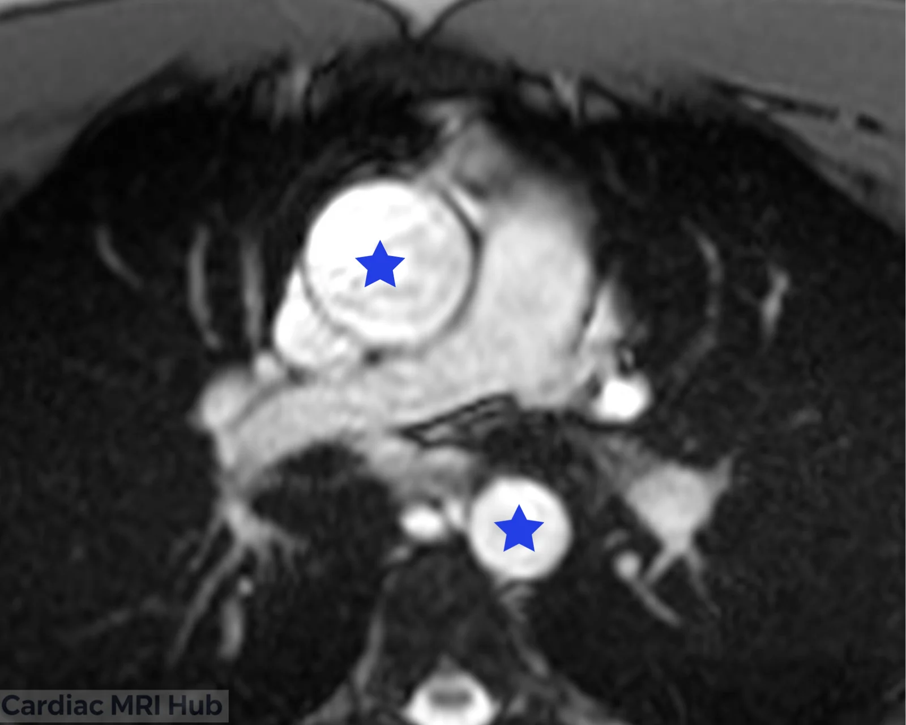

With 3-point planning you place three points and the scanner sets the new plane through all three. The points don't have to be on the same image: for the LV two-chamber, for example, two go on a short-axis slice and the apex goes on a sagittal localizer.

# Landmarks at a glance

| View | The three points | Place them on |
|---|---|---|
| [LV two-chamber](/guide/lv-2-chamber/) | Anterior LV wall, inferior LV wall, LV apex | Walls on a basal or mid short axis, on a line through the middle of the LV parallel to the septum; apex on a sagittal localizer, or on the 4-chamber if you already have it |
| [LV three-chamber](/guide/lv-3-chamber/) | Mitral valve, aortic root, LV apex | Mitral valve and aortic root on the short axis, each on the slice through it; apex on the 2-chamber |
| [LV four-chamber](/guide/lv-4-chamber/) | Tricuspid valve, mitral valve, LV apex | Tricuspid valve and mitral valve on the short axis; apex on the 2-chamber |
| [RV three-chamber](/guide/rv-3-chamber/) | Tricuspid valve, pulmonary valve, RV apex | Tricuspid valve on the 4-chamber; pulmonary valve on the sagittal RVOT; RV apex on the RV 2-chamber |
| [Bicaval](/guide/bicaval-views/) | SVC, IVC, middle of the right atrium | All three on axials |
| [Candy cane (thoracic aorta)](/guide/thoracic-aorta/) | Aortic arch, ascending aorta, descending aorta | Arch on an axial through the arch; ascending and descending aorta on an axial below the arch |

# LV two-chamber view

- **Anterior and inferior LV walls:** on a basal or mid short-axis slice, where a line through the middle of the LV, parallel to the septum, crosses each wall.
- **LV apex:** on a sagittal localizer, or on the 4-chamber if you already have it.

The plane should bisect the mitral valve and run through the apex, parallel to the interventricular septum. More in the [LV two-chamber guide](/guide/lv-2-chamber/).

# LV three-chamber view

- **Mitral valve and aortic root:** on the short axis, at the centre of each, each on the slice through it.
- **LV apex:** on the 2-chamber.

The view should show the mitral valve, LV apex, LVOT and aortic root together. More in the [LV three-chamber guide](/guide/lv-3-chamber/).

# LV four-chamber view

- **Tricuspid valve and mitral valve:** on the short axis, at the centre of each.
- **LV apex:** on the 2-chamber.

.")

The plane should bisect both valves and the apex and stay out of the LVOT. More in the [LV four-chamber guide](/guide/lv-4-chamber/).

# RV three-chamber view

More in the [RV three-chamber guide](/guide/rv-3-chamber/).

# Bicaval view

More in the [bicaval guide](/guide/bicaval-views/).

# Candy cane view (thoracic aorta)

More in the [thoracic aorta guide](/guide/thoracic-aorta/).
