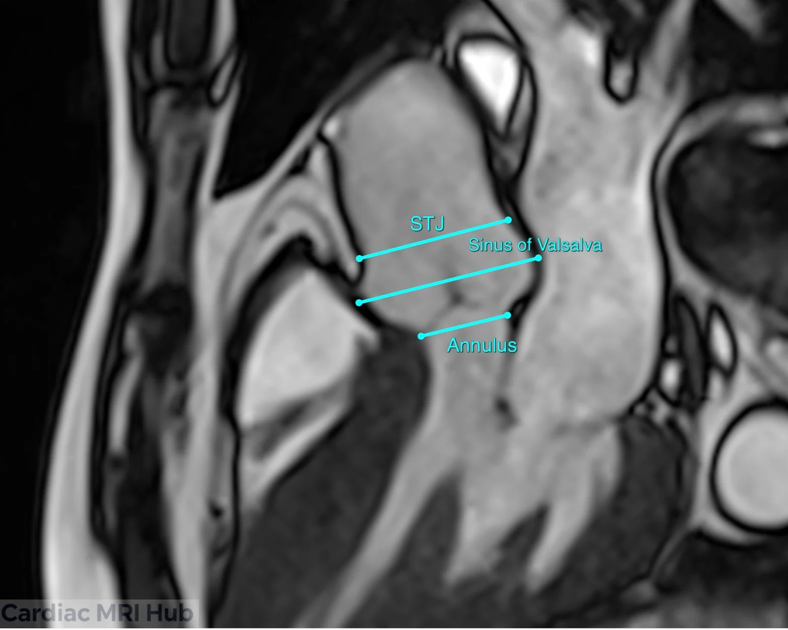
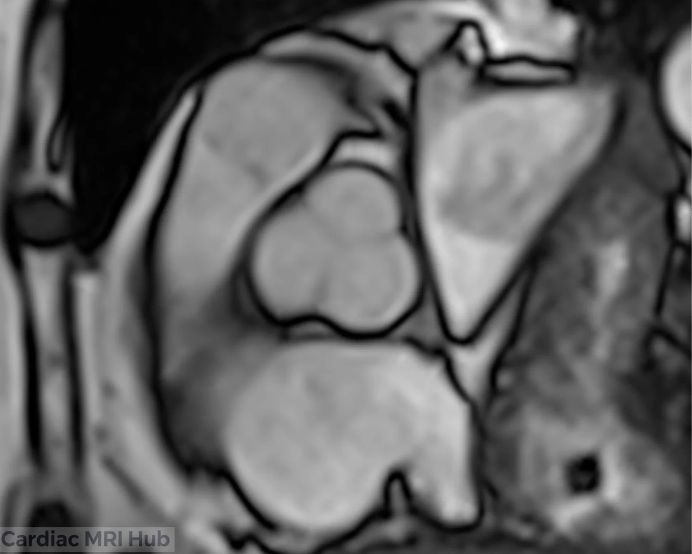
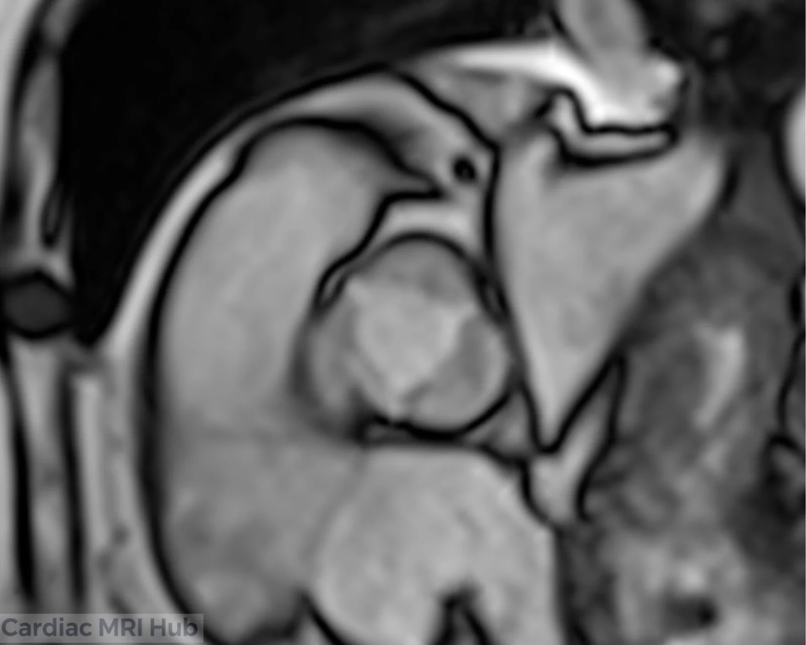
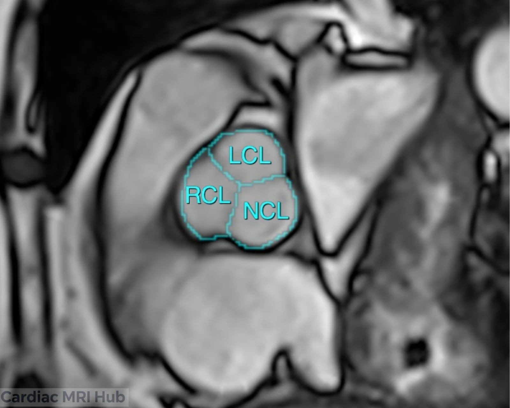
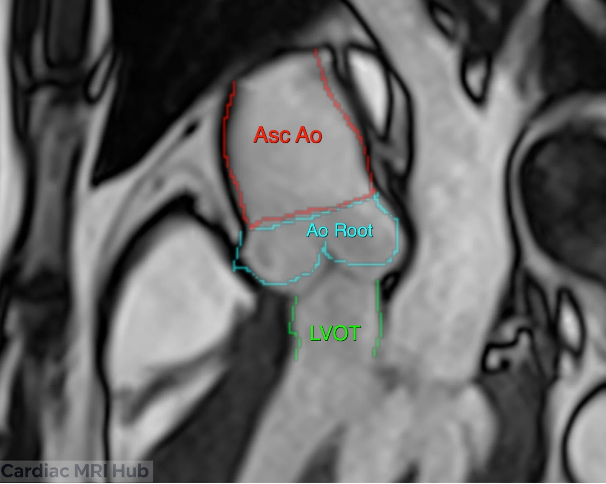

The aortic valve views show the valve and its root: a short-axis stack across the valve from the annulus to the sinotubular junction (STJ), and long-axis views of the outflow tract. They're used for valve shape and function, aortic stenosis and regurgitation, and sizing the annulus.

# Plan it

1. **On the 3-chamber,** place the short-axis slices across the aortic root, square to it, from the annulus through the sinus of Valsalva to the STJ.

2. **On the LVOT view,** set the same stack square to the root, from the annulus to the STJ.

.")

# Check it

- The valve is cut straight across. A normal valve shows three cusps of about the same size when it's closed. If they look uneven or the root looks oval, the slices are tilted: angle them square to the root on both views.
- The stack covers the annulus, the sinus of Valsalva and the STJ.
- In systole, a slice through the leaflet tips shows the opening. For stenosis, add the stack across the jet (Key settings).

# Key settings

- **Cine:** bSSFP in the plane of the valve, ECG-gated, in a breath-hold.
- **Stenosis:** a contiguous or slightly overlapping stack of cines across the jet, from the valve opening downstream, to measure the opening.
- **Jets:** a gradient echo cine can show regurgitant jets more clearly than bSSFP; use it to see them, not to measure them.
- **Flow:** through-plane, just above the valve (about 5 mm) at end-diastole; for stenosis, at the peak of the jet.
- **Regurgitation:** add flow across the descending aorta at the level of the main pulmonary artery, for diastolic flow reversal.

Flow planning for each valve and vessel is in [phase contrast planning](/guide/phase-contrast-planning/).

# More detail

# 1. Planning

- **Orientation:** line the plane up so it shows the valve clearly, usually perpendicular to the valve plane.
- **Slice thickness:** thinner slices give better spatial resolution of the valve and nearby structures.
- **Field of view:** the aortic valve and the landmarks around it.
- **Timing:** ECG-gated through the cardiac cycle, to show the valve opening and closing.
- **Contrast:** if it's part of the exam, contrast helps separate the valve from the surrounding myocardium.

# 2. What it's used for

- Aortic valve shape and function.
- How severe aortic stenosis or regurgitation is.
- Related structural abnormalities.
- Follow-up of the aortic valve over time.

# 3. What the short-axis view shows

- **Leaflets:** their structure and movement.
- **Annulus:** its size, measured for possible procedures.
- **Surrounding structures:** how the valve sits against the left ventricle and ascending aorta.
