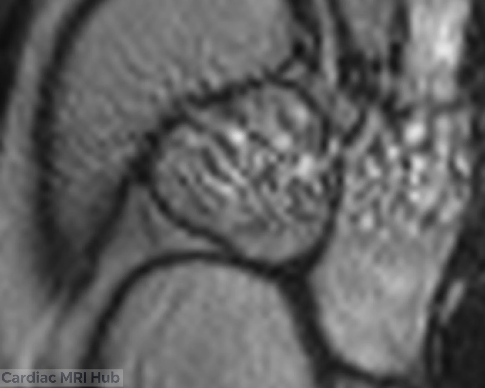
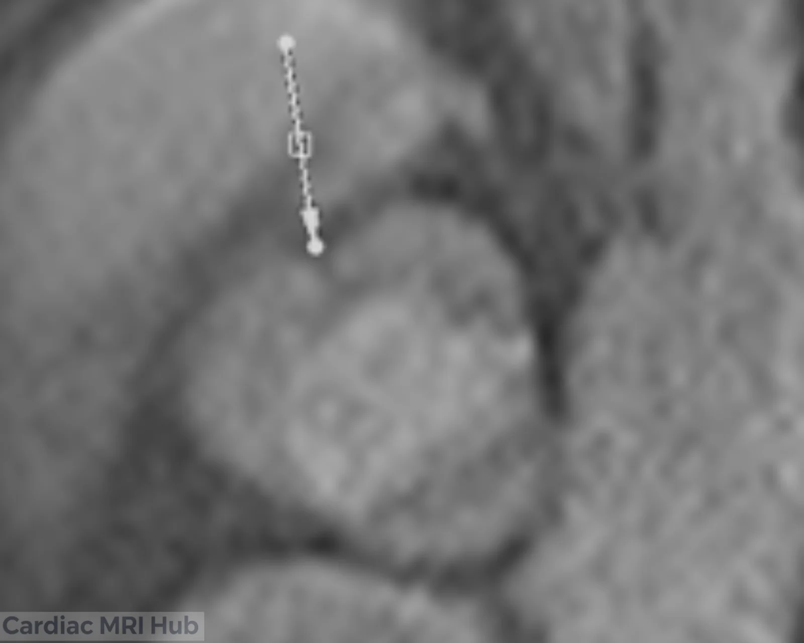
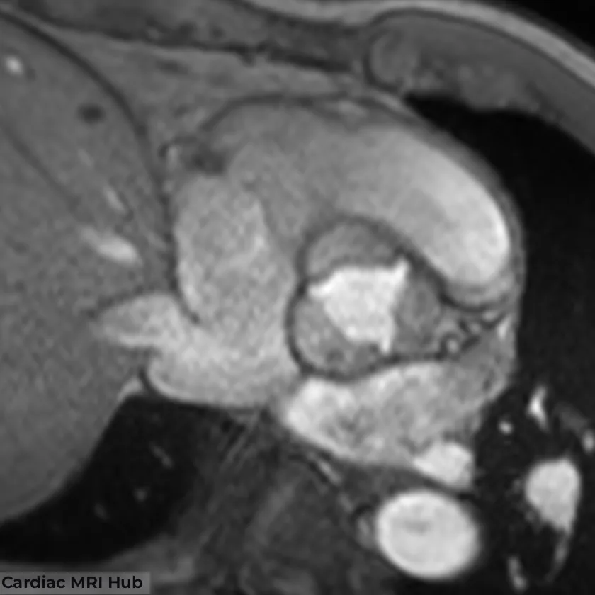
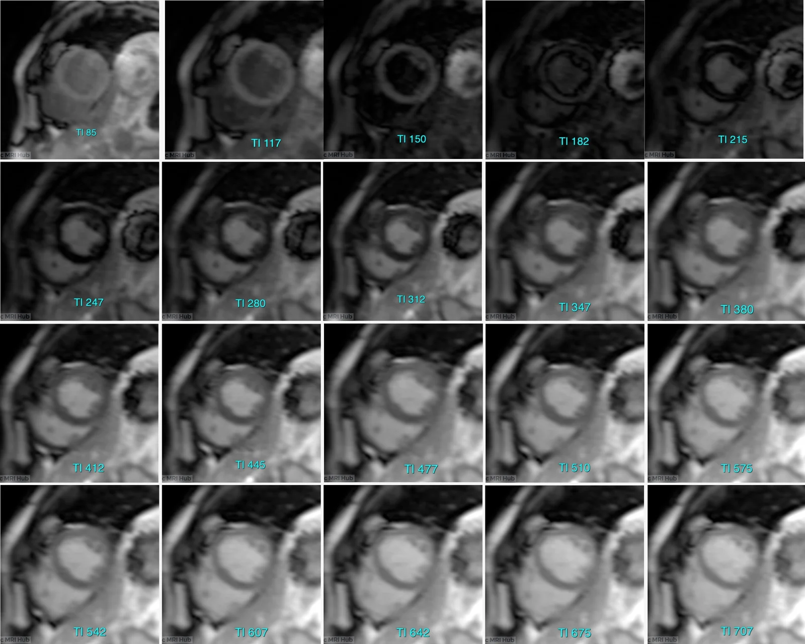
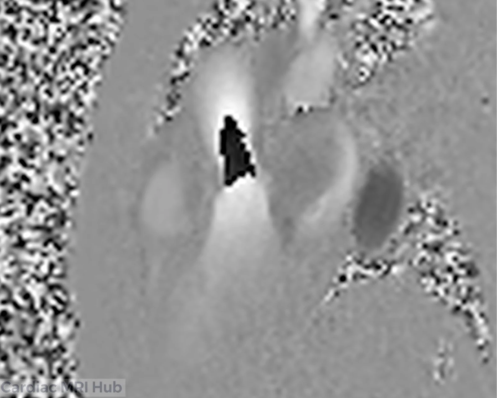
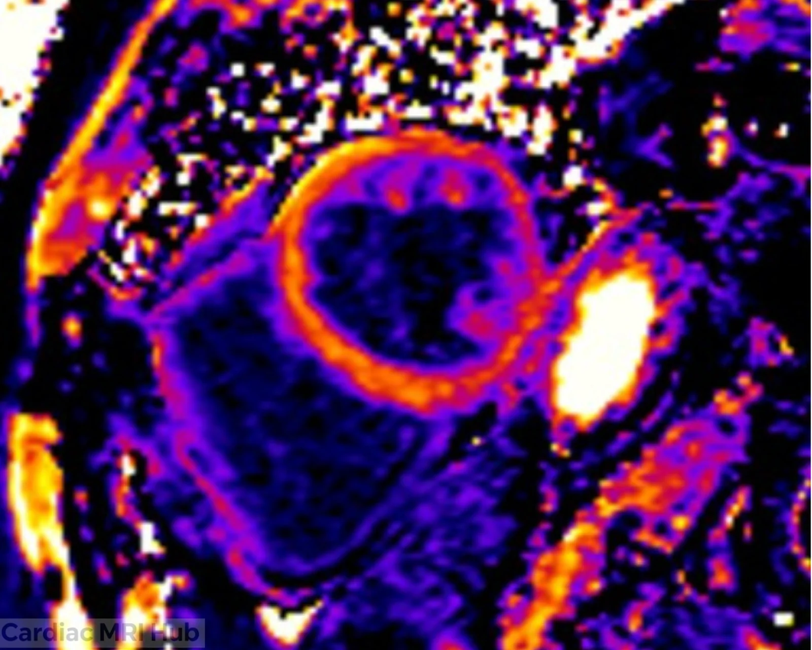

A card for each common artifact: what it looks like, why it happens and the fix at the scanner, quickest fix first. Setting names are Siemens' (written on a MAGNETOM Sola at 1.5 T), with GE and Philips sequence names in brackets where a published source gives them. Cards without a picture have one coming.

- **Cines:** [Banding](#off-resonance-banding) · [Breathing ghosts](#breathing-ghosts) · [Slices that don't line up](#slice-misregistration) · [Wrap](#wrap) · [Partial volume](#partial-volume-at-the-base-and-apex) · [India ink](#chemical-shift-india-ink)
- **ECG gating:** [Mistriggering](#mistriggering) · [Arrhythmia](#arrhythmia)
- **LGE and dark blood:** [Wrong TI](#wrong-ti) · [Flow ghosts](#pulsatile-flow-ghosts) · [Fat](#fat-that-looks-like-enhancement) · [Blood not suppressed](#incomplete-blood-suppression)
- **Perfusion:** [Dark rim](#dark-rim)
- **Flow:** [Velocity aliasing](#velocity-aliasing)
- **Maps:** [Motion](#motion-between-map-images) · [Banding](#banding-on-maps) · [Heart rate](#heart-rate-effect-on-t1)
- **Metal, devices and the room:** [Wires, valves and clips](#metal-wires-valves-and-clips) · [Pacemakers and ICDs](#pacemakers-and-icds) · [RF zipper](#rf-zipper)

# Cines

## Off-resonance banding

*Also called:* dark bands, banding artifact, off-resonance artifact.

**What it looks like:** dark bands or streaks across the heart or a valve on a TrueFISP cine (GE: FIESTA; Philips: balanced FFE).[\[Scheffler 2003\]](https://doi.org/10.1007/s00330-003-1957-x) A band can shift through the cine as the heart and blood move, and blood flowing near a band can look brighter than normal.[\[Ferreira 2013\]](https://doi.org/10.1186/1532-429X-15-41)

**Why it happens:** TrueFISP loses signal wherever the magnetic field is slightly off the scanner's center frequency, and the loss falls in regularly spaced dark bands. The field bends most where tissue meets air, such as the heart against the lungs. The longer the TR, the closer together the bands.[\[Ferreira 2013\]](https://doi.org/10.1186/1532-429X-15-41) Banding is worse at 3 T.[\[SCMR 2020\]](https://pmc.ncbi.nlm.nih.gov/articles/PMC7038611/)

**Fix at the scanner**, quickest first. SCMR lists the first three.[\[SCMR 2020\]](https://pmc.ncbi.nlm.nih.gov/articles/PMC7038611/)

1. Run a frequency scout and set the center frequency to the offset that clears the heart. About 50 Hz is often enough. Check that another band hasn't moved in from the other side.[\[Ferreira 2013\]](https://doi.org/10.1186/1532-429X-15-41)
2. Shim over the heart only: fit the shim box (Siemens: adjust volume) to the heart, with room above and below the slice for blood flowing through it.[\[Ferreira 2013\]](https://doi.org/10.1186/1532-429X-15-41)
3. Shorten the TR. The bands spread apart, so fewer land on the heart.[\[Ferreira 2013\]](https://doi.org/10.1186/1532-429X-15-41)
4. If the band won't clear, switch to a spoiled GRE cine (Siemens: FLASH; GE: SPGR; Philips: T1 CE-FFE).[\[Bitar 2006\]](https://doi.org/10.1148/rg.262055063) SCMR names it as the alternative when artifact compromises TrueFISP cines, mostly a 3 T problem.[\[SCMR 2020\]](https://pmc.ncbi.nlm.nih.gov/articles/PMC7038611/)

**After:** a GRE cine of the same valve in systole, with no bands. It showed a partly fused bicuspid valve that the TrueFISP bands hid. The full case: [GRE vs TrueFISP for the aortic valve](/guide/gre-vs-truefisp-aortic-valve/).

## Breathing ghosts

*Also called:* respiratory ghosting, breathing artifact, motion ghosts.

**What it looks like:** a blurred heart, or faint copies of the heart and chest wall repeated along the phase-encode direction.[\[Ferreira 2013\]](https://doi.org/10.1186/1532-429X-15-41) Breathing moves everything, so the liver and chest wall blur too. That sets it apart from [arrhythmia](#arrhythmia), where only the heart blurs.

*Picture coming.*

**Why it happens:** a cine is built from several heartbeats in one breath-hold. If the chest moves between them, the pieces don't match, and the mismatch shows as ghosts or blur.[\[Ferreira 2013\]](https://doi.org/10.1186/1532-429X-15-41)

**Fix at the scanner**, quickest first:

1. Coach the breath-hold and repeat: the same words each time, holding at end-expiration. See [breath-holds at expiration vs inspiration](/guide/breath-hold-expiration-vs-inspiration/).
2. Shorten the breath-hold: more k-space lines per heartbeat (Siemens: Segments), parallel imaging, or fewer phase-encode lines.[\[Ferreira 2013\]](https://doi.org/10.1186/1532-429X-15-41) Compressed sensing helps too, if you have it. More lines per heartbeat lowers the temporal resolution, so keep it at 45 ms or less for wall motion.[\[SCMR 2020\]](https://pmc.ncbi.nlm.nih.gov/articles/PMC7038611/)
3. If the patient can't hold at all, run a real-time cine. Aim for 60 ms or less between frames; volumes measured from it are less accurate.[\[SCMR 2020\]](https://pmc.ncbi.nlm.nih.gov/articles/PMC7038611/)
4. On LGE, a saturation band over the front of the chest suppresses ghosts from the chest wall if the breath-hold slips.[\[Ferreira 2013\]](https://doi.org/10.1186/1532-429X-15-41)

## Slice misregistration

*Also called:* slices that don't line up, breath-hold mismatch.

**What it looks like:** in a short-axis stack, neighboring slices skip or repeat part of the heart. On a long axis with the slice lines shown, the lines bunch together or leave a gap.

*Picture coming.*

**Why it happens:** each slice is usually its own breath-hold. A deeper or shallower breath moves the heart, so a slice lands somewhere other than where it was planned. Holding at end-expiration gives more consistent positions than holding in.[\[SCMR 2020\]](https://pmc.ncbi.nlm.nih.gov/articles/PMC7038611/)

**Fix at the scanner**, quickest first:

1. Ask for the same end-expiration breath-hold every time, with the same words.[\[SCMR 2020\]](https://pmc.ncbi.nlm.nih.gov/articles/PMC7038611/)
2. Before the patient leaves, check the stack against the long axes with the slice positions shown.[\[Schulz-Menger 2020\]](https://doi.org/10.1186/s12968-020-00610-6)
3. Repeat only the slices that shifted.
4. Cut the number of breath-holds: parallel imaging or compressed sensing covers more slices in each one.[\[SCMR 2020\]](https://pmc.ncbi.nlm.nih.gov/articles/PMC7038611/)

## Wrap

*Also called:* aliasing, wraparound, fold-over.

**What it looks like:** an arm, the back or the chest wall folded into the opposite side of the image. Arms wrapping into the chest is a common one.[\[Ferreira 2013\]](https://doi.org/10.1186/1532-429X-15-41)

*Picture coming.*

**Why it happens:** anything outside the field of view in the phase-encode direction wraps into the opposite edge. The scanner prevents this in the frequency direction at no cost, but not in the phase direction without adding time.[\[Ferreira 2013\]](https://doi.org/10.1186/1532-429X-15-41)

**Fix at the scanner**, quickest first:

1. Check whether it covers the heart. If it doesn't, it can stay: accepting some wrap away from the heart keeps the scan short.[\[Ferreira 2013\]](https://doi.org/10.1186/1532-429X-15-41)
2. Add phase oversampling (Siemens: Phase oversampling), which costs time, or widen the field of view in the phase direction.[\[Ferreira 2013\]](https://doi.org/10.1186/1532-429X-15-41)
3. Swap the phase-encode direction (Siemens: Phase enc. dir.). It changes which part of the body can wrap.[\[Ferreira 2013\]](https://doi.org/10.1186/1532-429X-15-41)
4. On TSE, a saturation band over the part outside the field of view can suppress it.[\[Ferreira 2013\]](https://doi.org/10.1186/1532-429X-15-41)

## Partial volume at the base and apex

*Also called:* partial volume effect, basal descent.

**What it looks like:** at the base, a slice that shows LV in diastole but only left atrium in systole, or just a thin crescent of lateral wall. At the apex, a disc of myocardium with no cavity.[\[Schulz-Menger 2020\]](https://doi.org/10.1186/s12968-020-00610-6)

*Picture coming.*

**Why it happens:** each slice is 6–8 mm thick[\[SCMR 2020\]](https://pmc.ncbi.nlm.nih.gov/articles/PMC7038611/) and shows the average of everything in it. The mitral valve moves toward the apex in systole (basal descent), so the basal slice holds different anatomy at different points in the heartbeat.[\[Schulz-Menger 2020\]](https://doi.org/10.1186/s12968-020-00610-6)

**Fix at the scanner:** you can't remove it, but you can give the reader what they need to handle it.

1. Cover the whole LV, from the base through the apex, with the first slice planned on the 4- and 2-chamber views.[\[SCMR 2020\]](https://pmc.ncbi.nlm.nih.gov/articles/PMC7038611/)
2. Keep the stack perpendicular to the long axis of the LV body, even where that isn't parallel to the mitral valve.[\[SCMR 2020\]](https://pmc.ncbi.nlm.nih.gov/articles/PMC7038611/)
3. Keep slices at 6–8 mm, with or without a 2–4 mm gap.[\[SCMR 2020\]](https://pmc.ncbi.nlm.nih.gov/articles/PMC7038611/)
4. Acquire the long axes, so the reader can match the mitral annulus to the most basal slice.[\[Schulz-Menger 2020\]](https://doi.org/10.1186/s12968-020-00610-6) See [LV short axis](/guide/lv-short-axis/).

## Chemical shift (India ink)

*Also called:* India ink artifact, black boundary artifact, fat–water cancellation.

**What it looks like:** a thin black line wherever fat meets water-based tissue, such as epicardial fat against the RV wall on a TrueFISP cine. On black-blood TSE, fat can instead shift a pixel or two to one side; at the aortic wall this can look like a dissection flap.[\[Ferreira 2013\]](https://doi.org/10.1186/1532-429X-15-41)

*Picture coming.*

**Why it happens:** fat and water resonate about 210 Hz apart at 1.5 T. On GRE and TrueFISP, a voxel holding both cancels out when the two are out of phase, first at a TE of about 2.4 ms at 1.5 T, and TrueFISP's short TR keeps its TE near 2 ms. On TSE with a low bandwidth, the frequency difference shifts fat along the frequency-encode direction.[\[Ferreira 2013\]](https://doi.org/10.1186/1532-429X-15-41)

**Fix at the scanner**, quickest first:

1. Recognize it: the line sits exactly on the fat–water border.
2. Fat saturation removes the fat signal, so there's nothing left to cancel.[\[Ferreira 2013\]](https://doi.org/10.1186/1532-429X-15-41)
3. For the shift on TSE, raise the bandwidth: doubling it halves the shift. Swapping the frequency-encode direction moves the artifact with it.[\[Ferreira 2013\]](https://doi.org/10.1186/1532-429X-15-41)

# ECG gating

## Mistriggering

*Also called:* bad ECG triggering, gating failure, triggering on the T wave.

**What it looks like:** a blurred or jumpy cine, with frames out of step with the heartbeat. On perfusion, some frames are caught at a different point in the heartbeat from the rest.[\[Ferreira 2013\]](https://doi.org/10.1186/1532-429X-15-41)

*Picture coming.*

**Why it happens:** in the magnet, blood flowing through the aortic arch adds a voltage to the ECG, called the magnetohydrodynamic effect.[\[Krug 2013\]](https://doi.org/10.1186/1532-429X-15-104) It tends to raise the T wave and shrink the R wave, so the scanner can trigger on the T wave or on noise.[\[MRIquestions\]](https://mriquestions.com/ekg-problems.html)

**Fix at the scanner**, quickest first:

1. Check the trace before you start, and don't start with a bad one. On the Sola, each ECG channel should show at least two signal bars; with the patient still, rerun the Learning Phase (three heartbeats).[\[Siemens Healthineers\]](https://academy.siemens-healthineers.com/_/en-us/mr-cardiac-lead-placement--e-line-and-numaris-x-)
2. Pick the lead with the tallest, sharpest R wave, and use VCG detection if the scanner offers it.[\[MRIquestions\]](https://mriquestions.com/ekg-problems.html)
3. Still bad: fresh electrodes, rather than moving the old ones.[\[MRIquestions\]](https://mriquestions.com/ekg-problems.html) Prep the skin with an abrasive gel, not alcohol, and shave if needed. Place the electrodes between the ribs, with the white lead to the right of the sternum, and lay the ECG box across the abdomen toward isocenter.[\[Siemens Healthineers\]](https://academy.siemens-healthineers.com/_/en-us/mr-cardiac-lead-placement--e-line-and-numaris-x-)
4. For cines, switch to peripheral pulse triggering.[\[SCMR 2020\]](https://pmc.ncbi.nlm.nih.gov/articles/PMC7038611/) It lags behind the heartbeat and is less precise.[\[Ferreira 2013\]](https://doi.org/10.1186/1532-429X-15-41)
5. If triggering stays poor, a real-time cine doesn't depend on it.[\[Ferreira 2013\]](https://doi.org/10.1186/1532-429X-15-41)

## Arrhythmia

*Also called:* irregular rhythm, ectopic beats, AFib, PVCs.

**What it looks like:** one slice in a stack is smeared while its neighbors are sharp. The liver and chest wall stay sharp, so the breath-hold held. In the cine, the blurred slice barely moves, because each frame mixes beats of different lengths. On LGE, irregular beats blur the image too.[\[Ferreira 2013\]](https://doi.org/10.1186/1532-429X-15-41)

. The liver and chest wall are sharp, so the breath-hold held. Irregular beats during that one breath-hold blurred the slice.")

**Why it happens:** a segmented cine fills each frame over several heartbeats. Beats of different lengths don't match, so the pieces blur together. On LGE, irregular beats also change how far the signal recovers between inversions.[\[Ferreira 2013\]](https://doi.org/10.1186/1532-429X-15-41)

**Fix at the scanner**, quickest first:

1. Scroll every stack before moving on, and repeat just the blurred slice. A steadier run of beats often gives a clean repeat.[\[Ferreira 2013\]](https://doi.org/10.1186/1532-429X-15-41)
2. Turn on arrhythmia rejection: beats outside a window around the expected R-R interval are thrown out, which lengthens the breath-hold.[\[MRIquestions\]](https://mriquestions.com/gating-parameters.html)
3. Run a real-time cine for an irregular rhythm. Aim for 60 ms or less between frames; volumes measured from it are less accurate.[\[SCMR 2020\]](https://pmc.ncbi.nlm.nih.gov/articles/PMC7038611/)
4. On LGE, read out every other heartbeat as usual, every heartbeat under 60 bpm, and every third heartbeat over 100 bpm or with arrhythmia (Siemens: Trigger pulse). Single-shot LGE is the backup for an irregular rhythm.[\[SCMR 2020\]](https://pmc.ncbi.nlm.nih.gov/articles/PMC7038611/)

**After:** a real-time cine of the same patient. *Picture coming.*

# LGE and dark blood

## Wrong TI

*Also called:* myocardium not nulled, TI too short, TI too long.

**What it looks like:** on magnitude LGE, normal myocardium isn't black, so scar has much less contrast against it.[\[Ferreira 2013\]](https://doi.org/10.1186/1532-429X-15-41)

, the long TI leaves the myocardium gray. PSIR on the right.")

**Why it happens:** the TI that nulls normal myocardium differs from patient to patient and rises with time after the injection; it's typically about 200–300 ms.[\[Ferreira 2013\]](https://doi.org/10.1186/1532-429X-15-41) The TI scout doesn't read out the same way as the LGE, so the best TI on the LGE can differ from the scout's by up to 50 ms.[\[SCMR 2020\]](https://pmc.ncbi.nlm.nih.gov/articles/PMC7038611/)

**Fix at the scanner**, quickest first:

1. Use PSIR: it nulls normal myocardium on the display whatever the TI.[\[Ferreira 2013\]](https://doi.org/10.1186/1532-429X-15-41)[\[SCMR 2020\]](https://pmc.ncbi.nlm.nih.gov/articles/PMC7038611/)
2. Rerun the TI scout and pick the TI where the myocardium is darkest.[\[SCMR 2020\]](https://pmc.ncbi.nlm.nih.gov/articles/PMC7038611/)
3. Raise the TI as the exam goes on: as contrast washes out, the right TI gets longer.[\[Ferreira 2013\]](https://doi.org/10.1186/1532-429X-15-41)

More on choosing it: [choosing the TI time](/guide/psir-ti-time/).

## Pulsatile flow ghosts

*Also called:* flow artifact, ghosting from the aorta, CSF ghosting.

**What it looks like:** faint copies of a vessel, usually the aorta, repeated in a line along the phase-encode direction, sometimes across the myocardium. On LGE a ghost can mimic enhancement. Spinal fluid (CSF) and pleural effusions can ghost the same way on LGE and STIR.[\[Ferreira 2013\]](https://doi.org/10.1186/1532-429X-15-41)

*Picture coming.*

**Why it happens:** the speed of the blood changes from beat to beat, and so does the phase of its signal. The scanner reads phase as position, so it spreads the vessel's signal along the phase-encode direction. CSF and other long-T1 fluids ghost on inversion-prepared scans because their signal swings from beat to beat.[\[Ferreira 2013\]](https://doi.org/10.1186/1532-429X-15-41)

**Fix at the scanner**, quickest first:

1. Repeat with the phase-encode direction swapped (Siemens: Phase enc. dir.). A ghost turns with it; real enhancement stays where it was.[\[Ferreira 2013\]](https://doi.org/10.1186/1532-429X-15-41)
2. Put a saturation band over the source: the vessel, the front of the chest wall, or the spinal canal for CSF.[\[Ferreira 2013\]](https://doi.org/10.1186/1532-429X-15-41)
3. On GRE, turn on flow compensation (Siemens: Flow comp.).[\[Ferreira 2013\]](https://doi.org/10.1186/1532-429X-15-41)

## Fat that looks like enhancement

*Also called:* epicardial fat, fat vs fibrosis, fatty infiltration.

**What it looks like:** a bright line along the outside of the heart on LGE, or bright spots inside the wall. Subepicardial enhancement can be hard to tell from epicardial fat.[\[Kellman 2012\]](https://doi.org/10.1002/jmri.23605)

*Picture coming.*

**Why it happens:** fat has a short T1, like scar, so it's bright at the TI that nulls normal myocardium. On a standard LGE, fat and fibrosis both look bright.[\[Kellman 2012\]](https://doi.org/10.1002/jmri.23605) Fat also brings chemical shift lines at its borders (see [India ink](#chemical-shift-india-ink)).

**Fix at the scanner**, quickest first:

1. Run a fat–water separated (Dixon) LGE if you have it: it shows fat and scar apart.[\[Kellman 2012\]](https://doi.org/10.1002/jmri.23605)
2. Add black-blood T1-weighted TSE (GE: FSE) through the area, then the same slices with fat saturation: fat that's bright on the first goes dark on the second. SCMR's ARVC and mass protocols include this pair.[\[SCMR 2020\]](https://pmc.ncbi.nlm.nih.gov/articles/PMC7038611/)

## Incomplete blood suppression

*Also called:* slow flow artifact, residual blood signal, bright blood on dark-blood images.

**What it looks like:** bright signal in the ventricle on a dark-blood (black-blood) image, often a white layer along the trabeculations. The opposite can happen too: part of the myocardium loses signal.[\[Ferreira 2013\]](https://doi.org/10.1186/1532-429X-15-41)

*Picture coming.*

**Why it happens:** a dark-blood image inverts the blood and reads out when the blood moving into the slice is nulled. Slow blood that stays in the slice isn't replaced, so it stays bright. If the heart has moved between the inversion and the readout, myocardium that wasn't re-inverted can lose signal instead. A TI that's too long or too short also leaves blood bright.[\[Ferreira 2013\]](https://doi.org/10.1186/1532-429X-15-41)

**Fix at the scanner**, quickest first:

1. Adjust the trigger delay and the inversion time so the readout falls when the blood is nulled.[\[Ferreira 2013\]](https://doi.org/10.1186/1532-429X-15-41)
2. Change the re-inversion slab. It's usually 2–3 times the slice thickness: a thicker slab protects the myocardium but leaves more slow blood bright, so go thinner for slow flow and thicker if the myocardium loses signal.[\[Ferreira 2013\]](https://doi.org/10.1186/1532-429X-15-41)
3. If a bright area could be thrombus, an LGE with the TI set to null thrombus (about 500–550 ms at 1.5 T) helps tell thrombus from a mass.[\[SCMR 2020\]](https://pmc.ncbi.nlm.nih.gov/articles/PMC7038611/)

# Perfusion

## Dark rim

*Also called:* dark rim artifact, Gibbs ringing.

**What it looks like:** a thin dark band along the inner edge of the myocardium on perfusion images, while the contrast in the LV is at its brightest. It can mimic a subendocardial perfusion defect.[\[Ferreira 2013\]](https://doi.org/10.1186/1532-429X-15-41)

*Picture coming.*

**Why it happens:** two things add up at the sharp edge between bright blood and darker myocardium: ringing at the edge (Gibbs ringing, worse at low resolution) and heart motion during the long readout of each image.[\[Ferreira 2013\]](https://doi.org/10.1186/1532-429X-15-41)

**Fix at the scanner**, quickest first:

1. Raise the in-plane resolution to about 3 mm or finer.[\[SCMR 2020\]](https://pmc.ncbi.nlm.nih.gov/articles/PMC7038611/) The ringing gets thinner, though not weaker.[\[Ferreira 2013\]](https://doi.org/10.1186/1532-429X-15-41)
2. Shorten the readout of each image, to about 100–125 ms or less, with parallel imaging if you have it.[\[SCMR 2020\]](https://pmc.ncbi.nlm.nih.gov/articles/PMC7038611/) That cuts the part caused by motion.[\[Ferreira 2013\]](https://doi.org/10.1186/1532-429X-15-41)
3. Note it for the reader: the dark rim fades once the contrast in the LV drops after the first pass.[\[Ferreira 2013\]](https://doi.org/10.1186/1532-429X-15-41)

Planning and settings: [stress perfusion](/guide/stress-perfusion/).

# Flow (phase contrast)

## Velocity aliasing

*Also called:* phase wrap, VENC too low, flow aliasing.

**What it looks like:** pixels of the opposite color inside a jet, such as a black core in a white jet. The flow curve can flip direction at peak flow.[\[Nayak 2015\]](https://doi.org/10.1186/s12968-015-0172-7)

**Why it happens:** the VENC is the highest velocity the scan can encode. Anything faster wraps around to the other end of the range.[\[Nayak 2015\]](https://doi.org/10.1186/s12968-015-0172-7)

**Fix at the scanner**, quickest first:

1. Check the phase images after every flow scan.[\[SCMR 2020\]](https://pmc.ncbi.nlm.nih.gov/articles/PMC7038611/)
2. If you see aliasing, raise the VENC and repeat. Use the lowest VENC that doesn't alias, because a higher VENC makes the measurement noisier.[\[SCMR 2020\]](https://pmc.ncbi.nlm.nih.gov/articles/PMC7038611/)[\[Nayak 2015\]](https://doi.org/10.1186/s12968-015-0172-7)
3. For a jet, a velocity scout, if you have one, finds the peak first.[\[SCMR 2020\]](https://pmc.ncbi.nlm.nih.gov/articles/PMC7038611/) Starting VENCs for each vessel: [phase contrast planning](/guide/phase-contrast-planning/).
4. Don't count on fixing it later: software can unwrap simple aliasing, but not reliably at the edge of a jet.[\[Ferreira 2013\]](https://doi.org/10.1186/1532-429X-15-41)[\[Nayak 2015\]](https://doi.org/10.1186/s12968-015-0172-7)

**After:** through-plane phase images at the sinotubular junction, with aliasing and then without.

# Maps

T1, T2 and T2* maps. More on planning them: [MOLLI maps](/guide/molli-maps/).

## Motion between map images

*Also called:* motion on maps, misregistered maps, motion correction errors.

**What it looks like:** blurred map edges, with odd values along the borders of the myocardium. On the source images, the diaphragm moves or the heart is caught at different points in the heartbeat.[\[Messroghli 2017\]](https://doi.org/10.1186/s12968-017-0389-8)

*Picture coming.*

**Why it happens:** a map is fitted pixel by pixel from several images taken during one breath-hold. If the heart moves between them, each pixel mixes different tissue. Motion correction fixes in-plane shifts only, not through-plane motion, and it can misalign images.[\[Messroghli 2017\]](https://doi.org/10.1186/s12968-017-0389-8)

**Fix at the scanner**, quickest first:

1. Coach the breath-hold before the map: clear instructions prevent incomplete breath-holds.[\[Messroghli 2017\]](https://doi.org/10.1186/s12968-017-0389-8)
2. Turn on motion correction if you have it, but don't count on it instead of a breath-hold.[\[Messroghli 2017\]](https://doi.org/10.1186/s12968-017-0389-8)
3. Before moving on, look at the motion-corrected source images and the error map, if there is one, and repeat the map if they're off.[\[Messroghli 2017\]](https://doi.org/10.1186/s12968-017-0389-8)
4. Watch for mistriggered or skipped beats during the map; repeat if there were any.[\[Messroghli 2017\]](https://doi.org/10.1186/s12968-017-0389-8)

## Banding on maps

*Also called:* off-resonance on maps, regional T1 error.

**What it looks like:** dark bands across a T1 map, or a patch of T1 that's lower or higher than the rest of the wall, often near the lungs. On T2* maps, the lungs, liver and veins cause susceptibility artifacts.[\[Kellman 2014\]](https://doi.org/10.1186/1532-429X-16-2)[\[Messroghli 2017\]](https://doi.org/10.1186/s12968-017-0389-8)

*Picture coming.*

**Why it happens:** MOLLI reads out with TrueFISP, so off-resonance causes the same banding as on cines. Even where no band shows, off-resonance shifts T1 by region, and the effect is big enough to matter at 1.5 T.[\[Kellman 2014\]](https://doi.org/10.1186/1532-429X-16-2)

**Fix at the scanner**, quickest first:

1. Shim over the heart before the maps. SCMR's mapping consensus calls heart-focused shimming highly recommended at 1.5 T and essential at 3 T.[\[Messroghli 2017\]](https://doi.org/10.1186/s12968-017-0389-8)
2. Check the center frequency, since off-resonance in it can lower T1. Adjust it as for [banding](#off-resonance-banding) and repeat.[\[Messroghli 2017\]](https://doi.org/10.1186/s12968-017-0389-8)
3. For T2*, draw the measurement in the septum on a mid short-axis map, away from the lungs, liver and veins.[\[Messroghli 2017\]](https://doi.org/10.1186/s12968-017-0389-8)

## Heart rate effect on T1

*Also called:* heart rate dependence, MOLLI heart rate error.

**What it looks like:** nothing you can see. On the original MOLLI scheme, long T1 values such as native myocardium shift with heart rate; newer schemes are much less affected.[\[Kellman 2014\]](https://doi.org/10.1186/1532-429X-16-2)

**Why it happens:** MOLLI needs time between its inversions for the signal to recover. At a fast heart rate the recovery heartbeats are shorter, so the signal hasn't recovered as far.[\[Kellman 2014\]](https://doi.org/10.1186/1532-429X-16-2)[\[Messroghli 2017\]](https://doi.org/10.1186/s12968-017-0389-8)

**Fix at the scanner**, quickest first:

1. Use a scheme with more recovery between the inversions, such as 5(3)3 or 5s(3s)3s, which counts the recovery in seconds. Both are much less sensitive than the original MOLLI.[\[Kellman 2014\]](https://doi.org/10.1186/1532-429X-16-2)
2. For tachycardia, use a sequence designed for higher heart rates if you have one. A systolic readout gives robust maps in fast abnormal rhythms but needs its own normal values.[\[Messroghli 2017\]](https://doi.org/10.1186/s12968-017-0389-8)
3. In AFib, repeat the map so the results can be averaged.[\[Messroghli 2017\]](https://doi.org/10.1186/s12968-017-0389-8)
4. Note the heart rate and rhythm for the reader, who has to weigh them when reading the values.[\[Messroghli 2017\]](https://doi.org/10.1186/s12968-017-0389-8)

# Metal, devices and the room

## Metal: wires, valves and clips

*Also called:* susceptibility artifact, metal artifact.

**What it looks like:** a black void with distorted, sometimes bright, edges around sternal wires, valve rings, clips, occluders or stents. On TrueFISP the void is bigger and brings dark bands with it.[\[Ferreira 2013\]](https://doi.org/10.1186/1532-429X-15-41)

*Picture coming.*

**Why it happens:** metal distorts the magnetic field around it. TrueFISP is the most sensitive sequence; on GRE, the signal loss grows with the TE; spin echo is the least sensitive.[\[Ferreira 2013\]](https://doi.org/10.1186/1532-429X-15-41)

**Fix at the scanner**, quickest first:

1. Switch the affected cines to spoiled GRE (Siemens: FLASH) with the shortest TE.[\[Ferreira 2013\]](https://doi.org/10.1186/1532-429X-15-41)[\[SCMR 2020\]](https://pmc.ncbi.nlm.nih.gov/articles/PMC7038611/)
2. For anatomy, black-blood HASTE or TSE (GE: SSFSE or FSE) shows less artifact.[\[Ferreira 2013\]](https://doi.org/10.1186/1532-429X-15-41)[\[Bitar 2006\]](https://doi.org/10.1148/rg.262055063)
3. If dark bands spread from the metal, adjust the frequency and shim as for [banding](#off-resonance-banding).[\[Ferreira 2013\]](https://doi.org/10.1186/1532-429X-15-41)

## Pacemakers and ICDs

*Also called:* device artifact, defibrillator artifact.

**What it looks like:** a large black void with distorted edges near the generator, and on TrueFISP, dark bands spreading from it.[\[Ferreira 2013\]](https://doi.org/10.1186/1532-429X-15-41) On LGE, an ICD can cause bright artifacts in the anterior and lateral LV wall that can't be read.[\[Rashid 2014\]](https://doi.org/10.1148/radiol.13130942)

*Picture coming.*

**Why it happens:** the generator distorts the magnetic field around it. On LGE, the myocardium near an ICD is so far off-resonance that the standard inversion pulse doesn't invert it, so it shows up bright.[\[Rashid 2014\]](https://doi.org/10.1148/radiol.13130942)

**Before you scan:** safety comes first. Follow the manufacturer's and your institution's guidelines; the device is programmed for the scan and checked before and after it, and the patient is monitored throughout.[\[SCMR 2020\]](https://pmc.ncbi.nlm.nih.gov/articles/PMC7038611/)

**Fix at the scanner**, quickest first:

1. Raise the arm on the generator side over the head.[\[SCMR 2020\]](https://pmc.ncbi.nlm.nih.gov/articles/PMC7038611/)
2. Try breath-holds in deep inspiration, which can improve image quality.[\[SCMR 2020\]](https://pmc.ncbi.nlm.nih.gov/articles/PMC7038611/)
3. If TrueFISP cines have significant artifact, switch to GRE cines.[\[SCMR 2020\]](https://pmc.ncbi.nlm.nih.gov/articles/PMC7038611/)
4. For LGE, use wideband LGE if you have it, particularly with an ICD.[\[SCMR 2020\]](https://pmc.ncbi.nlm.nih.gov/articles/PMC7038611/)[\[Rashid 2014\]](https://doi.org/10.1148/radiol.13130942)
5. Maps near a device aren't reliable unless special shimming or sequences are used.[\[Messroghli 2017\]](https://doi.org/10.1186/s12968-017-0389-8)

## RF zipper

*Also called:* zipper artifact, RF interference, RF noise.

**What it looks like:** a stripe of alternating bright and dark pixels across the whole image, at right angles to the frequency-encode direction.[\[Radiopaedia\]](https://radiopaedia.org/articles/16558)

*Picture coming.*

**Why it happens:** stray radio-frequency signal reaches the receiver: through the scanner room door left open, from electronics brought into the room, or from monitoring equipment such as pulse oximeters. If it keeps happening with the door shut, the RF shielding may be faulty.[\[Radiopaedia\]](https://radiopaedia.org/articles/16558)[\[MRIquestions\]](https://mriquestions.com/zipper-artifact.html)

**Fix at the scanner**, quickest first:

1. Make sure the scanner room door is shut.[\[Radiopaedia\]](https://radiopaedia.org/articles/16558)
2. Remove electronic devices from the patient and the room.[\[Radiopaedia\]](https://radiopaedia.org/articles/16558) Check monitoring equipment such as pulse oximeters.[\[MRIquestions\]](https://mriquestions.com/zipper-artifact.html)
3. If it persists, call service: the door contacts or the cable panel may need cleaning or repair.[\[Radiopaedia\]](https://radiopaedia.org/articles/16558)

# Coming next

Parallel imaging artifacts, a cine window too long for the heart rate, LGE ghosting, coil shading, breathing during the first pass, missed perfusion slices at high heart rates, background phase offset and jet signal loss.

# Help build it

Have a clear example of an artifact, ideally with the fixed repeat of the same view? Email [cardiacmrihub@gmail.com](mailto:cardiacmrihub@gmail.com). Send only images you have permission to share, with every patient detail removed: name, ID numbers, dates and the institution's name.
