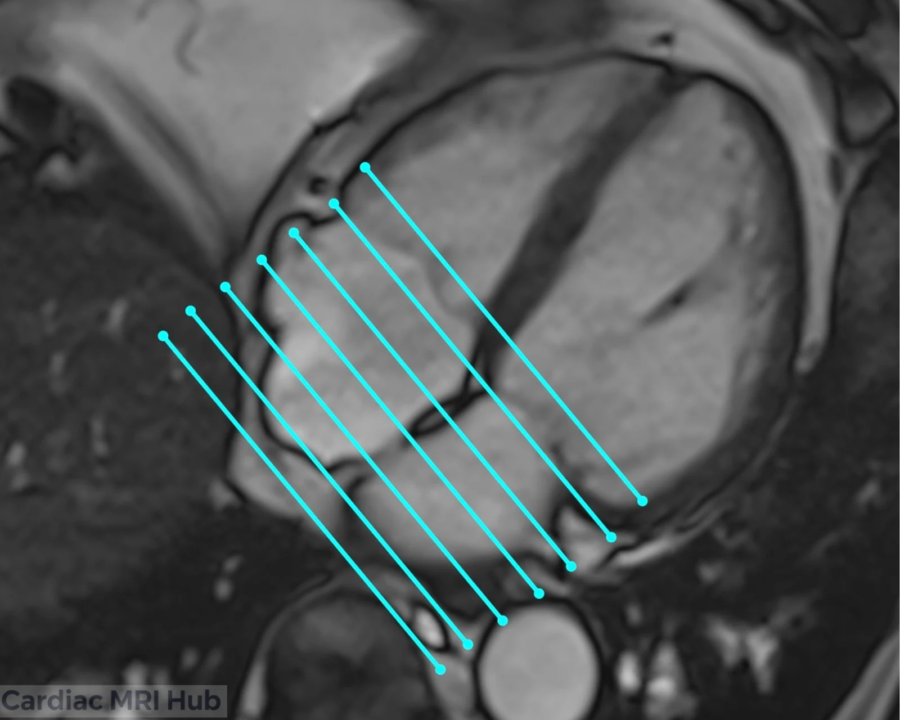

The atrial short axis shows both atria in cross-section. It's used to assess their size and shape, and to find structural abnormalities that standard views can miss.

# Atrial Short Axis Planning

# Short Axis Planning of the Atria in Cardiac MRI

The atrial short axis shows the left and right atria, for their structure and any abnormalities.

## Key Considerations for Planning

- **Orientation:** a plane that cuts horizontally through both atria.
- **Slice thickness:** thinner slices for more detail.
- **Field of view:** both atria.
- **Timing:** ECG-gated, ideally imaged in diastole, to show atrial size and function.
- **Contrast:** if it's part of the exam, contrast helps outline the atrial walls.

## What it's used for

- Atrial size and function.
- Atrial shape.
- Structural abnormalities of the atria.
- Follow-up of atrial enlargement or other changes.

## What the view shows

- **Left atrium:** size and structural abnormalities.
- **Right atrium:** volume, wall motion and function.

