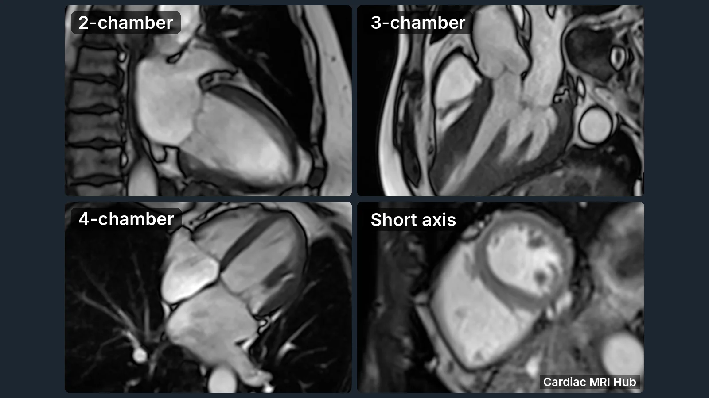
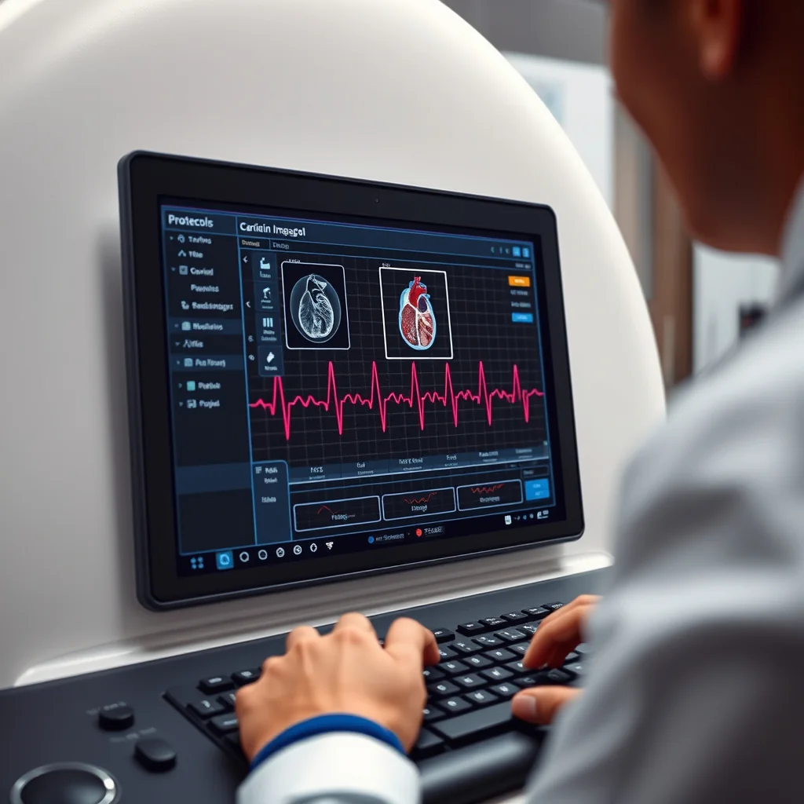

Cardiac MRI is a powerful, non-invasive imaging tool that provides detailed, high resolution pictures of the heart's structure, function, and tissue characteristics. As one of the most sophisticated imaging modalities in cardiovascular medicine, it has become the gold standard for assessing ventricular function, myocardial viability, and detecting a wide range of cardiac pathologies. For new MRI technologists stepping into the specialized field of cardiac imaging, the transition from general MRI to cardiac protocols can seem complex and overwhelming. Unlike other MRI examinations, cardiac imaging requires mastery of ECG gating, breath-hold coordination, precise anatomical planning, and an understanding of cardiac physiology.

This comprehensive guide breaks down the essential steps in the cardiac MRI workflow into manageable components, providing you with practical knowledge and confidence building strategies. Whether you're a seasoned MRI technologist transitioning into cardiac imaging or a new graduate entering the field, understanding these fundamental workflow steps will help you build a solid foundation before progressing to more advanced techniques like stress perfusion, T1/T2 mapping, or 4D flow imaging. The learning curve is steep, but with systematic practice and proper guidance, you'll develop the skills necessary to produce diagnostic quality cardiac images that directly impact patient care and clinical decision making.

# Understanding the Basics of Cardiac MRI

Before you start scanning, it's essential to understand the fundamental principles and unique challenges that distinguish cardiac MRI from other anatomical imaging. The primary goal of cardiac MRI is to capture high quality, motion free images of the heart's structure, function, blood flow patterns, and tissue characteristics. This requires synchronizing image acquisition with both the cardiac cycle and respiratory motion. These are two moving targets that must be carefully managed to successfully get diagnostic images of the heart.

Unlike static organs, the heart is in constant motion, beating 60-100 times per minute and moving with each breath. This presents unique technical challenges that new technologists must master. Cardiac MRI protocols are specifically designed to "freeze" cardiac motion at precise moments in the cardiac cycle while minimizing respiratory artifacts. Understanding this fundamental challenge will help you appreciate why ECG gating, breath-holding, and precise timing are absolutely critical to producing diagnostic images.

The cardiovascular system includes the heart chambers (left and right ventricles and atria), four valves (mitral, tricuspid, aortic, and pulmonary), coronary arteries, great vessels (aorta and pulmonary arteries), and the pericardium. Each structure may require different imaging sequences and planning approaches. As you begin your cardiac MRI journey, familiarize yourself with basic cardiac anatomy, the cardiac cycle phases (systole and diastole), and how blood flows through the heart. This anatomical foundation will make planning cardiac views much more intuitive.

Key points to remember:

- ECG (Electrocardiogram) Gating is fundamental: Cardiac MRI relies on prospective or retrospective ECG gating to synchronize image acquisition with specific phases of the cardiac cycle. The ECG signal triggers the scanner to acquire data during diastole (when the heart is relaxed) for functional imaging or throughout the entire cardiac cycle for cine sequences. Without proper gating, images will be blurred and non diagnostic. Understanding R-wave detection, trigger delays, and arrhythmia rejection is essential for troubleshooting gating issues.
- Multiple sequence types serve different diagnostic purposes: Cardiac MRI employs a variety of pulse sequences, each optimized for specific diagnostic information. Cine imaging (typically using balanced steady-state free precession or TrueFISP) captures cardiac motion and is used for functional assessment. T1-weighted sequences (such as inversion recovery) are excellent for visualizing anatomy and fat. T2-weighted sequences help detect myocardial edema and inflammation. Phase contrast sequences quantify blood flow velocities. Late gadolinium enhancement (LGE) identifies scar tissue and fibrosis. As a new technologist, you'll gradually learn when and how to apply each sequence type based on the clinical indication.
- Patient cooperation and breath holding ability directly impact image quality: Most cardiac MRI sequences require patients to hold their breath for 10-20 seconds to eliminate respiratory motion artifacts. Unlike general MRI where patients can breathe freely, cardiac imaging demands active patient participation. Before starting the exam, practice breath-hold instructions with your patient. Use consistent, clear verbal cues like "Breathe in, breathe out, and hold your breath." For patients who cannot breath-hold (due to heart failure, anxiety, or other conditions), navigator gated or free breathing sequences may be necessary, though these typically take longer and may have reduced image quality. Your ability to coach patients effectively is just as important as your technical scanning skills.

# Preparing the Patient

Patient preparation is the foundation of every successful cardiac MRI examination and often determines whether you'll achieve diagnostic-quality images or need to repeat sequences. Unlike other MRI exams where patient preparation is relatively straightforward, cardiac MRI requires meticulous attention to multiple factors that can significantly impact image quality. As a new technologist, developing a systematic approach to patient preparation will help you identify potential issues before they compromise your scan. Taking extra time during preparation often saves considerable time during acquisition and reduces the likelihood of repeat scans. Here's a comprehensive checklist of what you need to do:

- **Screen for contraindications:** Check for pacemakers, metal implants, or claustrophobia.
- **Explain the procedure:** Inform the patient about breath-holds and the importance of staying still. Remind patient of length of exam and have use bathroom if needed before starting exam.
- **Attach ECG leads:** Proper placement ensures accurate gating.
- **Position the patient:** Use cardiac coils and position the patient supine with arms at the sides or above the head, depending on scanner setup.

Clear communication helps reduce anxiety and improves image quality.

# Setting Up the MRI Scanner

Once the patient is properly prepared and positioned on the table, you'll configure the scanner for cardiac imaging. This scanner setup phase is where your technical knowledge and attention to detail come together. Proper configuration ensures optimal image quality and efficient workflow. Each vendor (Siemens, GE, Philips) has slightly different interface layouts, but the fundamental principles remain the same. Take time to familiarize yourself with your specific scanner's cardiac protocols and customization options. Here's your comprehensive scanner setup checklist:

- Select the cardiac coil and ensure it fits snugly around the chest.
- Input patient data and confirm ECG lead connections.
- Choose the appropriate cardiac MRI protocol based on the clinical question (e.g., function, viability, perfusion).
- Set the field of view (FOV) to cover the entire heart and great vessels.
- Adjust slice thickness and orientation to capture standard cardiac planes: short axis, long axis, and four-chamber views.

# Acquiring Scout Images

Scout images provide a roadmap for detailed scanning. They help locate the heart and plan subsequent slices.

- Use localizer sequences to get axial, sagittal, and coronal views.
- Identify the heart’s position and orientation.
- Ensure heart is at iso center and shim centered correctly.
- Plan slices perpendicular and parallel to the heart’s long axis.

This step ensures accurate coverage and reduces the need for repeat scans.

# ECG Gating and Breath-Hold Techniques

Cardiac MRI relies heavily on precise timing and synchronization with both the heartbeat and respiratory motion. These two fundamental technique ECG gating and breath-hold instruction, are what separate cardiac MRI from general body imaging and require mastery for successful scanning. Understanding how these work together is crucial:

ECG Gating Fundamentals: The ECG signal provides the timing reference for all cardiac sequences. The R-wave (the tallest peak on the ECG) marks ventricular depolarization and serves as the trigger point. Prospective gating triggers data acquisition at a specific delay after the R-wave, while retrospective gating collects data throughout the entire cardiac cycle and reconstructs it later. For new technologists, ensure your ECG leads show a clear, consistent R-wave with minimal artifact. Poor lead placement, patient movement, electromagnetic interference from the gradient coils, or the magnetohydrodynamic effect (where blood flow through the magnetic field creates voltage) can all degrade the ECG signal.

Breath-Hold Coordination: While ECG gating handles cardiac motion, breath holding eliminates respiratory motion. The standard breath hold instruction is: "Breathe in, breathe out, and hold your breath." This end expiration position is more comfortable and reproducible than full inspiration. Consistent breath hold depth across all sequences ensures that cardiac anatomy remains in the same position, which is essential for comparing images and for segmentation analysis. Monitor your patient's breath hold quality throughout the exam, fatigue can lead to progressively shallower or inconsistent breath holds.

- **ECG gating** triggers image acquisition during specific cardiac phases, minimizing motion blur.
- **Breath hold sequences** require the patient to hold their breath for 10-20 seconds to reduce respiratory motion.

Practice clear instructions and timing with the patient to improve cooperation.

# Common Cardiac MRI Sequences

As a new cardiac MRI technologist, understanding the different pulse sequences and their clinical applications is essential for protocol selection and troubleshooting. Each sequence type is optimized to provide specific diagnostic information, and knowing when to use each one comes with experience. Cardiac MRI protocols typically combine multiple sequence types to create a comprehensive examination. The specific sequences you'll use depend on the clinical question, is it a function study, viability assessment, valve evaluation, or congenital workup? Here's a detailed overview of the fundamental sequences you'll encounter:

- **Cine imaging:** Captures moving images of the beating heart, useful for assessing function and wall motion.
- **T1-weighted imaging:** Highlights anatomy and fibrosis.
- **T2-weighted imaging:** Detects edema and inflammation.
- **Late gadolinium enhancement (LGE):** Shows scar tissue and infarcts after contrast injection.

Each sequence has specific parameters and timing that you will learn with experience.

# Troubleshooting Common Issues

As a new cardiac MRI technologist, you will inevitably encounter technical challenges and image quality issues during your exams. Troubleshooting is a critical skill that develops over time through experience and systematic problem solving. Don't get discouraged when things don't go perfectly, even experienced technologists face these challenges regularly. The key is developing a methodical approach to identifying and resolving issues quickly to minimize scan time and patient discomfort. Here are the most common problems you'll encounter and practical solutions:

- **Poor ECG signal:** Check lead placement and skin contact; use conductive gel if needed. Try triggering on a specific ECG (1,2, or 3) or switching to VCG.
- **Motion artifacts:** Remind the patient about breath-holds; consider respiratory gating if available.
- **Incorrect slice positioning:** Use scout images carefully and double-check orientations.
- **Contrast timing errors:** Coordinate with the radiologist or nurse for precise injection timing during perfusion or LGE studies.

# Documenting and Reviewing Images

After acquisition, review images for quality and completeness:

- Confirm all required views are captured.
- Check for artifacts or motion blur.
- Label images correctly with patient information and sequence details.
- Communicate any issues to the radiologist promptly.

Good documentation supports accurate diagnosis and patient care.

# Building Confidence and Skills

Starting with cardiac MRI can feel overwhelming and intimidating, but remember that every expert cardiac technologist was once a beginner. Building confidence and competence in cardiac imaging is a gradual process that requires patience, dedication, and deliberate practice. Unlike general MRI where you might become proficient in weeks, cardiac MRI typically requires several months to a year of consistent practice before you feel truly comfortable and confident. This is normal and expected given the complexity of the field. The learning curve includes not just technical scanning skills, but also understanding cardiac anatomy, physiology, pathology, and how different sequences reveal different diagnostic information. Here are proven strategies to accelerate your learning and build lasting confidence:

- Observe experienced technologists and ask questions.
- Review cardiac anatomy and MRI physics regularly.
- Participate in hands on training sessions.
- Use checklists to ensure all workflow steps are followed.

With time, you will develop the skills to handle more complex cardiac MRI protocols.

Cardiac MRI is a highly rewarding specialty that uniquely combines advanced imaging technology, detailed anatomical knowledge, patient interaction, and clinical impact. Unlike many other imaging modalities, cardiac MRI allows you to directly visualize cardiac function in real time, assess myocardial tissue characteristics, quantify blood flow, and detect subtle pathology that other modalities might miss. Your role as a cardiac MRI technologist is crucial, the quality of images you produce directly influences diagnostic accuracy and, ultimately, patient outcomes.

By systematically mastering these fundamental workflow steps, new technologists establish a strong foundation for success in cardiac imaging. Start with basic function studies (cine imaging of the left ventricle), then progressively add complexity as your confidence grows, tissue characterization sequences, phase contrast flow imaging, stress perfusion, and advanced techniques. Don't rush the learning process. Each patient you scan provides valuable experience. Review your images critically, learn from challenging cases, seek feedback from radiologists and experienced colleagues, and continuously refine your technique.

The cardiac MRI field is constantly evolving with new sequences (compressed sensing, artificial intelligence reconstruction, parametric mapping), improved hardware (higher field strengths, better coils), and expanded clinical applications. Embrace lifelong learning through professional organizations like SCMR (Society for Cardiovascular Magnetic Resonance), attend conferences, participate in online forums, and stay current with the latest developments. The journey from beginner to expert cardiac MRI technologist is challenging but immensely fulfilling. Keep practicing, stay curious, maintain your passion for learning, and prepare yourself to explore the exciting advanced cardiac MRI techniques that await you in your future career development.
