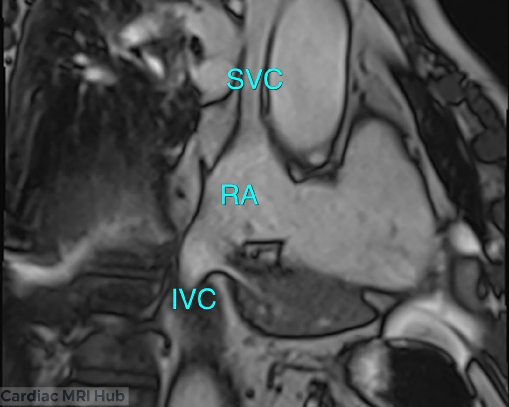
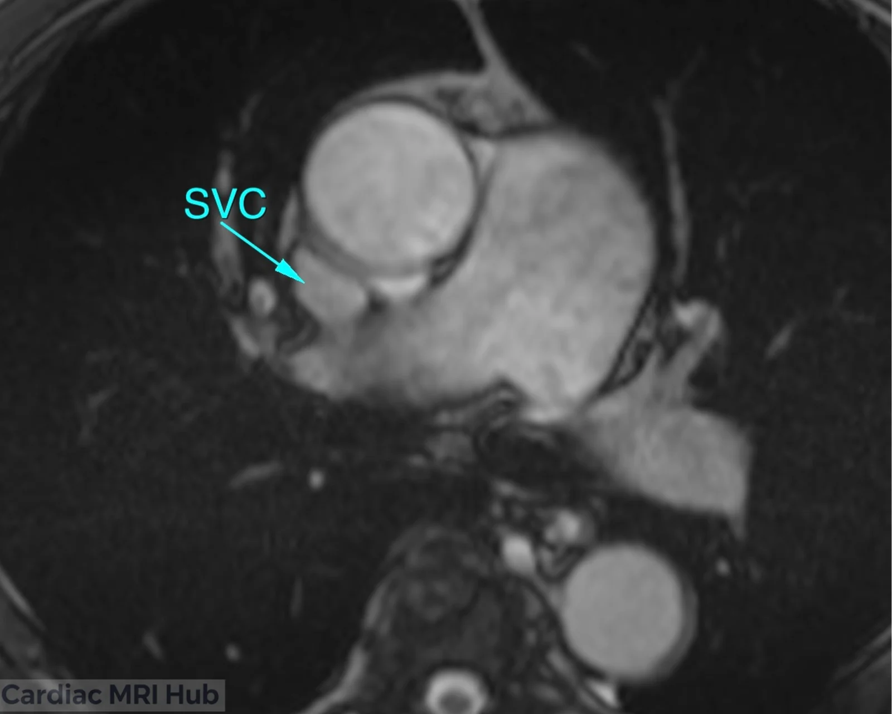
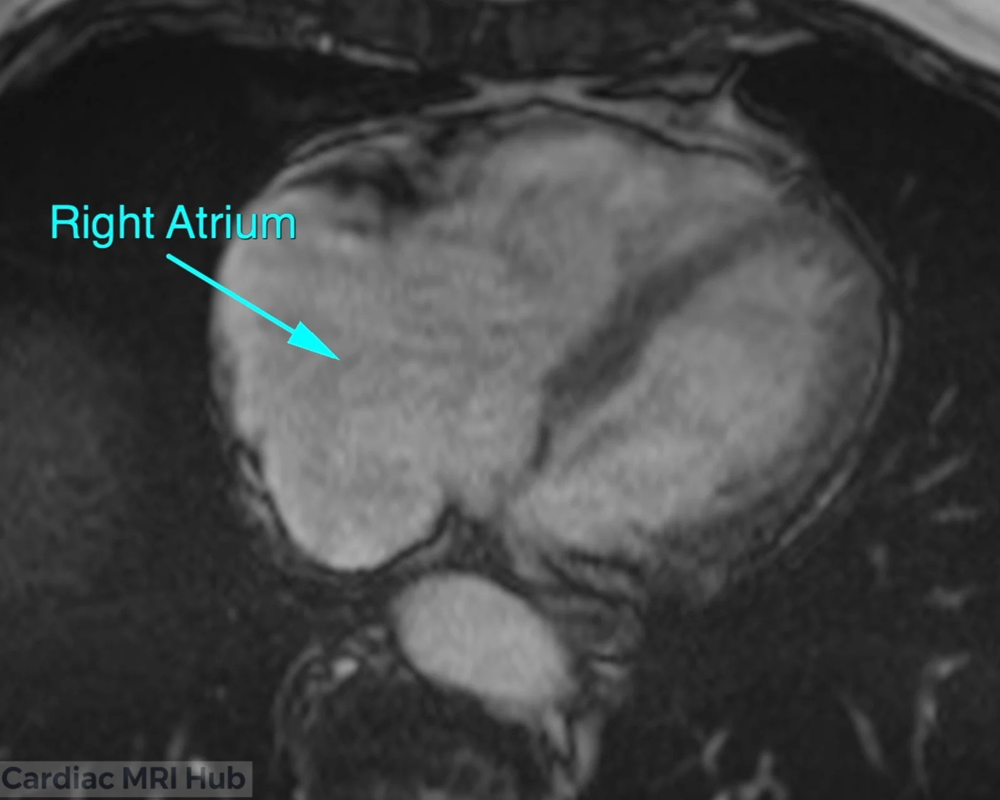
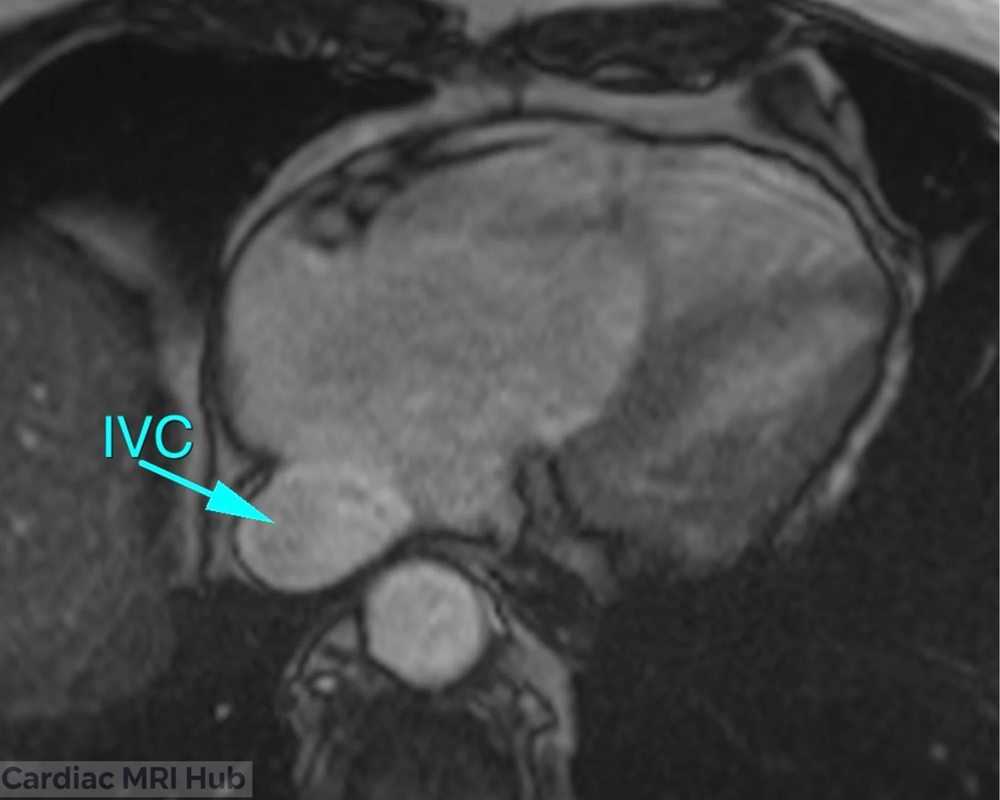

In cardiac MRI, precise imaging views are essential for comprehensive assessment of cardiac anatomy and function. Among these, the bicaval view plays a vital role as it uniquely visualizes both the superior vena cava (SVC) and inferior vena cava (IVC), as well as their entry into the right atrium. This view not only helps in evaluating venous return and right atrial anatomy but also aids in diagnosing abnormalities involving these major venous structures. Effective planning of the bicaval view involves careful alignment and imaging techniques to optimize visualization and yield critical clinical insights.

# Bicaval Planning

Bicaval view 3 point planning on SVC, IVC, and middle of RT Atrium

# Bicaval View Planning in Cardiac MRI

The bicaval view in cardiac MRI is crucial for visualizing the superior vena cava (SVC) and inferior vena cava (IVC), providing important information about the heart's venous return and overall anatomy. This view is particularly valuable for assessing the relationship between these major vessels and the right atrium, as well as for detecting any abnormalities in the venous structures.

## Key Considerations for Planning

- **Orientation:** The bicaval view is typically obtained by aligning the imaging plane perpendicular to the long axis of the heart, ensuring optimal visualization of both the SVC and IVC as they enter the right atrium.
- **Slice Thickness:** A thinner slice thickness is recommended to improve image resolution and enhance the visibility of the fine anatomical details of the venous structures.
- **Field of View:** The field of view must be sufficiently large to encompass both the SVC and IVC, along with adjacent anatomical landmarks, to avoid missing critical structures.
- **Timing:** Image acquisition should be timed with the cardiac cycle, ideally during diastole for cine imaging, to provide clearer images of the venous inflow and right atrial morphology.
- **Contrast Agents:** The use of contrast agents can enhance the delineation of the SVC and IVC, improving the clarity of the venous structures and surrounding tissues.

## Clinical Applications

- Evaluation of venous return and hemodynamics.
- Assessment of right atrial size and function.
- Identification of congenital anomalies involving the SVC and IVC.
- Monitoring of conditions such as superior vena cava syndrome.

## Key Features of the Bicaval View

- **Superior Vena Cava:** Detailed visualization of the SVC, including its size and any potential obstructions or abnormalities.
- **Inferior Vena Cava:** Assessment of the IVC's caliber and its relationship with the right atrium, including any signs of dilation or other pathologies.

## Conclusion

In conclusion, meticulous bicaval view planning enhances diagnostic accuracy and clinical decision-making by optimizing visualization of key venous structures. Understanding the technical and clinical nuances of this view ensures improved outcomes in patient management, particularly in complex cardiac conditions related to venous return and right atrial function. This makes the bicaval view an indispensable component of comprehensive cardiac MRI protocols.
