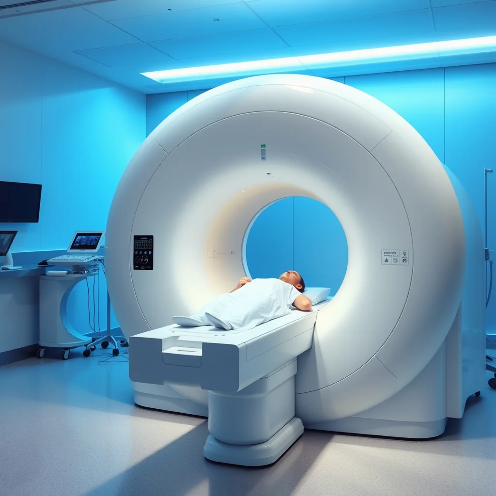
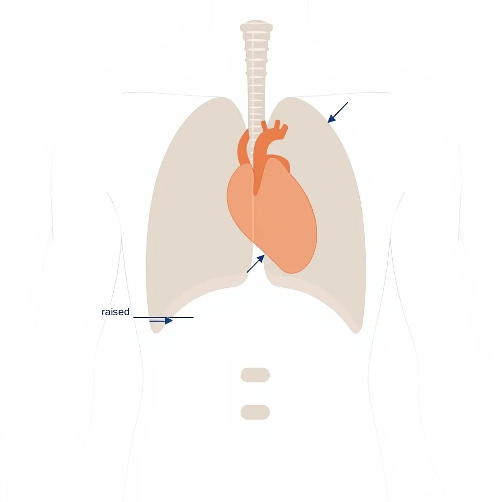
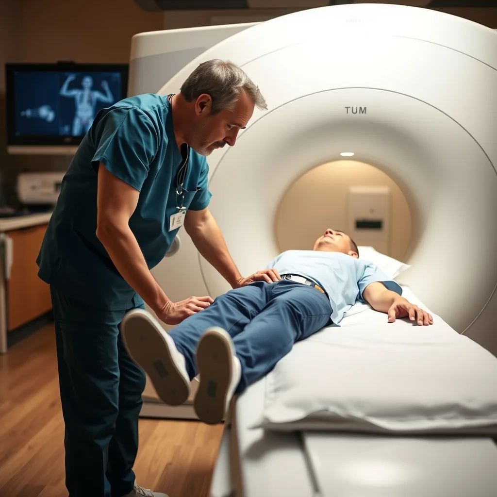

Cardiac MRI relies on breath-holds to freeze motion. Whether the patient holds at end-inspiration or end-expiration makes a measurable difference to motion artifacts, consistency and image quality. Compressed sensing and AI are also changing how breath-holds are used.[\[ajronline\]](https://ajronline.org/doi/10.2214/AJR.18.20239)

# Why Breathing Phase Matters

Breathing moves the diaphragm, chest wall and heart, which blurs the endocardial border and throws off measurements. A breath-hold stops most of that, but the phase you hold in changes how still the heart stays.[\[ajronline\]](https://ajronline.org/doi/10.2214/AJR.18.20239)

- End-inspiration: lungs full, diaphragm actively contracted.
- End-expiration: after a normal breath out, diaphragm lower and relaxed.

The two positions behave differently, so they produce different heart motion and different amounts of artifact on cines and T1-weighted images.[\[ajronline\]](https://ajronline.org/doi/10.2214/AJR.18.20239)

# Why end-expiration works better

Studies comparing the two consistently find fewer motion problems and better images at end-expiration.[\[pmc.ncbi.nlm.nih\]](https://pmc.ncbi.nlm.nih.gov/articles/PMC11639450/)

- In T1-weighted liver and chest MRI, used as a model for motion in the chest, end-expiration scored 3.35 for motion against 2.80 for end-inspiration (p < 0.00001). Radiologists preferred the end-expiration images in 59% of direct comparisons, against 20% for end-inspiration.\[ajronline\]
- Nearly 45% of end-expiration sequences scored 4–5 (little or no motion), against 23% at end-inspiration. In practice that means fewer repeats and more usable stacks.\[ajronline\]
- In free-breathing real-time cines sorted by breathing phase, end-expiration heartbeats were more alike from frame to frame (correlation about 0.94 against 0.90), and experts rated image quality the same or better at end-expiration in over 80% of cases.[\[pmc.ncbi.nlm.nih\]](https://pmc.ncbi.nlm.nih.gov/articles/PMC11639450/)

So end-expiration is the more consistent, steadier phase for cardiac MRI.

# Why: the diaphragm and the heart

The difference is in what the diaphragm does during the hold.

- At end-inspiration, the diaphragm and accessory muscles are contracted. During the hold they slowly relax ("creep"), so the diaphragm drifts up, at first by several mm per second and about 1 cm over a 15–20 second hold.[\[pmc.ncbi.nlm.nih\]](https://pmc.ncbi.nlm.nih.gov/articles/PMC11639450/)
- The pericardium is attached to the diaphragm, so this drift moves the heart from beat to beat and blurs its borders on gated images.[\[pmc.ncbi.nlm.nih\]](https://pmc.ncbi.nlm.nih.gov/articles/PMC11639450/)
- At end-expiration, the diaphragm is relaxed and stable, and moves much more slowly and steadily.
- The heart stays in the same place from beat to beat, so borders are sharper and there's less breathing ghosting.[\[pmc.ncbi.nlm.nih\]](https://pmc.ncbi.nlm.nih.gov/articles/PMC11639450/)

That's why motion scores are better and radiologists prefer end-expiration.\[ajronline\]

# Compressed sensing and AI

Compressed sensing (CS) and AI reconstruction are changing breath-holds, especially for patients who can't manage 10–15 seconds.

- CS cines can shorten breath-holds by 40–50% while keeping volume and function measurements the same, so sicker patients can manage an end-expiration hold.[\[pubmed.ncbi.nlm.nih\]](https://pubmed.ncbi.nlm.nih.gov/33566124/)
- Free-breathing CS cine and perfusion with in-line motion correction acquire through the whole breathing cycle and sort or correct the data to an expiration-like position. That gives the steadiness of a good breath-hold without the patient having to hold.[\[pmc.ncbi.nlm.nih\]](https://pmc.ncbi.nlm.nih.gov/articles/PMC11639450/)
- AI (deep learning) reconstruction removes noise and sharpens undersampled or motion-blurred data, improving images from very short or imperfect breath-holds, across field strengths and vendors.[\[nature\]](https://www.nature.com/articles/s41598-024-62294-7)

Most current CS and AI protocols still use end-expiration when a breath-hold is needed (cine, mapping, perfusion), and use respiratory navigators or phase sorting that targets expiration for free-breathing 3D whole-heart and real-time cines.[\[usa.philips\]](https://www.usa.philips.com/healthcare/clinical-article/compressed-sense-clinical-cardiac-mri)

# At the scanner

How to put this into practice:

- Make end-expiration the default for cines, maps and contrast sequences. Keep the coaching simple: "Breathe out normally and hold your breath there." Don't push for a maximal breath out.\[ajronline\]
- Coach the same comfortable breath out for every breath-hold in a stack. Switching between inspiration and expiration across slices causes slices that don't line up.
- Check the diaphragm on the localizers: at true end-expiration it sits lower on coronal and sagittal scouts than at inspiration. The same position each time means more consistent images.
- For patients who can't hold their breath (heart failure, shortness of breath, arrhythmia), switch to CS cines, AI-accelerated cines or free-breathing gated sequences rather than poor inspiration holds or inconsistent short holds.[\[pmc.ncbi.nlm.nih\]](https://pmc.ncbi.nlm.nih.gov/articles/PMC11639450/)

End-expiration breath-holds, with CS and AI where needed, are a simple way to improve image quality and cut repeats.[\[cardiovascularbusiness\]](https://cardiovascularbusiness.com/topics/cardiac-imaging/exploring-major-breakthroughs-cardiac-imaging)

# How breathing phase changes LV volumes

The breathing phase also changes the measured left ventricular (LV) volumes. That matters for consistent end-diastolic volume (EDV), end-systolic volume (ESV), stroke volume (SV) and ejection fraction (EF).

## LV and RV volumes move in opposite directions

Breathing makes RV and LV volumes move in opposite directions. Real-time cardiac MRI shows that during a normal breath in, RV end-diastolic volume rises by about 18% while LV volumes fall. The reverse happens on the breath out, and LV volumes peak at end-expiration. This comes from the ventricles sharing space and from pressure changes in the chest as you breathe.[\[pmc.ncbi.nlm.nih\]](https://pmc.ncbi.nlm.nih.gov/articles/PMC11639450/)

## The effect on EDV, ESV and EF

Real-time cardiac MRI shows the size of the effect. Comparing end-inspiration with end-expiration breath-holds:

- LV EDV is higher at end-inspiration: about 9 mL more than breath-held or end-expiration measurements (p = 0.02), so inspiration makes the LV cavity look bigger.[\[pmc.ncbi.nlm.nih\]](https://pmc.ncbi.nlm.nih.gov/articles/PMC11639450/)
- LV EF is lower at end-inspiration: about 3.9% higher at end-expiration (p < 0.01), enough to affect the reading and risk assessment.[\[pmc.ncbi.nlm.nih\]](https://pmc.ncbi.nlm.nih.gov/articles/PMC11639450/)
- LV SV drops at peak inspiration, as blood pools briefly in the lungs and less reaches the LV. It's highest at end-expiration, when return to the left heart is greatest.[\[pmc.ncbi.nlm.nih\]](https://pmc.ncbi.nlm.nih.gov/articles/PMC11639450/)
- LV ESV changes less than EDV, with a bias of about 0 mL between end-expiration and end-inspiration at rest. Most of the difference comes from filling in diastole.[\[nature\]](https://www.nature.com/articles/s41598-024-62294-7)

## Why: the ventricles share the pericardium

The two ventricles share the pericardial space. On a breath in, lower pressure in the chest draws more blood into the right ventricle, which fills and expands. That pushes the septum to the left, squeezing the LV and reducing its filling. On the breath out, the RV gets smaller, the septum moves back, and the LV fills normally, so LV EDV and EF are higher at end-expiration.[\[radiopaedia\]](https://radiopaedia.org/articles/ventricular-interdependence?lang=us)

## What it means for measurements

These differences matter for consistent reporting and follow-up:

- Acquire every breath-hold sequence in the same breathing phase, ideally end-expiration, on every exam. Mixing phases across slices or sequences causes misregistered slices and wrong volumes.\[ajronline\]
- Use the same breathing phase when comparing exams (for example before and after treatment). Switching from end-inspiration to end-expiration between exams can make LV EF look nearly 4% better when nothing changed, more than some follow-up protocols count as significant.[\[pmc.ncbi.nlm.nih\]](https://pmc.ncbi.nlm.nih.gov/articles/PMC11639450/)
- Normal ranges for LV EDV, ESV and EF in CMR come mostly from end-expiration breath-holds. Measuring at end-inspiration and comparing with those ranges can overestimate EDV and underestimate EF, giving false or borderline results.[\[pmc.ncbi.nlm.nih\]](https://pmc.ncbi.nlm.nih.gov/articles/PMC11639450/)
- For free-breathing or real-time cines, analyze end-expiration heartbeats. Most current software and CS reconstructions can sort out the end-expiration beats afterwards.[\[pmc.ncbi.nlm.nih\]](https://pmc.ncbi.nlm.nih.gov/articles/PMC11639450/)

In short, end-expiration isn't just better for motion: it's the right phase for accurate, repeatable LV volumes. EF is highest and the heart is steadiest at end-expiration. Standardizing on it keeps measurements in line with normal ranges and follow-up exams comparable.

# The evidence at a glance

| Metric | End-Expiration | End-Inspiration | Statistical Significance |
|---|---|---|---|
| Mean motion score | 3.35 | 2.80 | p < 0.00001 |
| Radiologist preference | 59% | 20% | Statistically significant |
| High-quality sequences (score 4–5) | 45% | 23% | Clinically meaningful​ |
| Frame-to-frame correlation | 0.94 | 0.90 | p ≤ 0.01 ​ |
| Diaphragm drift during breath-hold | ~3 mm, predominantly linear | ~11 mm, variable and larger | 3.7-fold difference​ |

# Bottom line

End-expiration is the better breath-hold for cardiac MRI because:

1. The diaphragm is relaxed and stable, not contracted
2. The heart stays in the same place from beat to beat
3. There are fewer motion artifacts
4. Image quality is higher and more consistent
5. Fewer repeats are needed
6. LV volumes are more accurate

A simple script to use:

"Take a breath in... now breathe out normally... and hold your breath right there. Stay still and relaxed."

With CS cines (2–3 beat holds) and free-breathing perfusion, the same idea applies: the reconstruction targets an expiration-like position.
