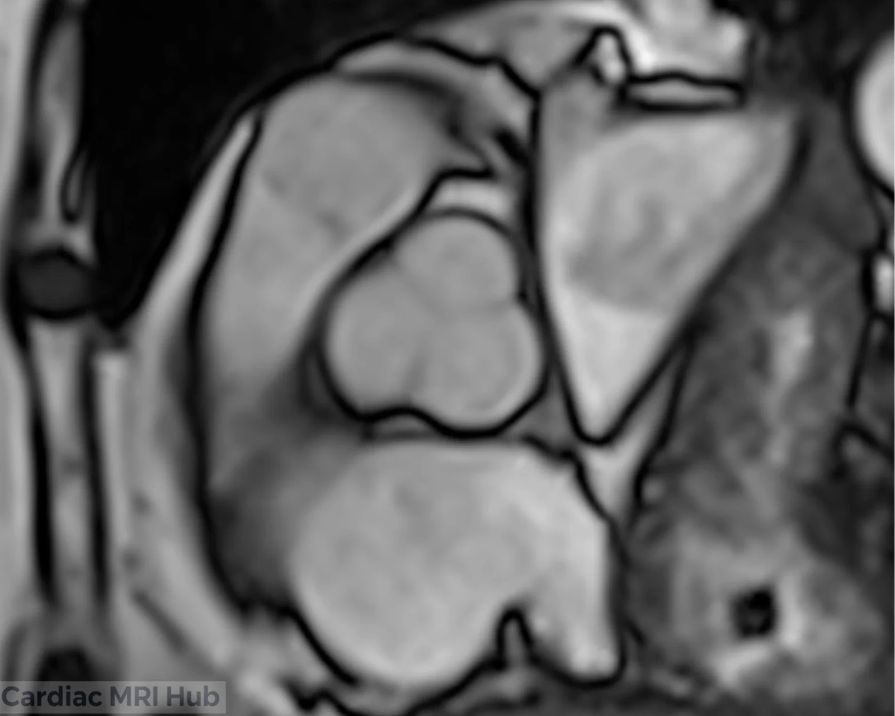
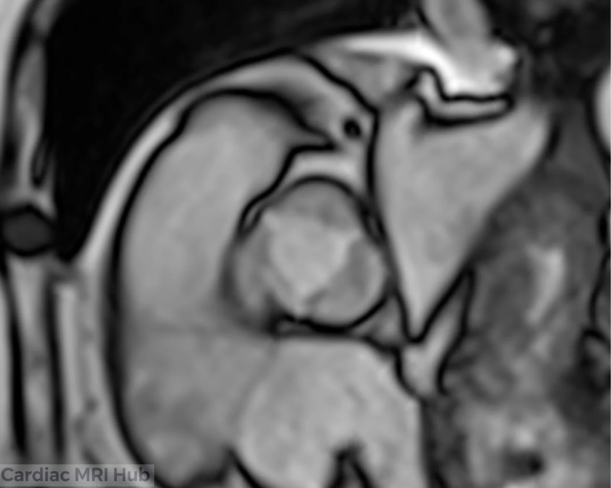
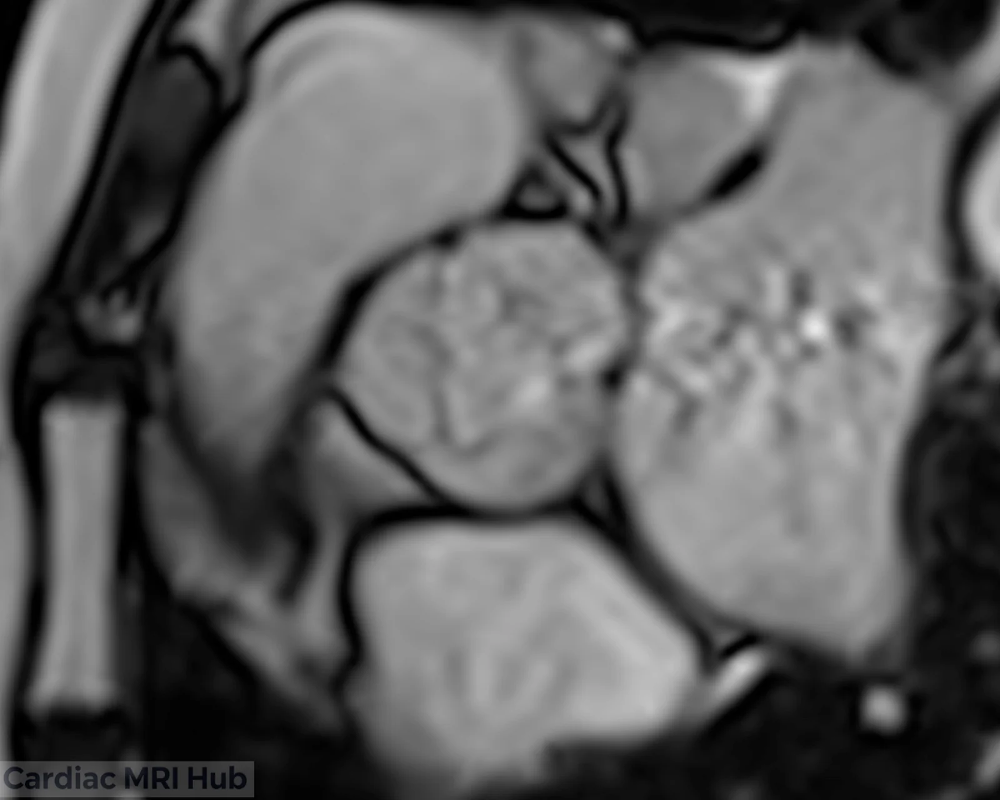
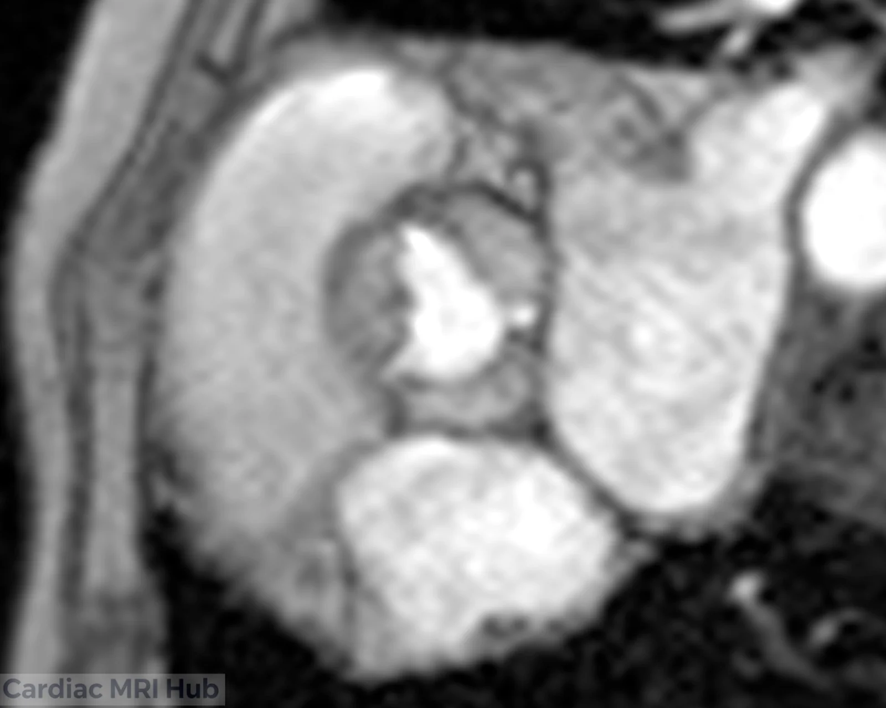
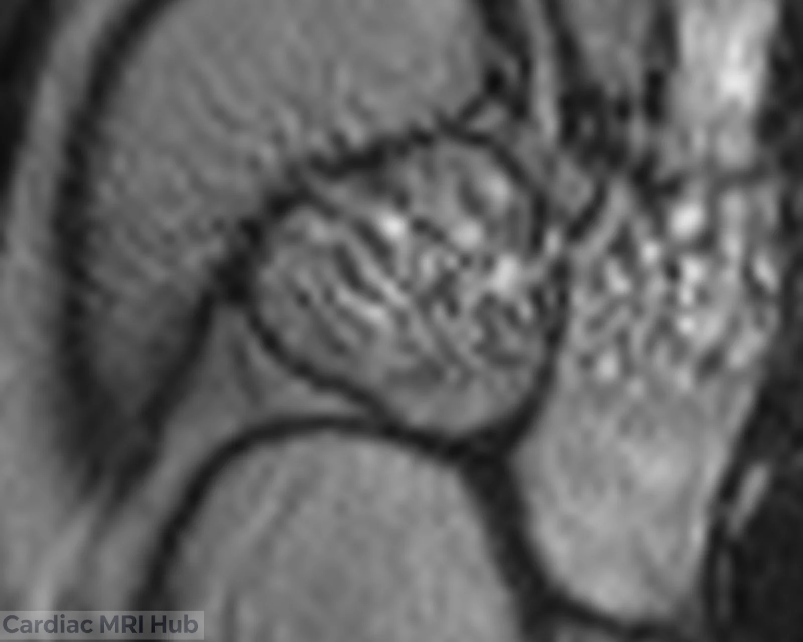
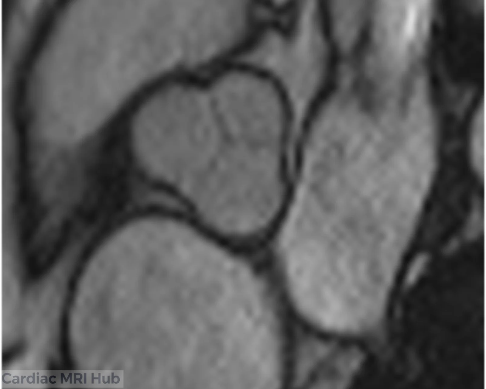
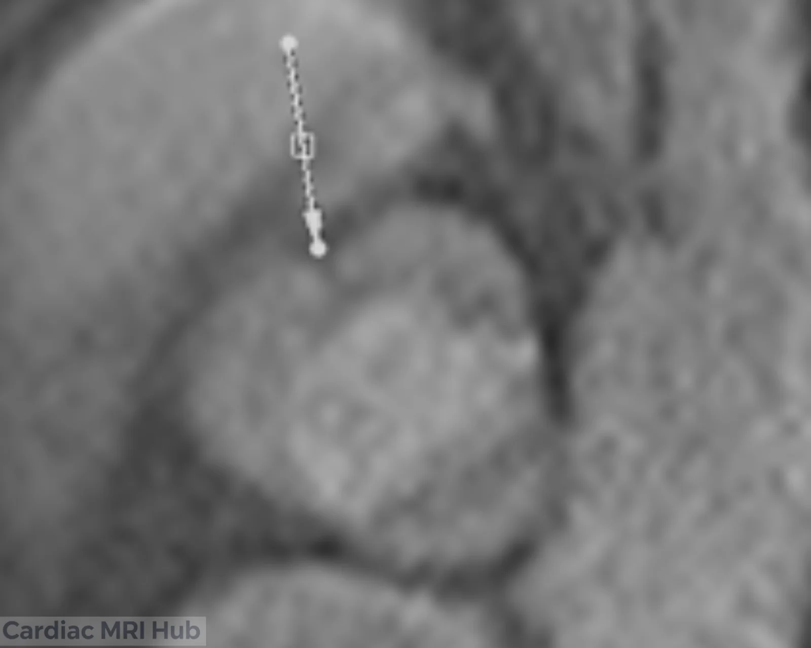
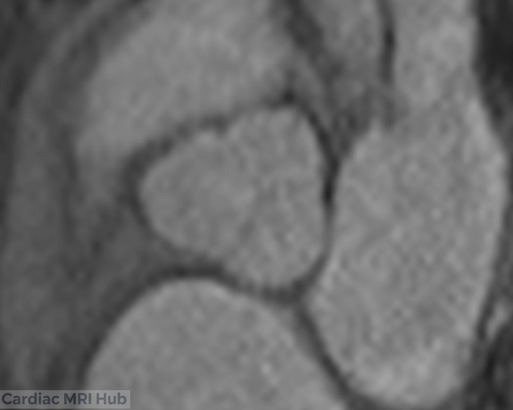

# Aortic Valve

# GRE vs True FISP: Sequence Selection and Artifact Considerations

The sequence you choose matters for the aortic valve. Gradient recalled echo (GRE) and TrueFISP (balanced SSFP) each have trade-offs that change what the reader can see.

## GRE for the aortic valve

GRE gives sharp valve leaflets with few flow artifacts, which makes it a good choice for valve shape. It's especially useful when valve size has to be measured, because image quality stays consistent across the cardiac phases.

## TrueFISP: strengths and limits

TrueFISP (balanced SSFP) has better blood-to-myocardium contrast and is faster. But as the images above show, it's prone to dark bands, especially over the aortic valve. The bands come from small differences in the magnetic field and can hide the anatomy.

## Why it matters

A dark band over the leaflets can hide vegetations, small perforations or calcification. That's why GRE is often preferred for dedicated aortic valve imaging, even though it takes longer.

## Case: banding hiding a valve abnormality

The images above show TrueFISP (SSFP) banding completely hiding a significant valve abnormality. It's why watching the images during the scan, and reviewing them before the patient leaves, matters.

### SSFP in systole

In the SSFP systole image (upper left), a dark band runs right across the aortic valve and hides the leaflets. It comes from small field differences, and it makes the valve's shape impossible to judge. In systole, with the valve open, the abnormality is completely hidden.

### SSFP in diastole

The SSFP diastole image (upper right) has little artifact. But diastole alone would miss how the valve opens and its shape in systole.

### GRE shows the abnormality

The GRE systole image (lower left) has no banding, and it clearly shows a forme fruste bicuspid aortic valve: the right and left coronary cusps are partly fused. The cusps never fully separated, leaving a raphe (arrow). The valve works like a three-leaflet valve but is bicuspid underneath.

The GRE diastole image (lower right) shows the closed valve without artifact and confirms the abnormal cusps in both phases.

## The technologist's part

The abnormality would have been missed completely if:

- The banding hadn't been recognized during the scan
- GRE images hadn't been added
- The images hadn't been reviewed before the patient left
- The radiologist had received only the SSFP images

A forme fruste bicuspid valve matters because it:

- Carries similar risks to a true bicuspid valve, including faster wear
- Can develop aortic stenosis or regurgitation earlier than a normal three-leaflet valve
- Needs long-term follow-up
- Can affect when a valve is replaced
- Is often missed on echo

Without the decision to add GRE when banding appeared, this would have gone undetected, delaying the right follow-up.

## What to do

- Use GRE as the main sequence for detailed aortic valve shape
- Use TrueFISP for function when there's little banding
- Adjust the shim and center frequency to reduce TrueFISP banding when needed
- When banding is over the valve, always add GRE images
- Note the sequences used and any artifacts for the report

## The takeaway

TrueFISP is fast and has great contrast, but banding can hide valve disease completely. When you see a band over the valve, add GRE: the extra minute is worth far more than a missed diagnosis.

