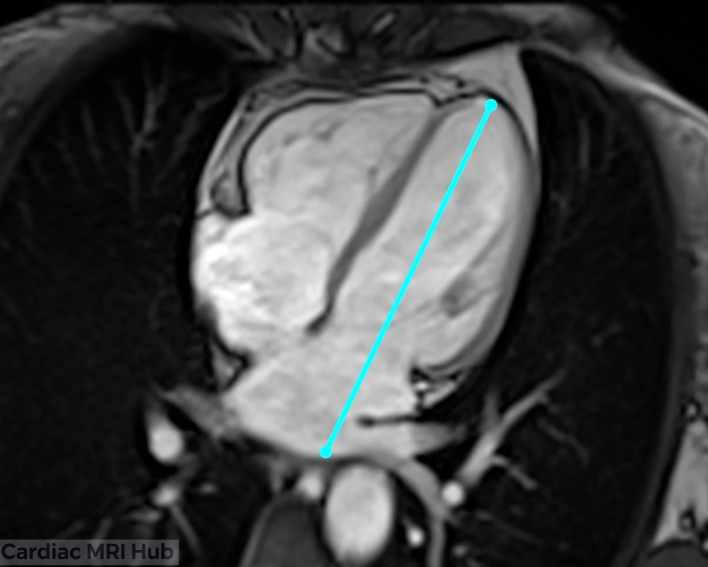
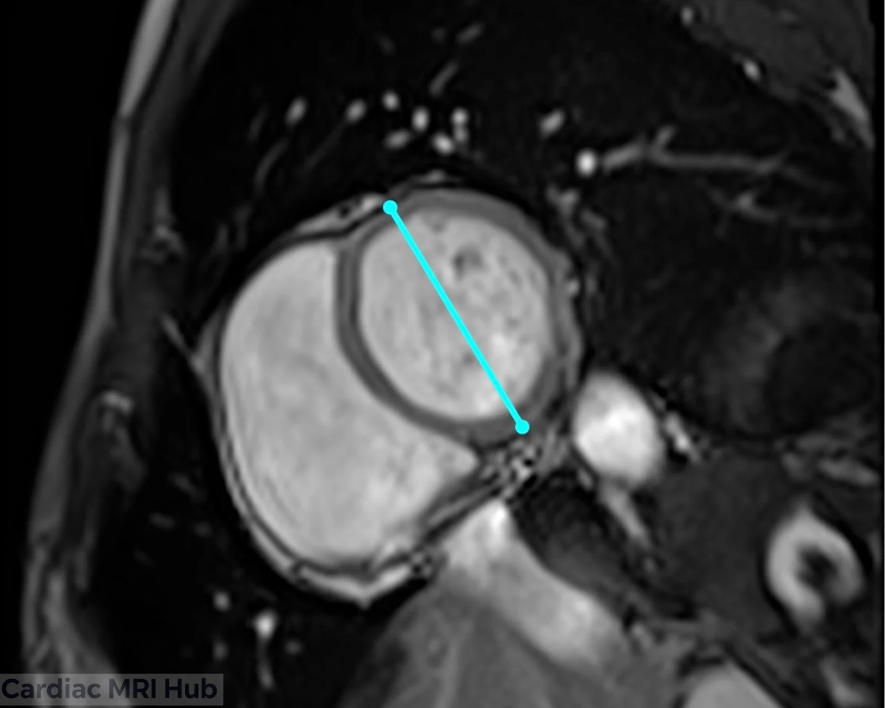
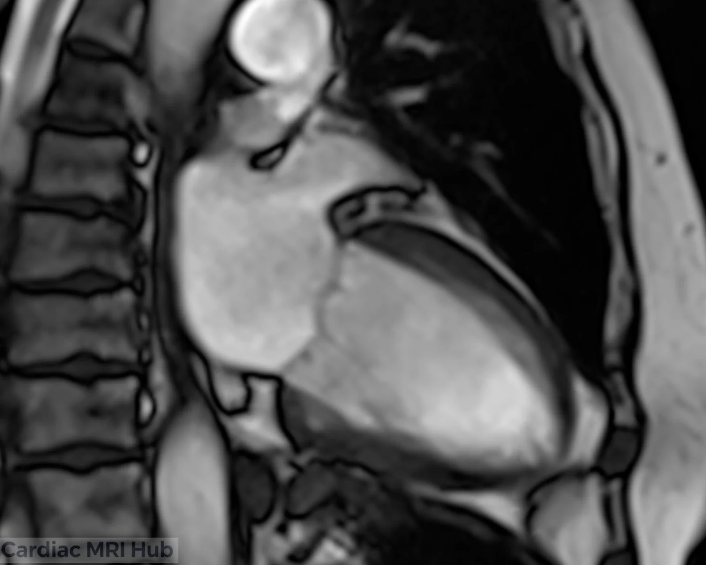
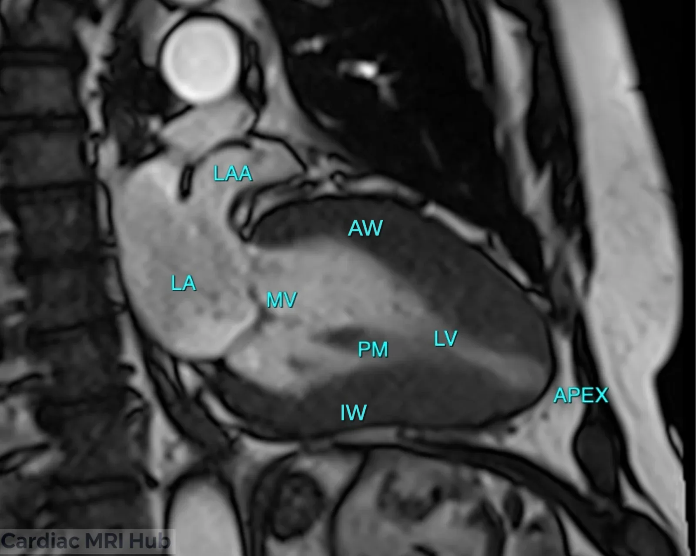

The left ventricle two-chamber (LV 2ch) view shows the left atrium, mitral valve and left ventricle, with the anterior and inferior walls. It's used for function, ischemia and infarction, and tissue characterization.

# Plan it

1. **On the 4-chamber,** draw the line through the middle of the mitral valve and the LV apex.

2. **On the mid short axis,** run the line through the middle of the LV, parallel to the interventricular septum.

Planning with 3 points instead? The anterior and inferior walls go on the short axis and the apex on a sagittal localizer or the 4-chamber: see the box above.

# Check it

- The LA, mitral valve and LV are in the slice, with the anterior wall on one side and the inferior wall on the other.
- The LV is at full length, with the true apex in the slice. If the LV looks short, the plane is foreshortened: recheck it on the 4-chamber.
- No septum or RV in the slice. If you see them, the line isn't parallel to the septum; straighten it on the mid short axis.

# Key settings

- **Slice thickness:** 6–8 mm; LGE uses the same thickness as the cines.
- **Field of view:** 280–350 mm, adjusted to the patient.
- **Temporal resolution:** 45 ms or less (real time 60 ms or less).
- **Gating:** retrospective ECG gating, 25–30 phases.
- **Breath-hold:** 8–12 seconds.

The full settings table is under More detail.

# More detail

# 1. What it's used for

- **Function**
  - Regional LV function, ejection fraction and wall motion.
  - Shows the patterns of wall motion abnormality in ischemic and non-ischemic cardiomyopathy.
- **Valves**
  - Mitral valve shape and how well it closes.
  - Mitral regurgitation jets, prolapse or stenosis, on cines and phase contrast.
- **Tissue characterization**
  - Shows subendocardial and transmural scar on infarct imaging, and fibrosis.
  - A long-axis view for LGE, T1 and T2 mapping, and perfusion.
- **Follow-up**
  - Repeat scans to track myocarditis, hypertrophic cardiomyopathy or remodeling after treatment.

# 2. Planning and acquisition

- **Orientation and planning**
  - The 2ch plane cuts through the middle of the mitral valve and the LV apex, parallel to the interventricular septum and the long axis of the LV.
  - Check it against the 4ch and short-axis views so the LV isn't foreshortened. A consistent plane gives measurements you can repeat.
- **Patient positioning**
  - Supine, arms positioned to avoid coil artifact.
  - Check the patient can hold their breath; practice before scanning if you can.
- **Slice thickness and resolution**
  - Cines: 6–8 mm slices balance resolution and SNR.
  - LGE uses the same slice thickness as the cines.
  - Use slices under 6 mm when you need higher resolution.
- **Field of view (FOV)**
  - Standard adult FOV: 280–350 mm, adjusted for body size.
  - Include the whole length of the LV and the LA, without extra tissue outside the area of interest.
- **Timing**
  - Retrospective ECG gating to cover the whole cardiac cycle (25–30 phases). Temporal resolution 45 ms or less (real time 60 ms or less).
  - For tissue characterization, target mid-diastole or the phase with the least motion.
- **Common pitfalls**
  - Check the plane on the 4ch and short axis so it runs parallel to the interventricular septum.
  - Avoid partial volume and wrap by lining it up with the 4ch.
  - Arrhythmia or poor breath-holds: be ready to switch to real-time cines (non-gated or compressed sensing).

# 3. Contrast and tissue characterization

- **Gadolinium contrast**
  - LGE after contrast shows infarction, fibrosis and infiltrative disease.
  - Timing (10 minutes after injection) and a well-set inversion time are what make scar visible.
- **Other sequences**
  - Consider T1, T2 and extracellular volume (ECV) mapping for tissue characterization, especially for myocarditis and infiltrative disease.

# 4. Troubleshooting

- **Artifacts**
  - Motion: respiratory gating for patients who struggle with breath-holds, or free breathing with motion correction.
  - Arrhythmia: arrhythmia rejection or single-shot sequences. Compressed sensing helps if you have it.
  - Coil placement: center the coil over the heart for the best SNR, and use multiple coil arrays for more signal.
- **Watch during the scan**
  - Keep an eye on the ECG trace. Fix poor R-wave detection right away: skin prep, move the leads or change leads.
  - Talk with the patient throughout to keep them comfortable and still.
- **Adjusting the protocol**
  - Check with the radiologist on complex cases, especially congenital heart disease.
  - Adjust the number of slices, thickness and sequences to the clinical question and what the patient can tolerate.

# 5. Post-processing

- **Volumes and function**
  - Analysis software calculates volumes, function and wall motion.
  - Measure LV mass, LA size and the extent of infarction.
- **Reporting**
  - Standard templates keep reports consistent: chamber sizes, function and any abnormal findings (for example hypertrophy or delayed enhancement).

# 6. Clinical pointers

- **Left atrium**
  - Enlargement: a marker of heart failure and AFib.
  - Size and shape help assess diastolic dysfunction.
- **Left ventricle**
  - Regional wall motion: shows ischemic segments and infarcts.
  - Scar: guides treatment for arrhythmia and after a heart attack.

# 7. Good habits

- Plan the 2ch carefully every time, so images are consistent from exam to exam.
- Adapt the technique to each patient and clinical question.
- Ask the radiologist or referring clinician when the clinical question isn't clear.

# Summary Table: Two-Chamber Settings

| Parameter | Recommendation (Adult) |
|---|---|
| Orientation | Bisect mitral valve & LV apex, long-axis plane |
| Slice Thickness | 6–8 mm with or without 2-4mm gap (to make total of 10mm), LGE: Same thickness as cine. |
| Field of View | 280–350 mm, adjusted to patient. |
| Phase Oversampling | Adjust to patient/FOV to avoid wrap. |
| Temporal Resolution | 45ms or less preferred (Real-time 60ms or less) |
| Resolution | 1.4–1.8mm preferred. |
| Bandwidth | Wide: 750-1300 Hz/Px (Higher reduces artifacts) |
| Flip Angle | 40–90 (CINE), 20–25 (LGE) |
| Parallel Imaging | GRAPPA 2 or parallel imaging |
| Compressed Sensing | Use when available to reduce acquisition time and motion artifacts, especially useful in patients with poor breath-hold or arrhythmia. |
| Timing | Retrospective ECG gating; 25–30 phases preferred. |
| Contrast | Gadolinium for LGE 10 mins post (delay timing will depend on dose and if stress/rest perfusion performed). Precise timing of TI needed to null myocardium |
| Immobilization | Supine, coil centered over heart. |
| Breath-hold | 8-12 sec preferred. |
