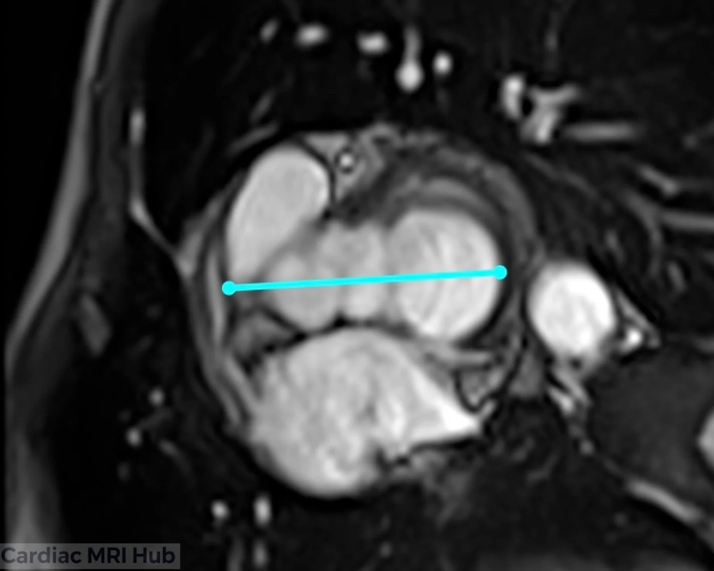
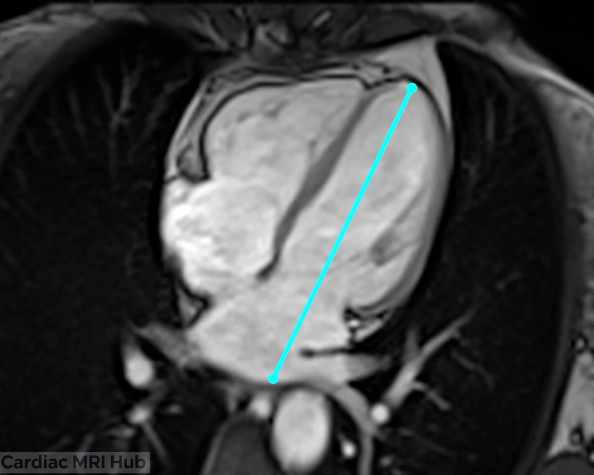
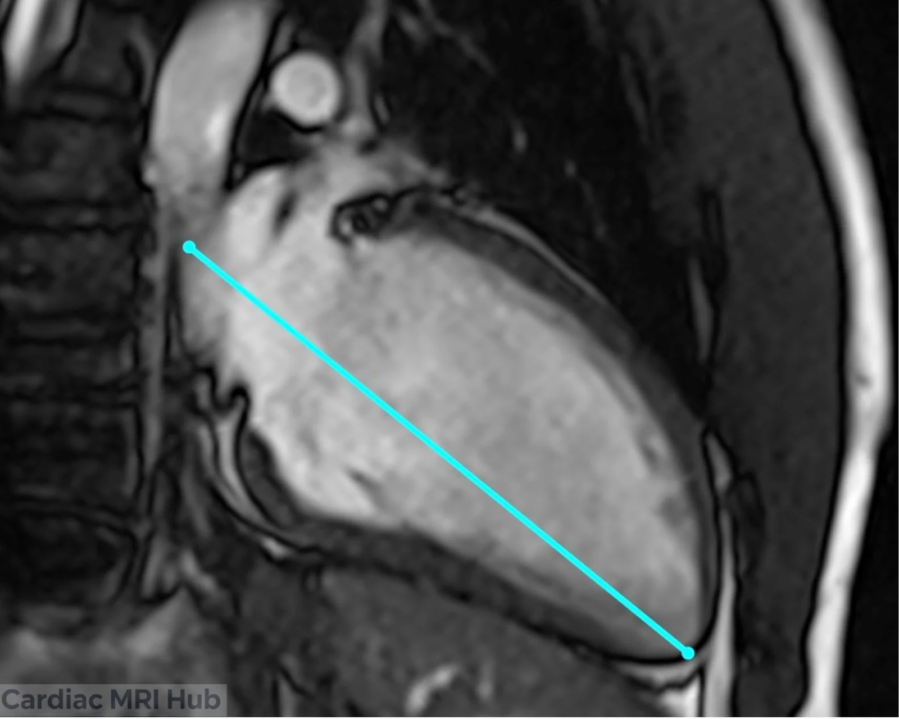
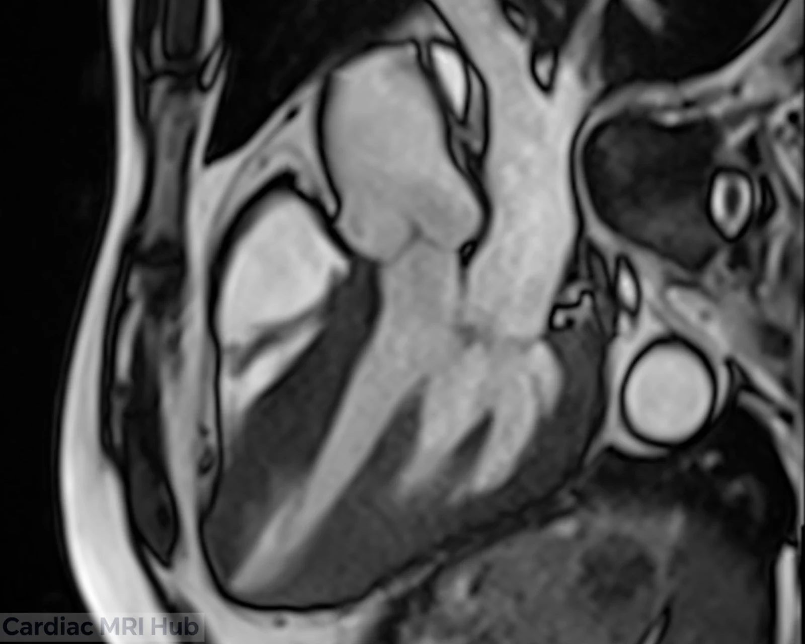
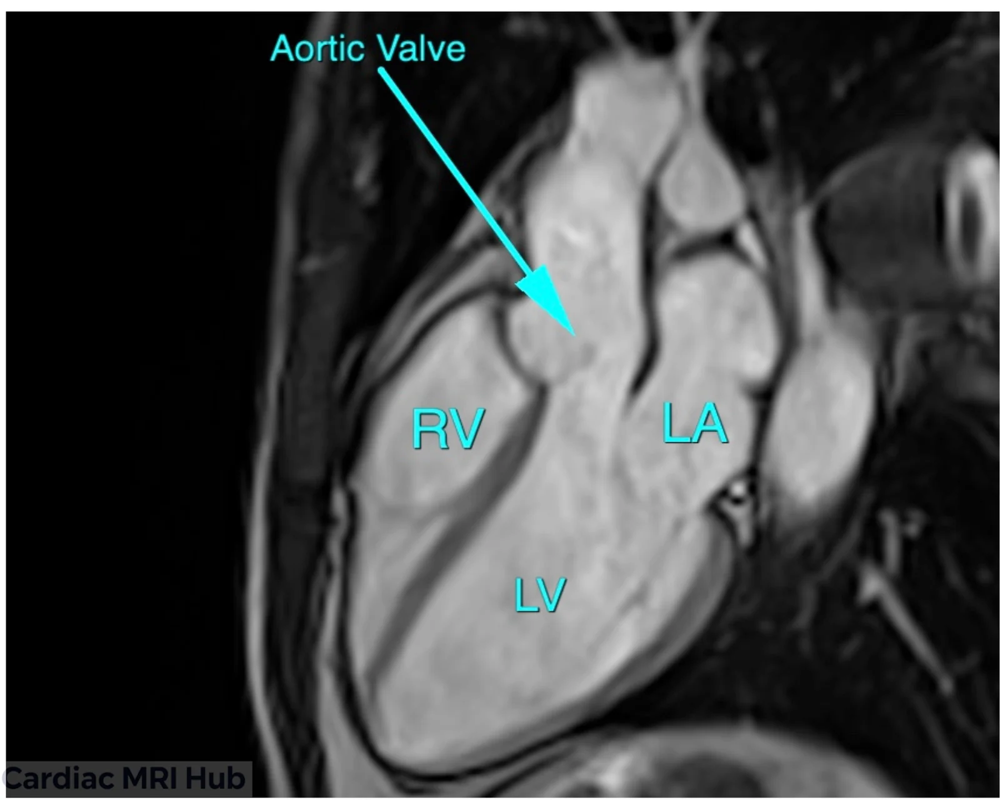

The left ventricle three-chamber (LV 3ch) view shows the LV, left atrium, mitral and aortic valves, the LV outflow tract (LVOT) and the ascending aorta in one plane. It's planned after the 2ch and 4ch, and it's the view for valve disease, outflow obstruction and the basal walls.

# Plan it

1. **On the basal short axis,** draw the line through the middle of the LVOT and the mitral valve.

2. **On the 4-chamber,** angle the line through the middle of the mitral valve and the LV apex.

3. **On the 2-chamber,** check the line runs along the long axis, from the mitral valve to the apex.

Planning with 3 points instead? The mitral valve and aortic root go on the short axis and the apex on the 2-chamber: see the box above.

# Check it

- The mitral valve, aortic valve, LVOT and aortic root are all in the slice, with the LV and LA.
- The LV is at full length, with the true apex in the slice. If the LV looks short, the plane is foreshortened: recheck it on the 4-chamber and 2-chamber.
- The LVOT and aortic valve are cut through the middle. If the valve or root looks narrow or clipped, the line is off center; replan it on the basal short axis.

# Key settings

- **Slice thickness:** 6–8 mm; LGE uses the same thickness as the cines.
- **Field of view:** 280–350 mm, adjusted to the patient.
- **Temporal resolution:** 45 ms or less (real time 60 ms or less).
- **Gating:** retrospective ECG gating, 25–30 phases.
- **Breath-hold:** 8–12 seconds.

The full settings table is under More detail.

# More detail

# 1. What it's used for

- **Function**
  - Wall motion, especially the basal septum and lateral wall.
  - Shows the LVOT and aortic root for obstruction.
- **Valves**
  - Mitral and aortic valve shape, function and how well they close.
  - Cines and phase contrast measure regurgitant volumes and gradients across the valves.
- **Outflow tract**
  - The LVOT matters in hypertrophic cardiomyopathy, aortic stenosis and follow-up after procedures.
- **Follow-up**
  - Repeat scans of valve disease, LVOT obstruction, and remodeling after surgery or treatment (for example valve replacement or ablation).

# 2. Planning and acquisition

- **Orientation and planning**
  - The 3ch plane cuts through the center of the LV and LA, through both the mitral and aortic valves, lined up with the LVOT and aortic root on the short axis.
  - Check it against the 2ch and 4ch (the planning line goes through the mitral valve and the apex) so the LV isn't foreshortened and the plane runs straight through the LVOT.
- **Patient positioning**
  - Supine, arms positioned to avoid coil artifact.
  - Check the patient can hold their breath; practice before scanning if you can.
- **Slice thickness and resolution**
  - Cines: 6–8 mm slices balance detail and SNR.
  - LGE uses the same slice thickness as the cines.
  - Use slices under 6 mm when you need higher resolution, for example for the valves.
- **Field of view (FOV)**
  - Standard adult FOV: 280–350 mm, adjusted for body size.
  - Make sure the LV, LA, the whole LVOT and the aortic root are in the image, without extra space that lowers detail.
- **Timing**
  - Retrospective ECG gating to cover the whole cardiac cycle (25–30 phases). Temporal resolution 45 ms or less (real time 60 ms or less).
  - For tissue characterization, target mid-diastole or the phase with the least motion.
- **Common pitfalls**
  - Check the plane on the 4ch and 2ch every time. An oblique slice can hide disease and makes follow-up scans hard to compare.
  - For mitral regurgitation flow, use the 3ch to place the flow plane perpendicular to the jet.
  - Arrhythmia or poor breath-holds: be ready to switch to real-time cines (non-gated or compressed sensing).

# 3. Contrast and tissue characterization

- **Gadolinium contrast**
  - LGE after contrast shows fibrosis, infarction and changes around the valves.
  - Timing (10 minutes after injection) and the right inversion time separate myocardium from the blood pool.
- **Other sequences**
  - T1 and T2 mapping and perfusion add tissue detail, especially for basal septal or infiltrative disease.

# 4. Troubleshooting

- **Artifacts**
  - Motion: respiratory gating for patients who struggle with breath-holds, or free breathing with motion correction.
  - Arrhythmia: arrhythmia rejection or single-shot sequences. Compressed sensing helps if you have it.
  - Coil placement: center the coil over the heart for the best SNR, and use multiple coil arrays for more signal.
- **Watch during the scan**
  - Keep an eye on the ECG trace. Fix poor R-wave detection right away: skin prep, move the leads or change leads.
  - Talk with the patient throughout to keep them comfortable and still.
- **Adjusting the protocol**
  - Check with the radiologist on complex cases, especially congenital heart disease.
  - Adjust the number of slices, thickness and sequences to the clinical question and what the patient can tolerate.

# 5. Post-processing

- **Volumes and function**
  - Analysis software calculates LV volumes, mass and ejection fraction.
  - Assess aortic and mitral valve function, measure LVOT gradients or regurgitation, and check the outflow tract size.
- **Reporting**
  - Standard templates keep reports consistent: chamber size and function, the valves, and any abnormal findings (for example obstruction, regurgitation or delayed enhancement).

# 6. Clinical pointers

- **LVOT and valves**
  - Outflow obstruction in hypertrophic cardiomyopathy, and valve shape.
  - Follow-up after valve replacement, repair or TAVI.
- **Left ventricle and aorta**
  - Basal septal thickening, LV scar and ascending aorta disease.
  - Gradients and aortic valve opening as part of the full cardiac exam.

# 7. Good habits

- Plan the 3ch carefully every time, so images are consistent from exam to exam.
- Adapt the technique to each patient and clinical question.
- Ask the radiologist or referring clinician when the clinical question isn't clear.

# Summary Table: Three-Chamber Settings

| Parameter | Recommendation (Adult) |
|---|---|
| Orientation | Bisect MV, LV apex, LVOT, and aortic root |
| Slice Thickness | 6–8 mm with or without 2-4mm gap (to make total of 10mm), LGE: Same thickness as cine. |
| Field of View | 280–350 mm, adjusted to patient. |
| Phase Oversampling | Adjust to patient/FOV to avoid wrap. |
| Temporal Resolution | 45ms or less preferred (Real-time 60ms or less) |
| Resolution | 1.4-1.8mm preferred. |
| Bandwidth | Wide: 750-1300 Hz/Px (Higher reduces artifacts) |
| Flip Angle | 40-90 (CINE), 20-25 (LGE) |
| Parallel Imaging | GRAPPA 2 or parallel imaging |
| Compressed Sensing | Use when available to reduce acquisition time and motion artifacts, especially useful in patients with poor breath-hold or arrhythmia. |
| Timing | Retrospective ECG gating; 25–30 phases preferred. |
| Contrast | Gadolinium for LGE 10 mins post (delay timing will depend on dose and if stress/rest perfusion performed). Precise timing of TI needed to null myocardium. |
| Immobilization | Supine, coil centered over heart. |
| Breath-hold | 8-12 sec preferred. |
