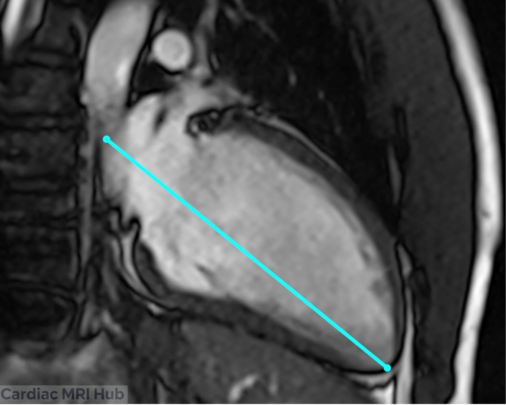
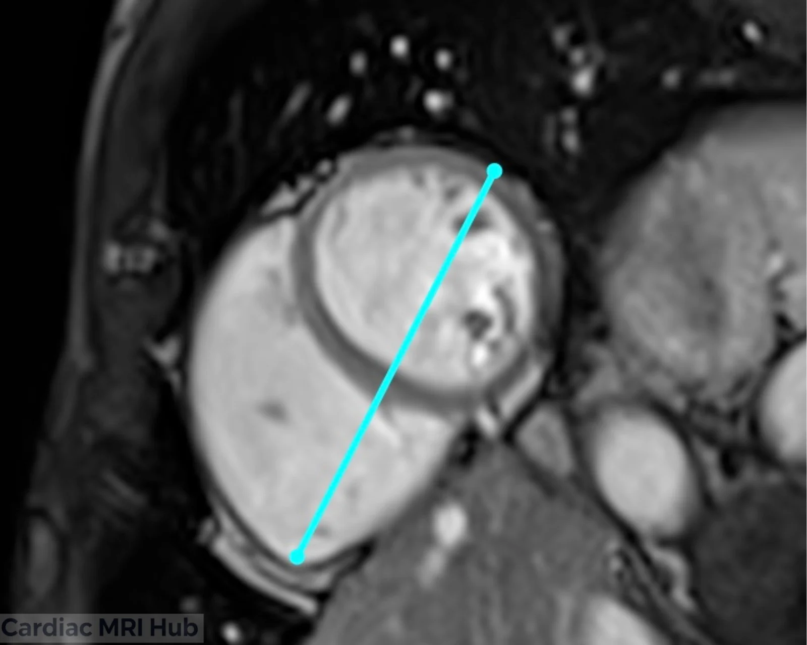
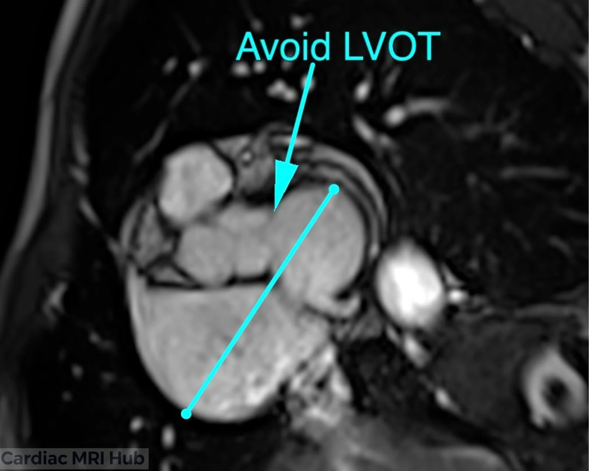
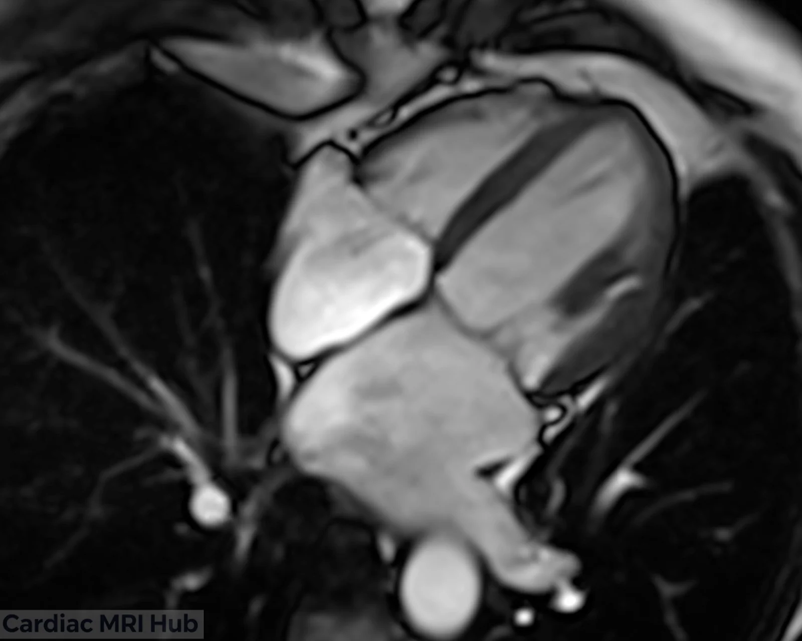

The left ventricle four-chamber (LV 4ch) view shows all four chambers at once: left ventricle (LV), left atrium (LA), right ventricle (RV) and right atrium (RA). It's used for function, valves and congenital heart disease.

# Plan it

1. **On the 2-chamber,** draw the line parallel to the long axis, through the middle of the mitral valve and the LV apex.

2. **On the mid short axis,** run the line through the middle of the LV.

3. **Check the basal short axis:** the line should stay clear of the LV outflow tract (LVOT).

4. **Fine-tune on the mid short axis:** the line through the middle of the LV should also reach the RV apex (blue).

 on mid short axis view.")

Planning with 3 points instead? The tricuspid and mitral valves go on the short axis and the apex on the 2-chamber: see the box above.

# Check it

- All four chambers are in the slice, with both the mitral and tricuspid valves.
- The LV is at full length, with the true apex in the slice. If the LV looks short, the plane is foreshortened: recheck it on the 2-chamber and 3-chamber.
- No LVOT or aortic valve in the slice. If you see them, the plane is too far toward the base; replan from a mid short-axis slice.

 right ventricle, (RA) right atrium, (LV) left ventricle, (LA) left atrium, and (MV) mitral valve, (TV) tricuspid valve, (IVS) inter-ventricular septum, (IAS) inter-atrial septum, (DA) descending aorta, (PV) pulmonary vein, and (AL) anterolateral wall")

# Key settings

- **Slice thickness:** 6–8 mm; LGE uses the same thickness as the cines.
- **Field of view:** 280–350 mm, adjusted to the patient.
- **Temporal resolution:** 45 ms or less (real time 60 ms or less).
- **Gating:** retrospective ECG gating, 25–30 phases.
- **Breath-hold:** 8–12 seconds.

The full settings table is under More detail.

# More detail

# 1. What it's used for

- **Function**
  - LV and RV function, including ejection fraction and wall motion.
  - Enlarged or thickened chambers, which matter for staging heart failure and cardiomyopathy.
- **Valves**
  - Mitral and tricuspid valve shape and how well they close.
  - Regurgitation jets and stenosis, on cines or with phase contrast.
- **Congenital and structural disease**
  - Atrial and ventricular septal defects (ASD, VSD).
  - Unusual connections, anomalous veins and post-surgical anatomy.
- **Follow-up**
  - Repeat scans to track conditions such as myocarditis, amyloidosis or cardiomyopathy from chemotherapy.

# 2. Planning and acquisition

- **Orientation and planning**
  - The 4ch plane cuts through both the mitral and tricuspid valves and the LV apex. Avoid the LVOT on the basal short-axis slice.
  - Check it against the 2ch and 3ch views so the LV isn't foreshortened.
- **Patient positioning**
  - Supine, arms in a comfortable position.
  - Make sure the patient understands the breathing instructions. If you can, practice breath-holds before the exam to see what they can do.
- **Slice thickness and resolution**
  - Cines: 6–8 mm slices balance resolution and SNR. LGE uses the same slice thickness as the cines.
  - Use slices under 6 mm when you need higher resolution.
- **Field of view (FOV)**
  - Standard adult FOV: 280–350 mm, adjusted for body size.
  - Make sure both ventricles, both atria and the septum are in the image, without extra space that lowers detail.
- **Timing**
  - Retrospective ECG gating to cover the whole cardiac cycle (25–30 phases). Temporal resolution 45 ms or less (real time 60 ms or less).
  - For tissue characterization, target mid-diastole or the phase with the least motion.
- **Common pitfalls**
  - Misalignment: angle the plane through the apex, checking it on the short axis and the 2ch.
  - The outflow tract: plan from a mid-ventricle slice to avoid it.
  - Arrhythmia or poor breath-holds: be ready to switch to real-time cines (non-gated or compressed sensing).

# 3. Contrast and tissue characterization

- **Gadolinium contrast**
  - LGE after contrast shows infarction, fibrosis and infiltrative disease.
  - Timing (10 minutes after injection) and a well-set inversion time are what make scar visible.
- **Other sequences (T1 and T2 mapping, perfusion)**
  - Consider T1, T2 and extracellular volume (ECV) mapping for tissue characterization, especially for myocarditis and infiltrative disease.

# 4. Troubleshooting

- **Artifacts**
  - Motion: respiratory gating for patients who struggle with breath-holds, or free breathing with motion correction.
  - Arrhythmia: arrhythmia rejection or single-shot sequences. Compressed sensing helps if you have it.
  - Coil placement: center the coil over the heart for the best SNR, and use multiple coil arrays for more signal.
- **Watch during the scan**
  - Keep an eye on the ECG trace. Fix poor R-wave detection right away: skin prep, move the leads or change leads.
  - Talk with the patient throughout to keep them comfortable and still.
- **Adjusting the protocol**
  - Check with the radiologist on complex cases, especially congenital heart disease.
  - Adjust the number of slices, thickness and sequences to the clinical question and what the patient can tolerate.

# 5. Post-processing

- **Volumes and function**
  - Analysis software calculates ventricular volumes and ejection fraction.
  - LV and RV mass and atrial size can be measured automatically, then checked and corrected by hand.
- **Reporting**
  - Standard templates keep reports consistent: chamber sizes, function and any abnormal findings (for example hypertrophy or delayed enhancement).

# 6. Clinical pointers

- **Left atrium**
  - Enlargement: seen in heart failure and AFib.
  - A sign of diastolic dysfunction.
- **Left ventricle**
  - Regional wall motion: shows ischemia or infarction.
  - Scar: guides treatment in arrhythmia and after a heart attack.
- **Right side**
  - Look for pulmonary hypertension and the effects of a shunt.

# 7. Good habits

- Plan the 4ch carefully every time, so images are consistent from exam to exam.
- Adapt the technique to each patient and clinical question.
- Ask the radiologist or referring clinician when the clinical question isn't clear.

# Summary Table: Four-Chamber Settings

| Parameter | Recommendation (Adult) |
|---|---|
| Orientation | Bisect valves & apex. |
| Slice Thickness | 6–8 mm with or without 2-4mm gap (to make total of 10mm), LGE: Same thickness as cine. |
| Field of View | 280–350 mm, adjusted to patient. |
| Phase Oversampling | Adjust to patient/FOV to avoid wrap. |
| Temporal Resolution | 45ms or less preferred (Real-time 60ms or less) |
| Resolution | 1.4-1.8mm preferred. |
| Bandwidth | Wide: 750-1300 Hz/Px (Higher reduces artifacts) |
| Flip Angle | 40-90 (CINE), 20-25 (LGE) |
| Parallel Imaging | GRAPPA 2 or parallel imaging |
| Compressed Sensing | Use when available to reduce acquisition time and motion artifacts, especially useful in patients with poor breath-hold or arrhythmia. |
| Timing | Retrospective ECG gating; 25–30 phases preferred. |
| Contrast | Gadolinium for LGE 10 mins post (delay timing will depend on dose and if stress/rest perfusion performed). Precise timing of TI needed to null myocardium. |
| Immobilization | Supine, coil centered over heart. |
| Breath-hold | 8-12 sec preferred. |

