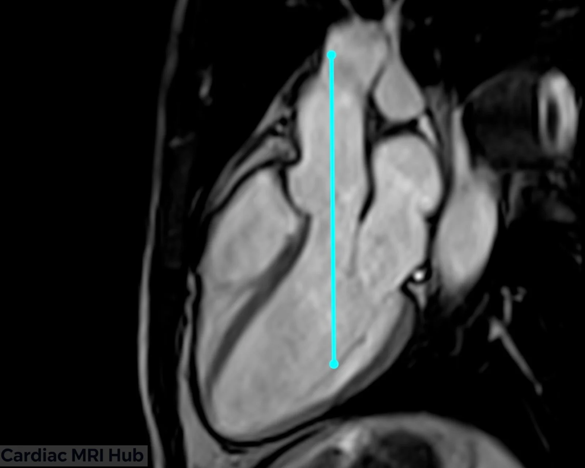
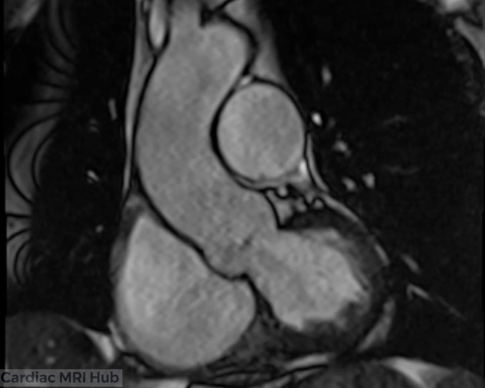
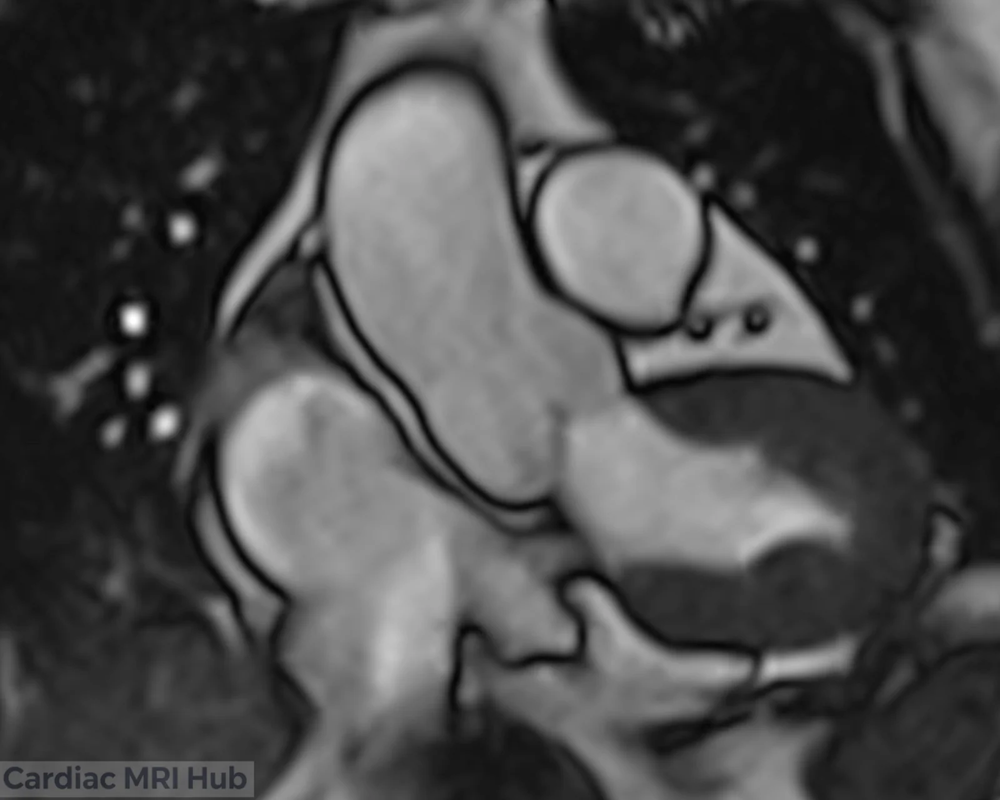
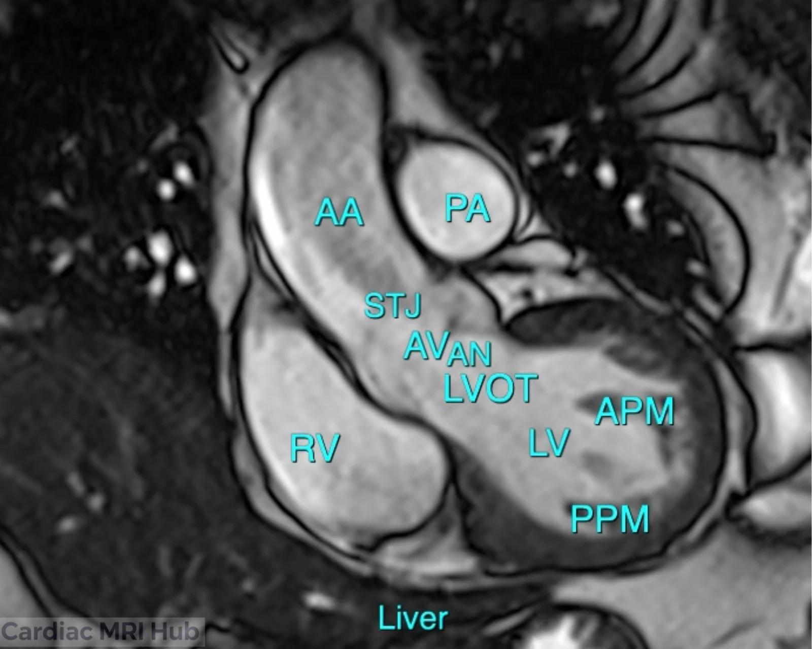

The coronal left ventricle outflow tract (LVOT) view runs through the LVOT, aortic valve and ascending aorta. It's used for valve disease, hypertrophic cardiomyopathy, congenital heart disease and planning procedures.

# Plan it

1. **On the 3-chamber,** draw the line straight up the middle of the LVOT, through the aortic valve and along the ascending aorta.

That line gives this view:

# Check it

- The LV cavity, LVOT, aortic valve and ascending aorta are all in the slice, up past the sinotubular junction.
- The outflow tract and aortic valve are cut through the middle, at their widest. If they look narrow or the valve looks short, the line is off center: recheck it on the 3-chamber.
- The ascending aorta stays in the slice. If it runs out of the image, angle the line along the aorta on the 3-chamber.

AA: ascending aorta; PA: pulmonary artery; STJ: sinotubular junction; AV: aortic valve; AN: annulus; LVOT: left ventricular outflow tract; RV: right ventricle; LV: left ventricle; APM: anterior papillary muscle; PPM: posterior papillary muscle.

# Key settings

- **Slice thickness:** 6–8 mm; LGE uses the same thickness as the cines.
- **Field of view:** 280–350 mm, adjusted to the patient.
- **Temporal resolution:** 45 ms or less (real time 60 ms or less).
- **Gating:** retrospective ECG gating, 25–30 phases.
- **Breath-hold:** 8–12 seconds.

The full settings table is under More detail.

# More detail

# 1. What it's used for

- **Outflow tract**
  - Shows the LVOT from the basal septum to the aortic valve and proximal aorta.
  - Shows obstruction below or above the valve (for example septal hypertrophy, a membrane or post-surgical changes).
- **Valves**
  - Aortic and mitral valve shape, opening and regurgitant jets.
  - Cines show aortic stenosis, bicuspid or unicuspid valves, and prosthetic valves.
- **Congenital and structural disease**
  - Abnormal connections, outflow tract anomalies, and follow-up after surgery or transcatheter procedures.
  - Helps diagnose and follow hypertrophic cardiomyopathy and outflow gradients.
- **Follow-up**
  - Repeat scans of valve disease, hypertrophic cardiomyopathy (HCM), or after valve replacement or repair.

# 2. Planning and acquisition

- **Orientation and planning**
  - On the 3ch, the coronal LVOT plane runs straight up the center of the LVOT, aortic valve and ascending aorta.
  - Check it against the 3ch and 4ch so it passes through where the mitral and aortic valves meet, at the widest part of the outflow tract.
- **Coverage**
  - From the LV cavity to above the sinotubular junction of the ascending aorta.
  - Keep the LV cavity, outflow tract and proximal aorta in view.
- **Patient positioning**
  - Supine, arms positioned to avoid coil artifact.
  - Check the patient can hold their breath; practice before scanning if you can.
- **Slice thickness and resolution**
  - Cines: 6–8 mm slices for chamber and valve motion.
  - LGE uses the same slice thickness as the cines.
  - Use slices under 6 mm when you need higher resolution, for example when the outflow tract is abnormal.
- **Field of view (FOV)**
  - Standard adult FOV: 280–350 mm, covering the LV, LVOT and ascending aorta.
  - Check the left ventricle, LVOT and ascending aorta are all in the image, without extra space that lowers detail.
- **Timing**
  - Retrospective ECG gating (25–30 phases) to see the outflow tract move. Temporal resolution 45 ms or less (real time 60 ms or less).
  - For tissue characterization, target mid-diastole or the phase with the least motion.
- **Common pitfalls**
  - Valve measurements come out short if the slice isn't through the center of the aortic valve. Check the angle.
  - Arrhythmia or poor breath-holds: be ready to switch to real-time cines (non-gated or compressed sensing).

# 3. Contrast and tissue characterization

- **Gadolinium contrast**
  - LGE shows fibrosis, scar and post-surgical changes below, at and around the valve and aorta.
  - LGE timing (10 minutes after injection) and an accurate inversion time separate myocardium from the blood and the aorta.
- **Other sequences**
  - T1 and T2 mapping help when the outflow tract is involved in infiltrative, inflammatory or congenital disease.

# 4. Troubleshooting

- **Artifacts**
  - Motion: respiratory gating for patients who struggle with breath-holds, or free breathing with motion correction.
  - Arrhythmia: arrhythmia rejection or single-shot sequences. Compressed sensing helps if you have it.
  - Coil placement: center the coil over the heart for the best SNR, and use multiple coil arrays for more signal.
- **Watch during the scan**
  - Keep an eye on the ECG trace. Fix poor R-wave detection right away: skin prep, move the leads or change leads.
  - Talk with the patient throughout to keep them comfortable and still.
- **Adjusting the protocol**
  - Check with the radiologist on complex cases, especially congenital heart disease.
  - Adjust the number of slices, thickness and sequences to the clinical question and what the patient can tolerate.

# 5. Post-processing

- **Function and anatomy**
  - Measure LVOT area, aortic root size and outflow gradients.
  - Review valve shape and motion for dynamic obstruction, stenosis or regurgitation.
- **Reporting**
  - Structured reports cover LVOT size, valve shape, function, and any obstruction or regurgitation.

# 6. Clinical pointers

- **Hypertrophic cardiomyopathy**
  - Septal thickness and outflow tract narrowing.
  - Guides surgery, ablation or transcatheter procedures.
- **Aortic valve disease**
  - Stenosis, regurgitation and congenital valve variants.
  - Follow-up of prosthetic valves and leaks around them.
- **Congenital heart disease**
  - Conotruncal defects and follow-up after complex repairs.

# 7. Good habits

- Plan the coronal LVOT carefully every time, so images are consistent from exam to exam.
- Adapt the technique and coverage to each patient and clinical question.
- Ask the radiologist or referring clinician when the clinical question isn't clear.

# Summary Table: Coronal LVOT Settings

| Parameter | Recommendation (Adult) |
|---|---|
| Orientation | Vertical plane through MV, LVOT, and AA |
| Slice Thickness | 6–8 mm with or without 2-4mm gap (to make total of 10mm), LGE: Same thickness as cine. |
| Field of View | 280–350 mm, adjusted to patient. |
| Phase Oversampling | Adjust to patient/FOV to avoid wrap. |
| Temporal Resolution | 45ms or less preferred (Real-time 60ms or less) |
| Resolution | 1.4-1.8mm preferred. |
| Bandwidth | Wide: 750-1300 Hz/Px (Higher reduces artifacts) |
| Flip Angle | 40-90 (CINE), 20-25 (LGE) |
| Parallel Imaging | GRAPPA 2 or parallel imaging |
| Compressed Sensing | Use when available to reduce acquisition time and motion artifacts, especially useful in patients with poor breath-hold or arrhythmia. |
| Timing | Retrospective ECG gating; 25–30 phases preferred. |
| Contrast | Gadolinium for LGE 10 mins post (delay timing will depend on dose and if stress/rest perfusion performed). Precise timing of TI needed to null myocardium. |
| Immobilization | Supine, coil centered over heart. |
| Breath-hold | 8-12 sec preferred. |
