# Cardiac MRI of the Left Ventricle

A quick plan for the left ventricle, view by view. It covers:

## Critical Views

Four views make up the standard LV exam:

- **Two-chamber:** the anterior and inferior walls.
- **Four-chamber:** function and structure of both ventricles and both atria.
- **Three-chamber:** the left ventricular outflow tract and aortic valve.
- **Short axis:** basal, mid and apical levels for wall motion and thickness.

## Image Acquisition Techniques

The basics:

- **Sequences:** cines for motion, structure and shape; late gadolinium enhancement (LGE) for scar.
- **Slice thickness and spacing:** usually 6–8 mm with no gap, adjusted for patient size and the clinical question to balance resolution and scan time.
- **Timing:** ECG gating, imaging in diastole for the sharpest images.
- **Post-processing:** 3D reconstruction where it helps the analysis.

## Planning Steps

Before you plan:

- **Patient preparation:** make sure the patient understands the exam.
- **Positioning:** supine and comfortable.
- **Imaging settings:** set for good image quality.
- **Contrast:** give it safely, following your site's policy.
- **Monitoring:** keep checking on the patient during the exam.

# 2 Chamber Planning

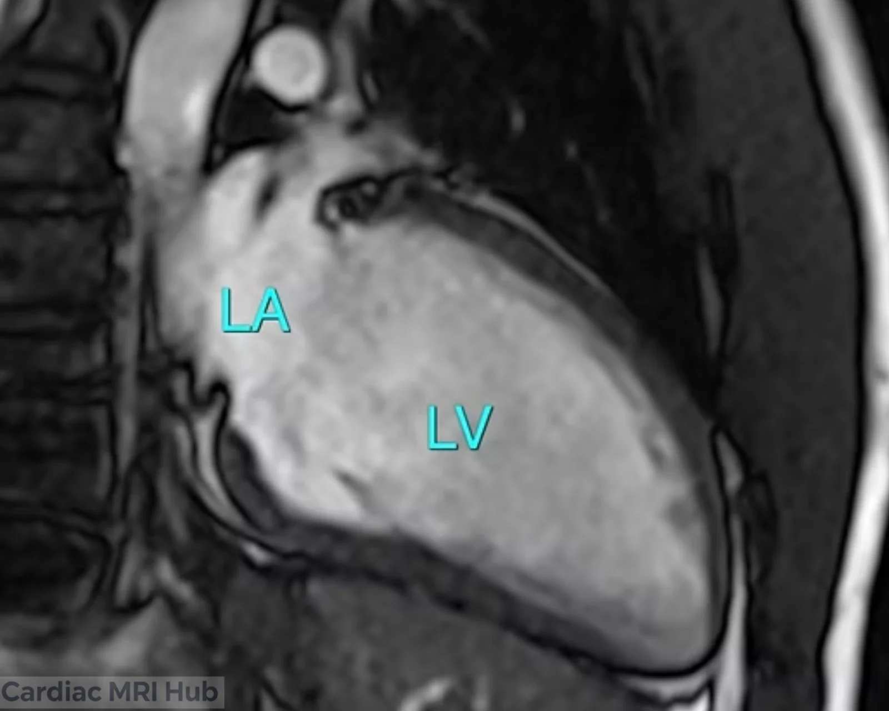

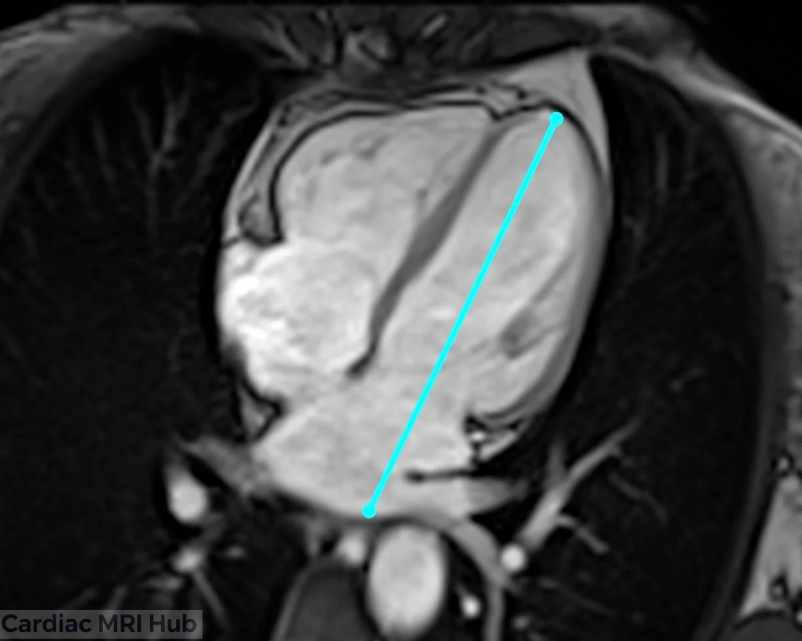

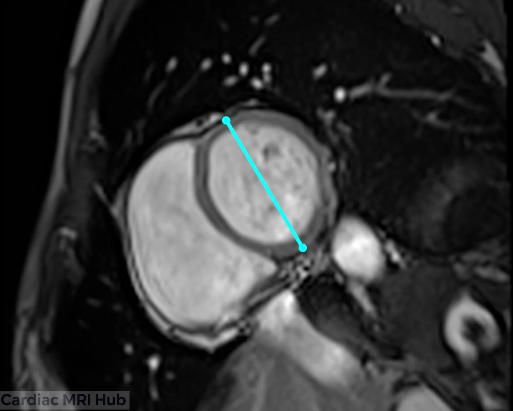

# Left Ventricle Two-Chamber View Planning

The two-chamber view shows the left atrium and left ventricle, for their structure and any abnormalities.

## Key Considerations for Planning

- **Orientation:** a plane through the left atrium and left ventricle.
- **Field of view:** the whole left atrium and ventricle.

## Clinical Applications

- Left ventricular size and function.
- Left atrial size and shape.
- Structural heart disease.
- Follow-up of left ventricular hypertrophy or dilation.

## Key Features of the Two-Chamber View

- **Left atrium:** size and structural abnormalities.
- **Left ventricle:** volume, wall motion and function.

# 3 Chamber Planning

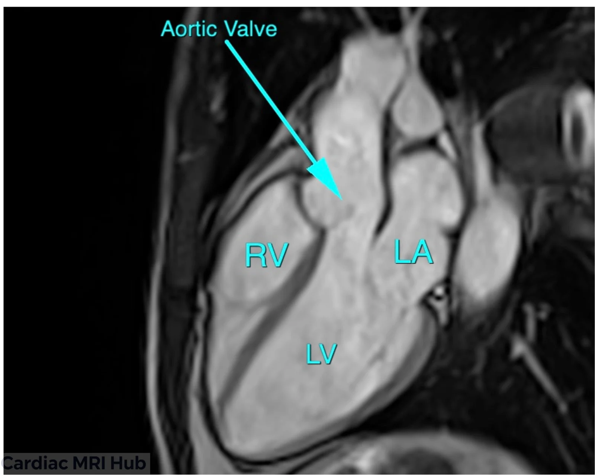

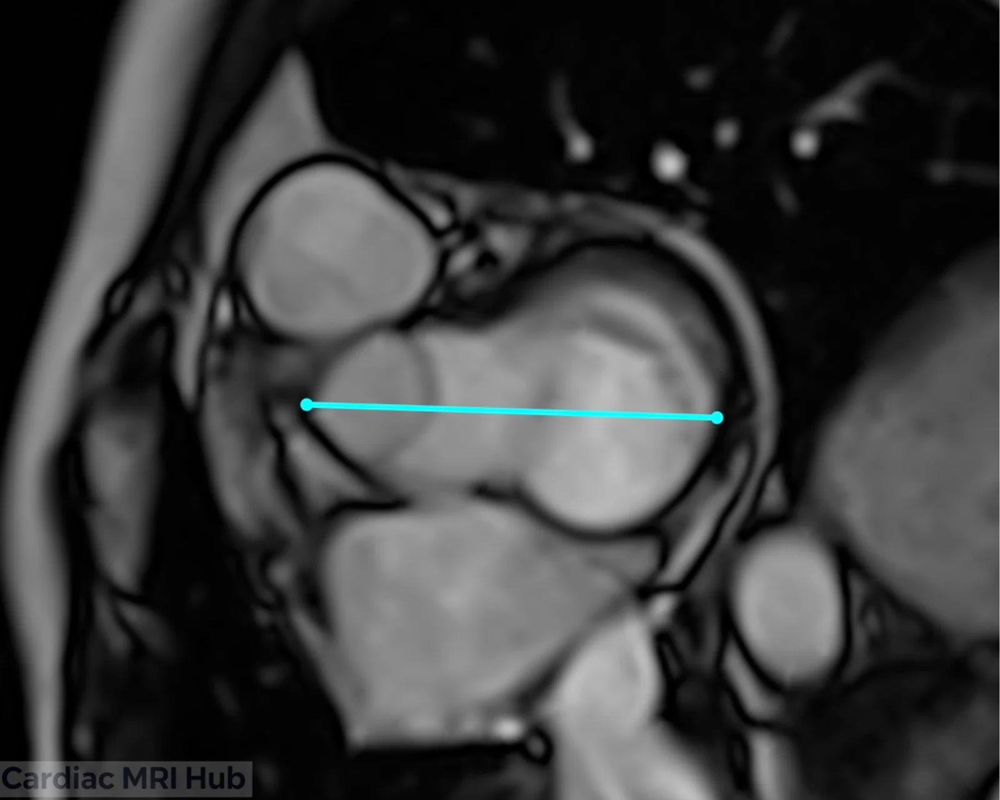

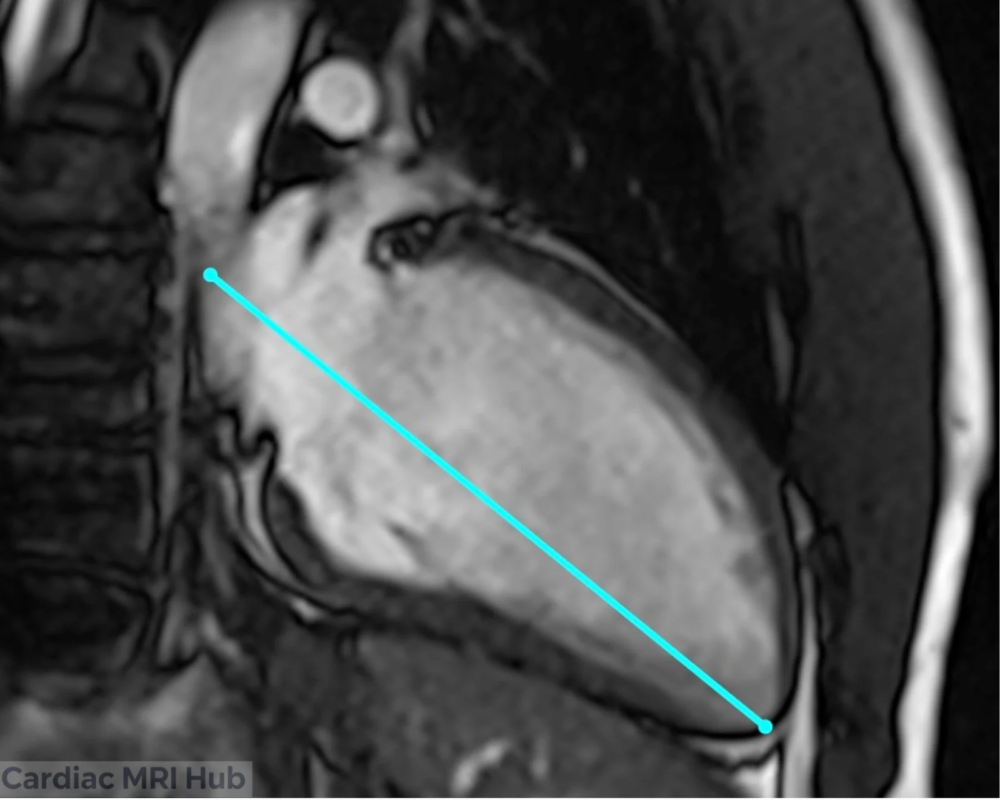

The images on the right and left show where the 3ch plane sits on the 2ch and 4ch.

# Left Ventricle Three-Chamber View Planning

The three-chamber view shows the left atrium, left ventricle and aorta.

## Key Considerations for Planning

- **Orientation:** line the plane up with the left ventricle and aorta to show the outflow tract.
- **Field of view:** the left ventricle, left atrium and proximal aorta.

## Clinical Applications

- Left ventricular function and wall motion.
- Mitral valve function and shape.
- Left atrial enlargement.
- Follow-up of hypertrophy or ischemia.

## Key Features of the Three-Chamber View

- **Left atrium:** size and abnormalities.
- **Left ventricle:** volume, wall motion and function.
- **Aorta:** the aortic root and proximal aorta.

# 4 Chamber Planning

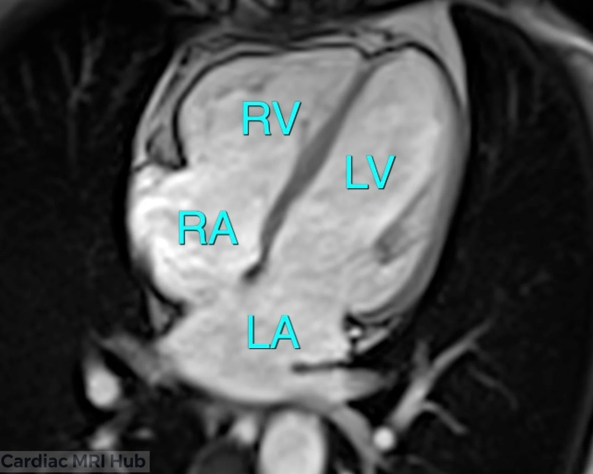

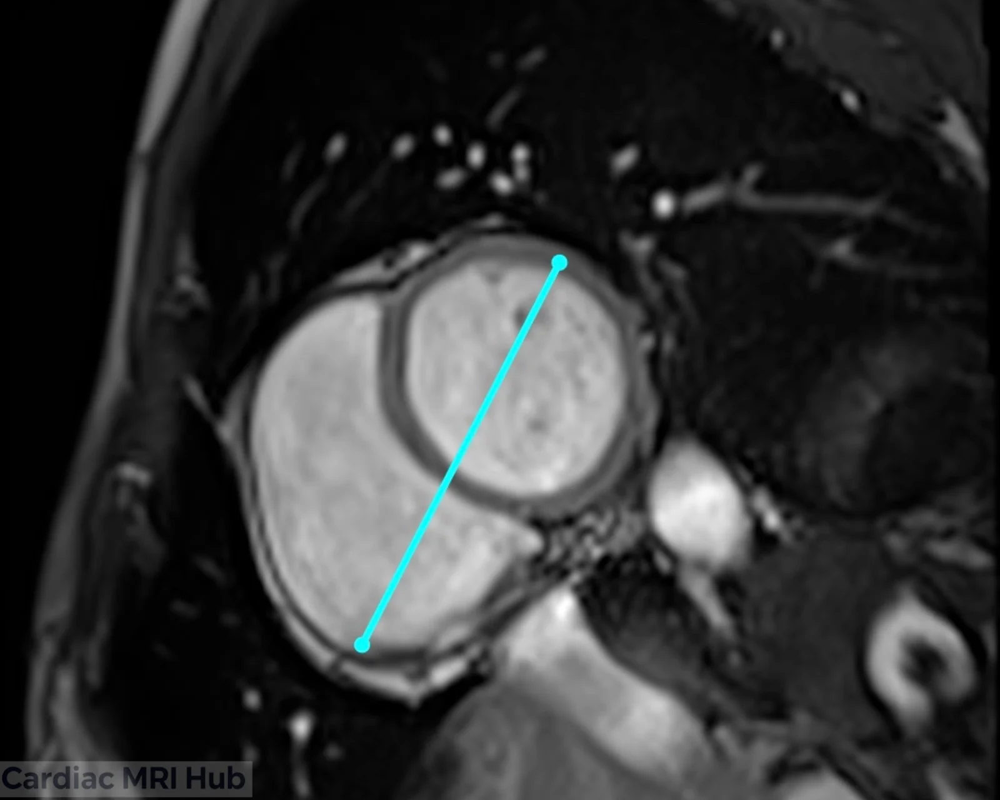

# Left Ventricle Four-Chamber View Planning

The four-chamber view shows both atria and both ventricles.

## Key Considerations for Planning

- **Orientation:** a plane through the heart showing all four chambers and the interventricular septum.
- **Field of view:** both ventricles and both atria.

## Clinical Applications

- Function and chamber sizes.
- Valve disease.
- Congenital heart defects.
- Follow-up over time.

## Key Features of the Four-Chamber View

- **Left atrium:** size and shape.
- **Left ventricle:** volume, wall motion and function.
- **Right atrium:** size and abnormalities.
- **Right ventricle:** size and function.

# Short Axis Planning

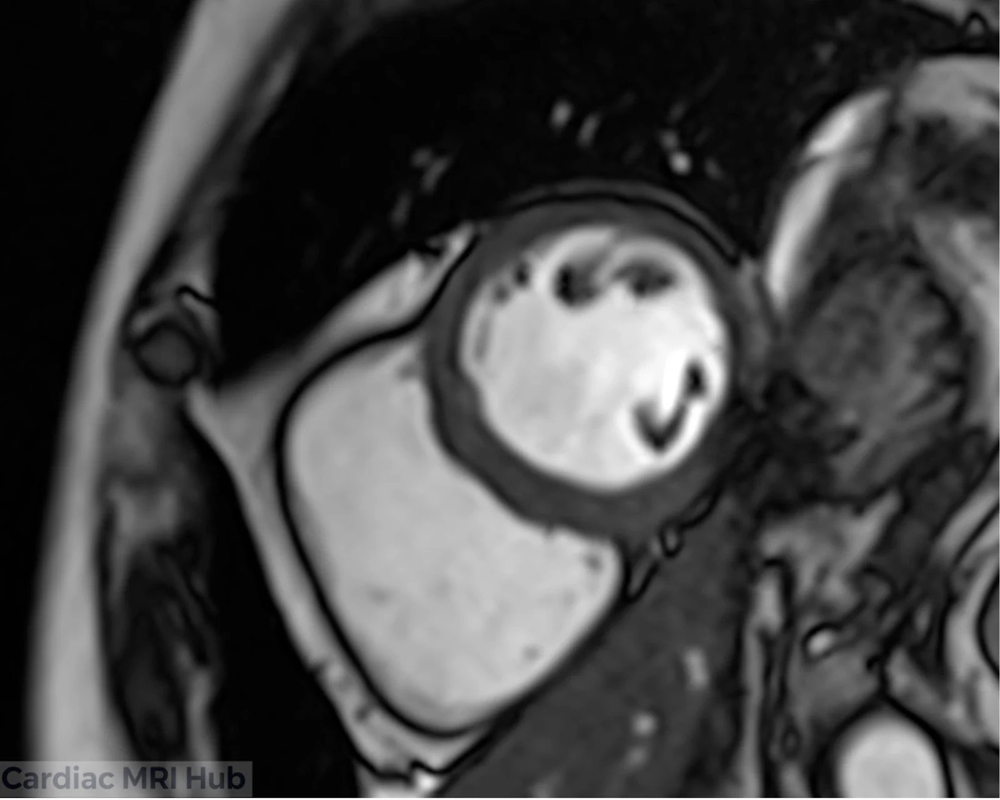

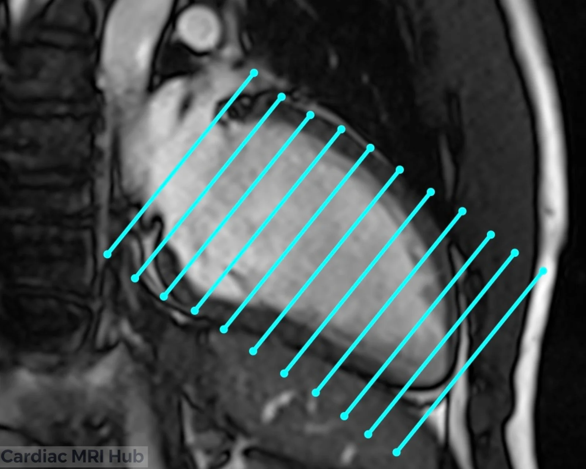

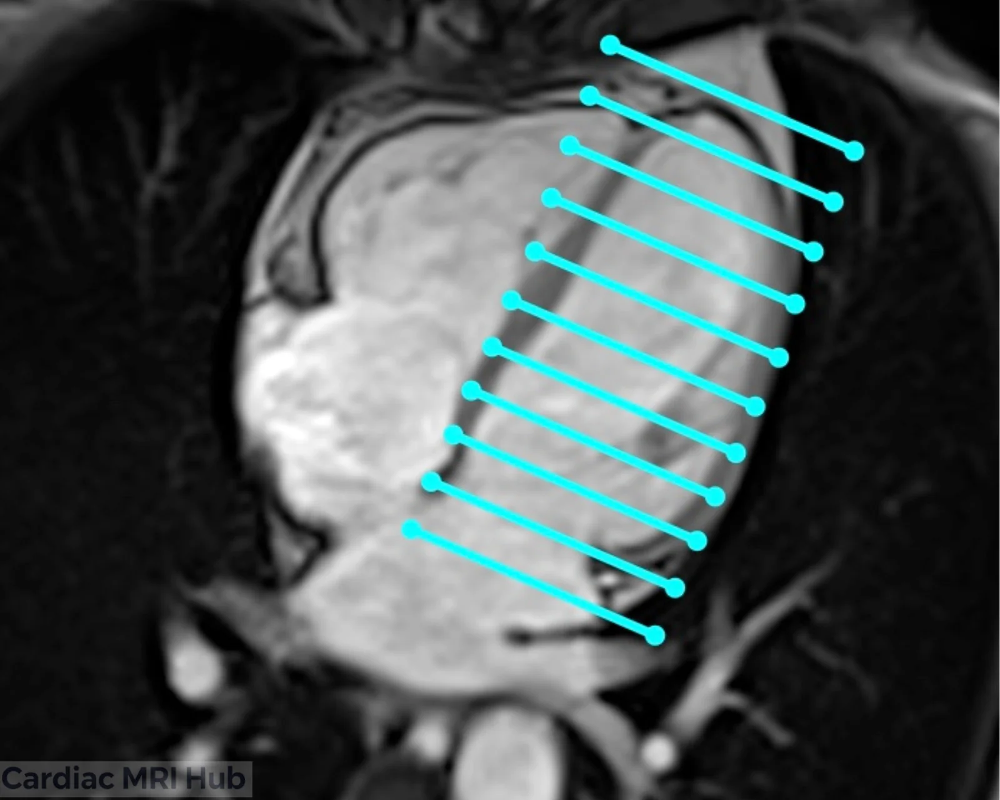

# Left Ventricle Short Axis View Planning

The short-axis view shows the left ventricle in cross-section, for the myocardium and wall motion.

## Key Considerations for Planning

- **Orientation:** perpendicular to the long axis, to show the ventricular walls and papillary muscles.
- **Field of view:** the whole left ventricle and nearby structures.

## Clinical Applications

- Left ventricular function and wall motion abnormalities.
- Ischemia and scar.
- Hypertrophic cardiomyopathy and other structural disease.
- Follow-up over time.

## Key Features of the Short Axis View

- **Ventricular walls:** thickness and motion.
- **Left ventricular volume:** end-diastolic and end-systolic volumes.
- **Papillary muscles:** shape and position.
- **Perfusion:** perfusion defects.

# Short Axis Sample (Base Mid Apex)

 slices shown above. Remember avoid LVOT on base slice and mid slice should see papillary muscle.")

# Short Axis Left Ventricle: Sample (Base Mid Apex)

## Short Axis View Alignment

The short axis runs perpendicular to the left ventricle's long axis. Each level shows something different:

- **Base:** the inflow tract and mitral valve, near the left atrium and aortic outflow tract.
- **Mid:** overall LV function, wall motion and thickness.
- **Apex:** regional wall motion and ischemic changes at the apex.

# Coronal Aortic (LVOT) Planning

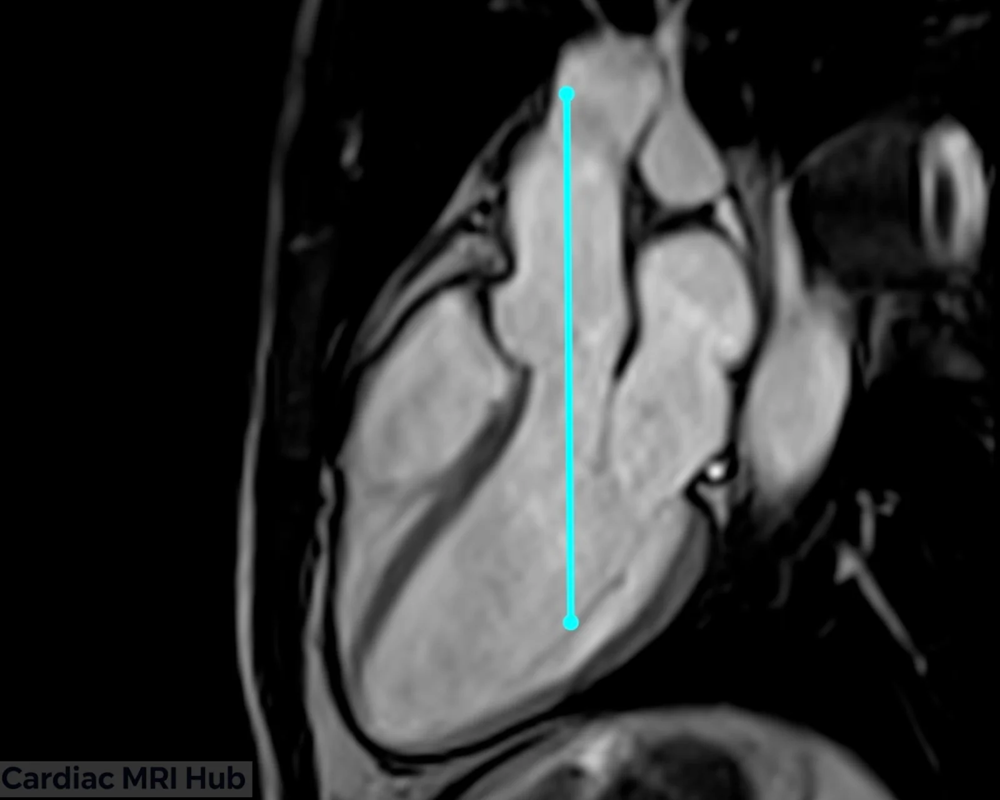

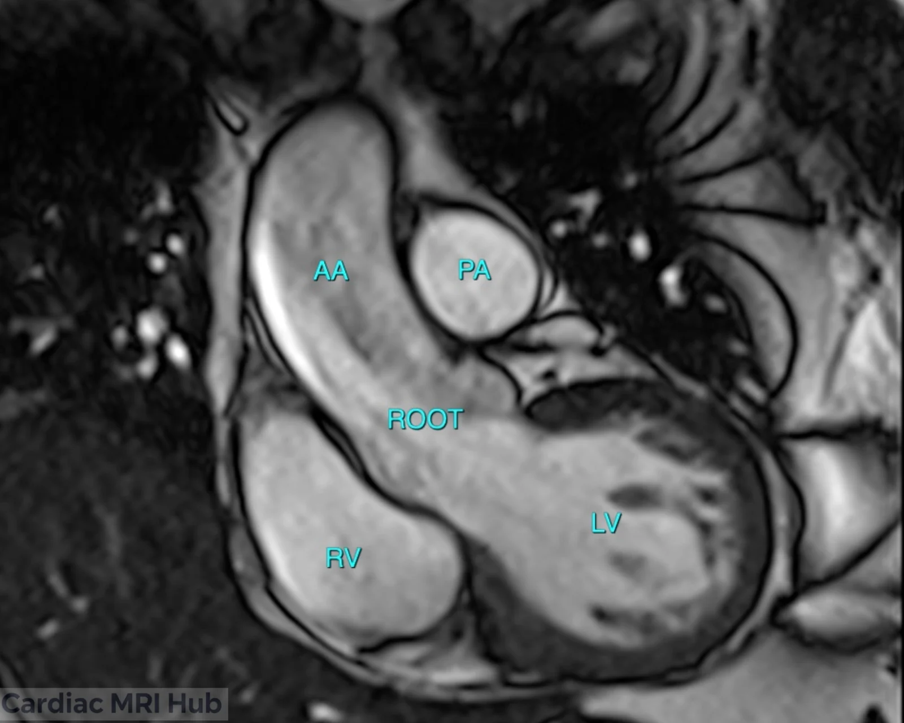

# Coronal Aortic Left Ventricular Outflow Tract Imaging

The coronal view of the left ventricular outflow tract is used for aortic stenosis and other valve disease.

## Key Considerations for Imaging

- **Orientation:** angle the slice through the aortic root.
- **Field of view:** the whole outflow tract and ascending aorta.

## Clinical Applications

- Outflow tract and aortic valve function.
- Aortic stenosis and regurgitation.
- Congenital anomalies.
- Follow-up of aortic or valve disease.

## Key Features of the Coronal View

- **Left ventricular outflow tract:** size and shape.
- **Aortic valve:** structure and function, including calcification, regurgitation or stenosis.
- **Ascending aorta:** dilation or other abnormalities.
- **Nearby structures:** the pulmonary artery and left atrium.
