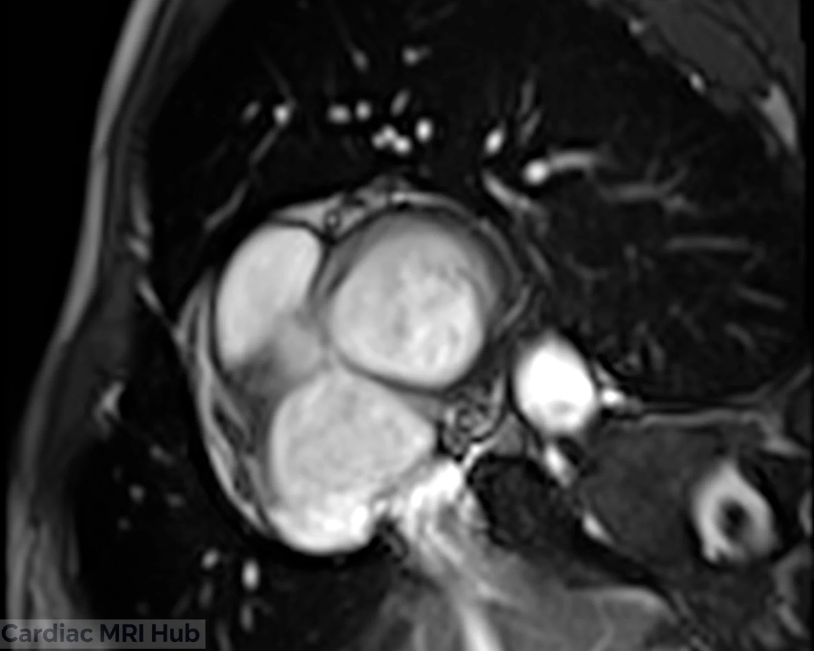
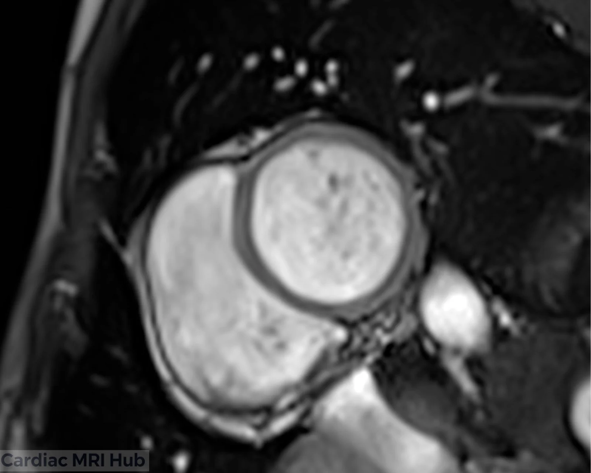
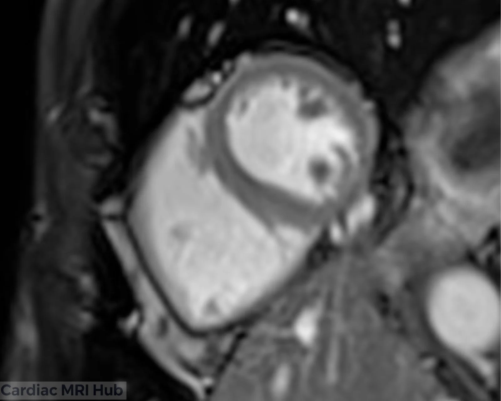
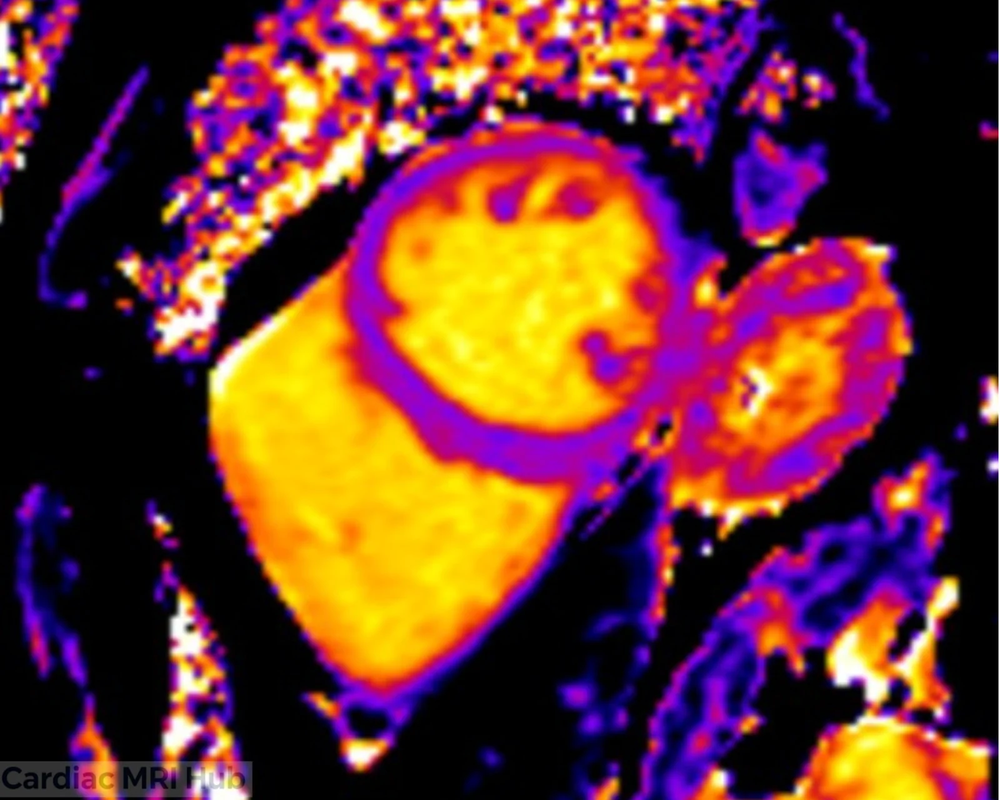
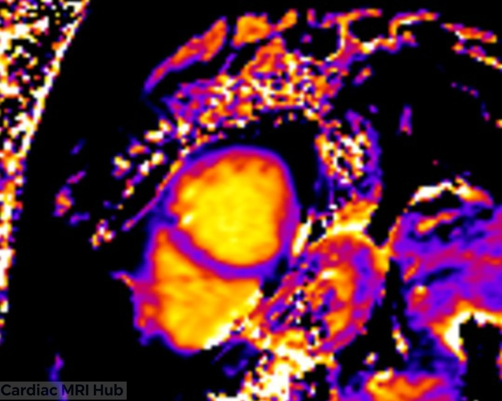
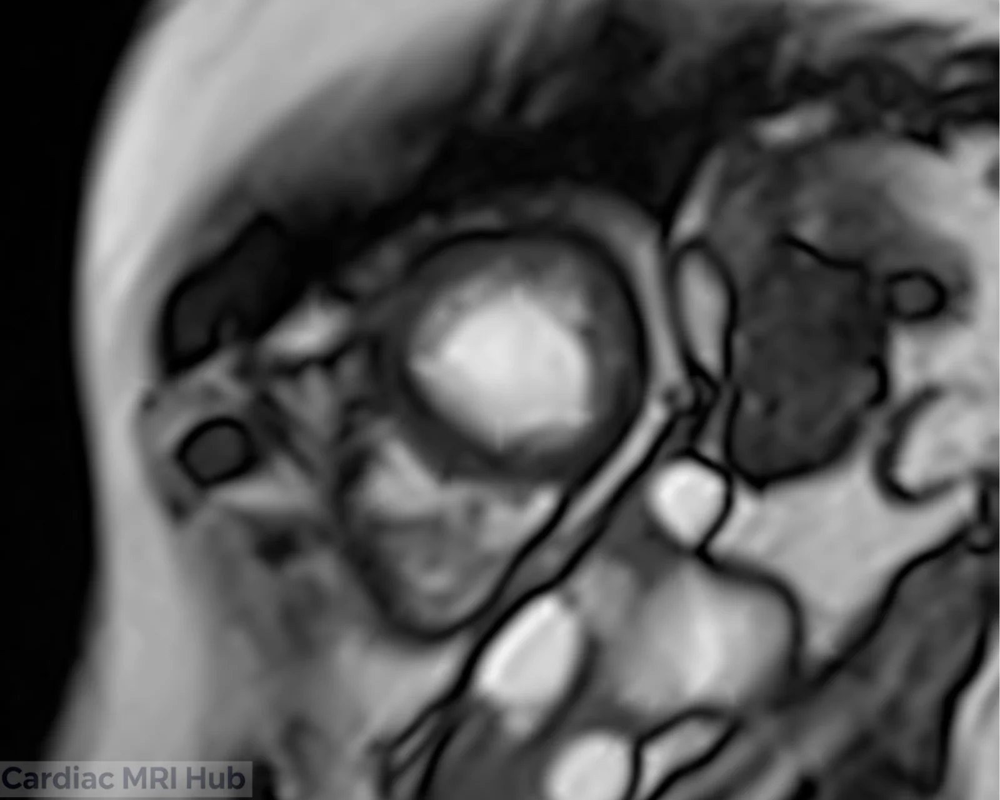

Proper sampling of the left ventricle in short axis orientation at base, mid, and apex levels is essential for technologists to master. Understanding the unique anatomy at each level ensures precise volumetric quantification and comprehensive wall motion analysis.

# Short Axis Sample (Base Mid Apex)

 slices shown above.")

The base slice to left is too close to LVOT, want to see full circle of myocardium shown in image on right.

The pictures to the right and left are a mid ventricle slice with papillary muscle shown.

Pictures to the right and left show slice at the apical level.

**Overview:** The left ventricle short axis (SAX) view is captured as contiguous slices—or samples—at distinct anatomic levels: **base**, **mid**, and **apex**. This segmentation enables precise regional and global analysis, essential for chamber quantification, wall motion, and tissue characterization.

# 1. Level-Specific Anatomy & Clinical Value

- **Basal Slice**
  - Imaging Plane: Near the mitral valve annulus.
  - Structures Visualized: LV inflow, mitral valve leaflets, basal interventricular septum, RV inflow, and atrioventricular junction.
  - Clinical Use: Essential for evaluating valve morphology, basal wall motion, and detecting basal septal hypertrophy or signal dropout from partial volume effects.
- **Mid-Ventricular Slice**
  - Imaging Plane: At the height of the papillary muscles.
  - Structures Visualized: Papillary muscles in full profile, mid LV wall segments (anteroseptal, lateral, inferior, anterior), clear demarcation between LV and RV.
  - Clinical Use: Key for regional wall motion assessment, papillary muscle analysis, precise quantification of LV volumes, and ischemia/infarction mapping.
- **Apical Slice**
  - Imaging Plane: Just above the true apex, away from mitral and papillary muscle landmarks.
  - Structures Visualized: LV cavity narrows to a point; thin myocardium, minimal RV contribution, no valve or papillary muscle imagery.
  - Clinical Use: Crucial for identifying apical aneurysm, thrombus, or small region infarction; supports accurate LV cavity closure in volumetric calculations.

# 2. Planning and Acquisition

- **Slice Placement**
  - Using 2ch & 4ch, plan perpendicular stacks from base (mitral plane) to apex, with no slice gap, ensuring complete LV coverage. Then choose slices from the short axis stack, sample slice locations should match a slice from the planned stack.
  - Base slice: Avoid including the LV outflow tract or aorta: stay true to mitral annulus.
  - Mid slice: Center through papillary muscles; verify position on long-axis views.
  - Apex slice: Capture thinned, distal LV cavity, without overlapping mid-ventricle.

# 3. Application in Disease Assessment

- **Volume and Function**
  - All three levels contribute to precise calculation of end-diastolic and end-systolic volumes, ejection fraction, and LV mass.
  - Segmental wall motion analysis identifies ischemia, infarction, or dyssynchrony (uncoordinated contraction) of the left ventricle.
- **Tissue Characterization**
  - LGE, T1/T2 mapping, and perfusion can be applied to all levels for detailed disease localization (e.g., apical fibrosis in HCM, basal edema in myocarditis, mid-wall scarring in DCM).

# 4. Troubleshooting & Optimization

- **Artifact Avoidance**
  - Basal images: Watch for flow artifacts from mitral inflow.
  - Apical images: Use tight FOV to maximize SNR.
  - All levels: Sequence parameters (temporal resolution, bandwidth) should be set for optimal motion capture and tissue detail.

# 5. Post-Processing and Reporting

- Quantify regional wall thickness, motion, and tissue characteristics.
- Include level-specific findings (e.g., basal hypertrophy, mid-wall scar, apical thrombus) in reporting for anatomical and clinical accuracy.

# 6. Educational Takeaways & Best Practices

- **Attention to Planning**
  - Ensure that sample slice locations match exact slice locations from short axis to maintain high quality analysis.
- **Clinical Pearls**
  - Base: Double-check for valve movement or aortic root inclusion on basal images—replan if present.
  - Mid: Papillary muscles serve as a reliable landmark for reproducible mid-slice position.
  - Apex: Thin myocardium may be susceptible to partial volume—use high-resolution and smaller FOV if needed.

# Summary Table: Short Axis Slice Levels

| Level | Landmarks | Structures Visualized | Clinical Focus |
|---|---|---|---|
| Base | Mitral valve annulus | Mitral valve, basal LV & septum, RV | Valve morphology, basal wall |
| Mid | Papillary muscle plane | Papillary muscles, mid LV walls & RV | Wall motion, ischemia, volume |
| Apex | Distal cavity, above true apex | Thin LV wall, minimal RV | Apex aneurysm, closure, scar |

**Conclusion:** Sampling the left ventricle in short-axis views at the base, mid, and apex is essential for accurate volumetric analysis, monitoring segmental function, and precise localization of tissue diseases. Mastering level-specific planning is crucial for effective diagnostics and customized reporting in every cardiac MRI examination.
