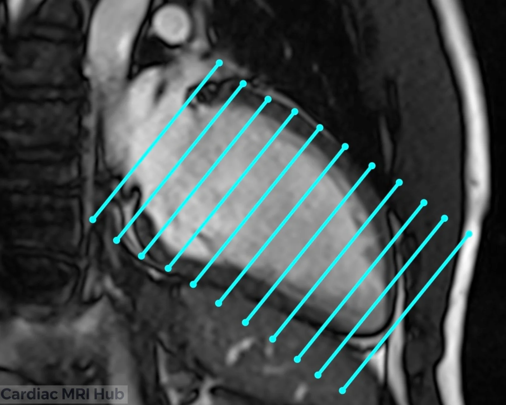
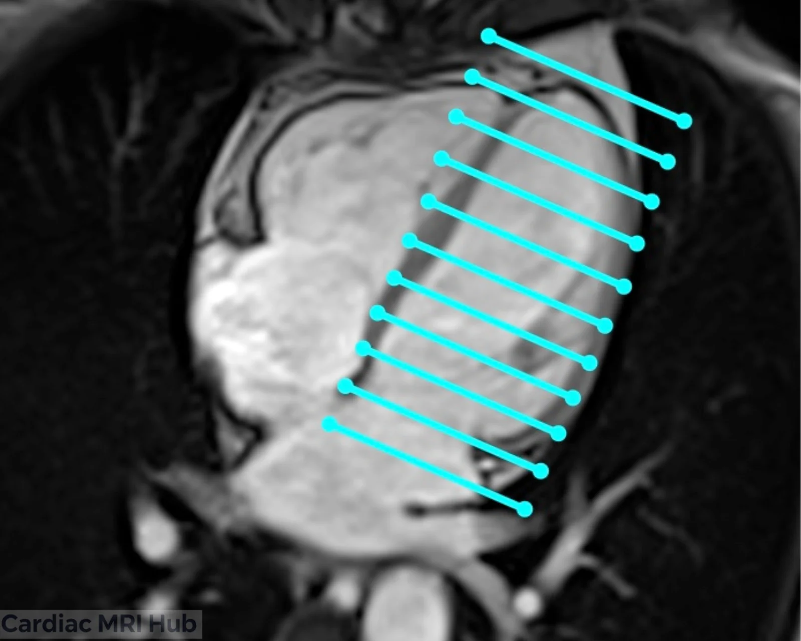
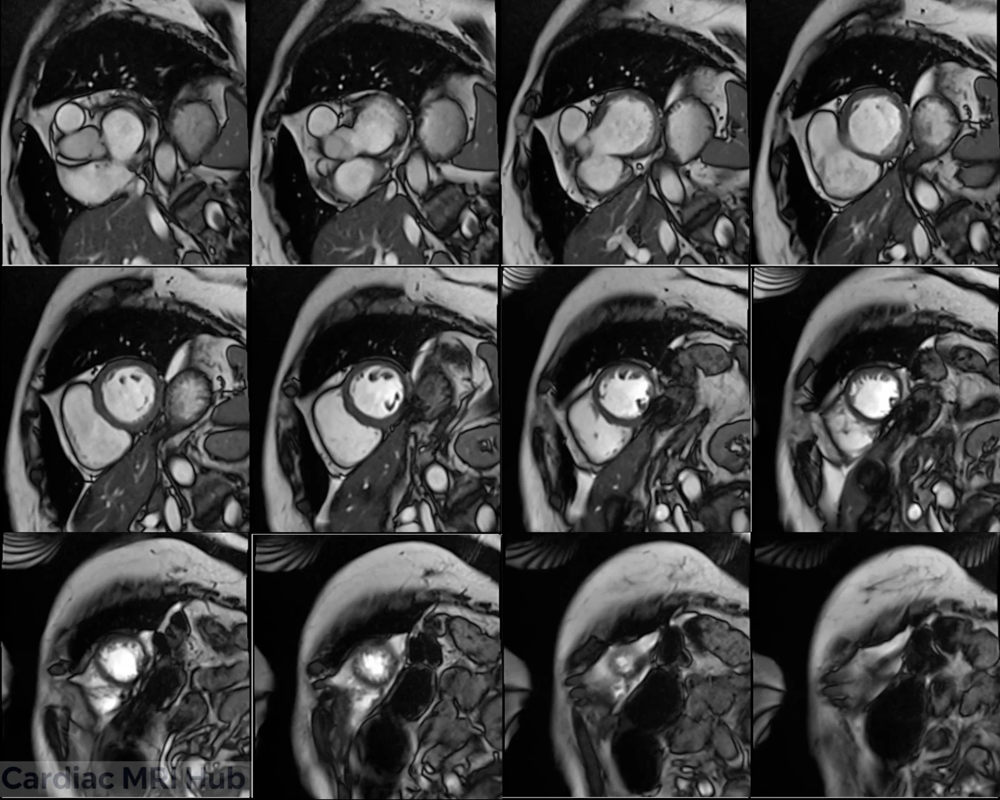

The short-axis (SAX) stack is the main way to measure the LV in cardiac MRI. The slices run perpendicular to the long axis of the LV, from the mitral valve plane at the base to the true apex, and cover the whole LV so volumes are accurate at both end-diastole and end-systole.

# Plan it

1. **On the 2-chamber,** place the stack perpendicular to the long axis of the LV, from the mitral valve plane to the apex.

2. **On the 4-chamber,** check the same stack: perpendicular to the long axis, covering the LV from the base to the apex.

# Check it

- The stack covers the whole LV, from the mitral valve plane to the true apex. If the base is cut off, end-diastolic volume comes out too low: add slices at the base.
- The slices are perpendicular to the LV long axis on both the 2-chamber and the 4-chamber. A tilted stack can make the walls look thicker than they are: replan it on both views.
- Slices aren't too thick and gaps aren't too large, or small infarcts and areas of hypertrophy get missed. Keep to the settings below.

# Key settings

- **Slice thickness:** 6–8 mm, with or without a 2–4 mm gap (10 mm in all); LGE uses the same thickness as the cines.
- **Field of view:** 280–350 mm, adjusted to the patient.
- **Temporal resolution:** 45 ms or less (real time 60 ms or less).
- **Gating:** retrospective ECG gating, 25–30 phases.
- **Breath-hold:** 8–12 seconds.

The full settings table is under More detail.

# More detail

Each short-axis slice is a cross-section through the left ventricle (LV), right ventricle (RV), interventricular septum (IVS), lateral wall (LW), anterior wall (AW), inferior wall (IW), inferoseptal wall (ISW) and papillary muscles.

# 1. What it's used for

- **Volumes**
  - The reference method for LV and RV volumes, mass and ejection fraction.
  - Used to follow heart failure, hypertrophy and cardiomyopathy.
- **Wall motion**
  - Shows regional wall motion, for ischemia, infarction and dyskinesis.
  - The papillary muscles help assess the mitral valve and the structures under it.
- **Tissue characterization**
  - LGE, T1 and T2 mapping by segment: fibrosis, scar, edema or infiltration.
- **Follow-up**
  - Repeat scans to track myocarditis, amyloidosis and the effects of chemotherapy.

# 2. Planning and acquisition

- **Orientation and planning**
  - Slices run perpendicular to the long axis of the LV, from the mitral annulus (base) to the true apex on the 2ch and 4ch.
  - Keep the LV outflow tract out of the basal slices, and make sure the stack cuts cleanly through the mid-ventricle and papillary muscles.
  - Check against the 2ch and 4ch so the LV isn't foreshortened.
- **Coverage**
  - Cover the whole LV: basal (mitral valve plane), mid (papillary muscles) and apical (just above the apex).
  - Include the RV when RV volumes are needed.
- **Patient positioning**
  - Supine, arms positioned to avoid coil artifact.
  - Check the patient can hold their breath; practice before scanning if you can.
- **Slice thickness and resolution**
  - Cines: 6–8 mm slices, ideally with no gap, for function.
  - LGE uses the same slice thickness as the cines.
  - Use slices under 6 mm when you need higher resolution.
- **Field of view (FOV)**
  - Standard adult FOV: 280–350 mm, adjusted for body size; phase FOV ideally 75% or more.
  - Check the LV and nearby structures are covered on every slice.
- **Timing**
  - Retrospective ECG gating to cover the whole cardiac cycle (25–30 phases). Temporal resolution 45 ms or less (real time 60 ms or less).
  - For tissue characterization, target mid-diastole or the phase with the least motion.
- **Common pitfalls**
  - Base not fully included: end-diastolic volume comes out too low.
  - Slices too thick or gaps too large: small infarcts or areas of hypertrophy are missed.
  - Stack not perpendicular to the true LV axis: measurements and reading suffer.

# 3. Contrast and tissue characterization

- **Gadolinium contrast**
  - LGE shows infarction, fibrosis and non-ischemic scar, with enough slices to measure it by segment. With arrhythmia, consider single-shot or motion-corrected LGE.
  - Timing (10 minutes after injection) and a well-set inversion time separate myocardium from the blood pool.
- **Other sequences (T1 and T2 mapping, perfusion)**
  - Consider T1, T2 and extracellular volume (ECV) mapping, especially for diffuse disease such as amyloidosis and myocarditis.

# 4. Troubleshooting

- **Artifacts**
  - Motion: respiratory gating for patients who struggle with breath-holds, or free breathing with motion correction.
  - Arrhythmia: arrhythmia rejection or single-shot sequences. Compressed sensing helps if you have it.
  - Coil placement: center the coil over the heart for the best SNR, and use multiple coil arrays for more signal.
- **Watch during the scan**
  - Keep an eye on the ECG trace. Fix poor R-wave detection right away: skin prep, move the leads or change leads.
  - Talk with the patient throughout to keep them comfortable and still.
- **Adjusting the protocol**
  - Check with the radiologist on complex cases, especially congenital heart disease.
  - Adjust the number of slices, thickness and sequences to the clinical question and what the patient can tolerate.

# 5. Post-processing

- **Volumes and function**
  - Analysis software calculates LV and RV volumes, EF and myocardial mass.
  - Wall motion and scar are measured by region, which guides treatment.
- **Reporting**
  - Standard templates keep reports consistent: chamber sizes, volumes, EF, where the scar is and how much, and any abnormal findings (for example hypertrophy or delayed enhancement).

# 6. Clinical pointers

- **Wall motion by segment**
  - Used for ischemia, viability and follow-up after a heart attack.
- **Hypertrophy and remodeling**
  - Mass and wall thickness for staging cardiomyopathy and checking response to treatment.
- **Papillary muscles**
  - Show how the mitral valve works and where functional mitral regurgitation comes from.

# 7. Good habits

- Keep the stack truly perpendicular to the LV long axis, so measurements can be repeated.
- Adapt slice thickness, gap and sequence settings to the clinical question and the patient's anatomy.
- Ask the radiologist or referring clinician when the clinical question isn't clear.

# Summary Table: Short-Axis Settings

| Parameter | Recommendation (Adult) |
|---|---|
| Orientation | Perpendicular to LV long axis, mitral plane to apex |
| Slice Thickness | 6–8 mm with or without 2-4mm gap (to make total of 10mm), LGE: Same thickness as cine. |
| Field of View | 280–350 mm, adjusted to patient. |
| Phase Oversampling | Adjust to patient/FOV to avoid wrap. |
| Temporal Resolution | 45ms or less preferred (Real-time 60ms or less) |
| Resolution | 1.4-1.8mm preferred. |
| Bandwidth | Wide: 750-1300 Hz/Px (Higher reduces artifacts) |
| Flip Angle | 40-90 (CINE), 20-25 (LGE) |
| Parallel Imaging | GRAPPA 2 or parallel imaging |
| Compressed Sensing | Use when available to reduce acquisition time and motion artifacts, especially useful in patients with poor breath-hold or arrhythmia. |
| Timing | Retrospective ECG gating; 25–30 phases preferred. |
| Contrast | Gadolinium for LGE 10 mins post (delay timing will depend on dose and if stress/rest perfusion performed). Precise timing of TI needed to null myocardium. |
| Immobilization | Supine, coil centered over heart. |
| Breath-hold | 8-12 sec preferred. |
