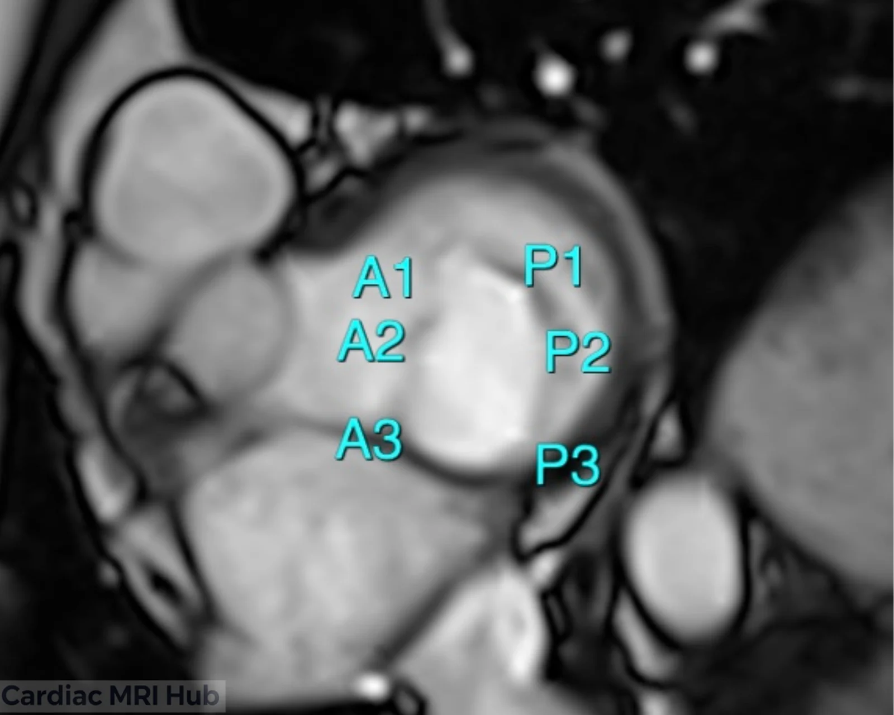
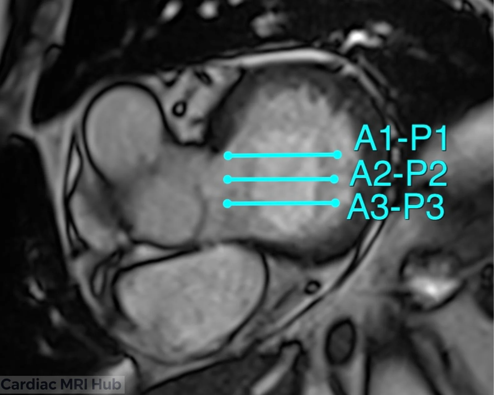
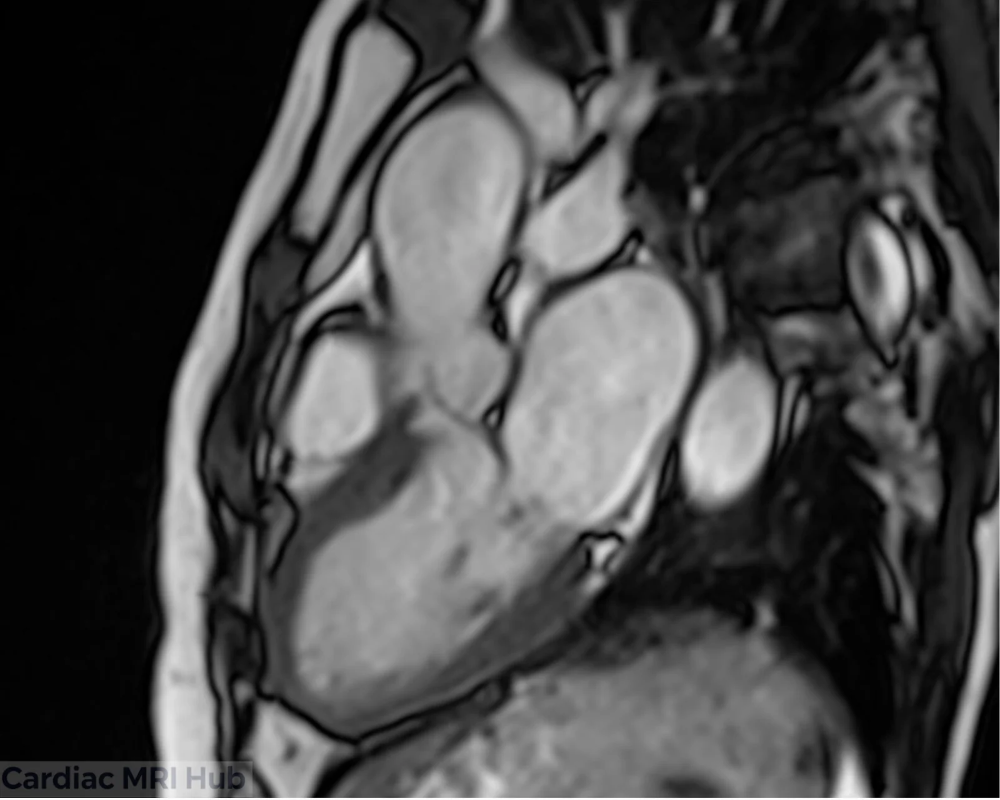
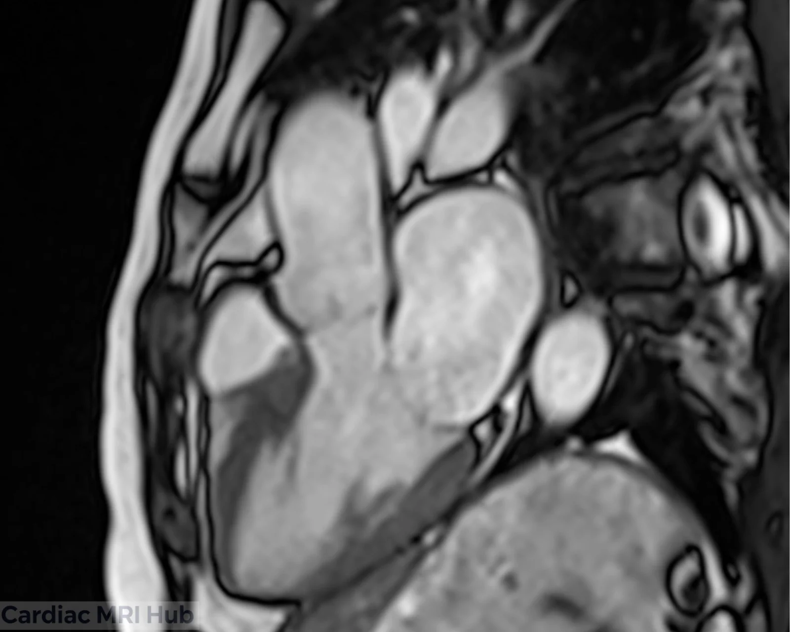
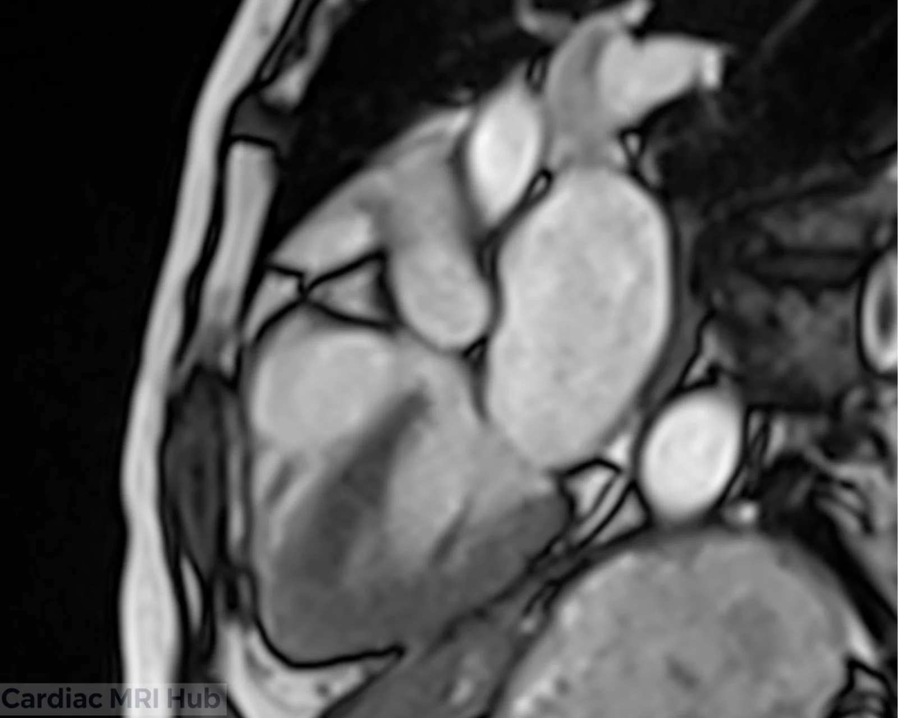

The mitral valve scallops view shows the mitral leaflets segment by segment: three anterior scallops (A1, A2, A3) and three posterior (P1, P2, P3), the Carpentier classification. It shows exactly where prolapse, regurgitation or other damage is, which matters for surgery and catheter procedures.

# Plan it

1. **On a basal short axis through the mitral valve,** find the scallops: A1–A3 on the anterior leaflet and P1–P3 on the posterior.

2. **On the same slice,** place three parallel slices across the valve, square to the line where the leaflets meet: A1–P1, A2–P2 and A3–P3.

# Check it

- Each slice crosses both leaflets at its matching pair: A1–P1, A2–P2 or A3–P3.
- Both leaflets show from the annulus to their tips. If a leaflet looks short or cut at an angle, the slice isn't square to where the leaflets meet: re-angle it on the basal short axis.
- The three slices are spread across the whole valve, so the end pairs (A1–P1 and A3–P3) aren't missed.

# Key settings

- **Cine:** bSSFP in the plane of the valve, ECG-gated, in a breath-hold.
- **Stenosis:** a contiguous or slightly overlapping stack of cines across the jet, from the valve opening downstream, to measure the opening.
- **Jets:** a gradient echo cine can show regurgitant jets more clearly than bSSFP; use it to see them, not to measure them.
- **Flow:** through-plane, just above the valve (about 5 mm); for stenosis, at the peak of the jet.
- **Regurgitation:** measure flow at the sinotubular junction and compare it with the LV stroke volume.

Flow planning for each valve and vessel is in [phase contrast planning](/guide/phase-contrast-planning/).

# More detail

# 1. Planning

- **Orientation:** a plane that shows the scallops clearly, with the leaflets and the structures around them.
- **Slice thickness:** thinner slices for more detail of the valve.
- **Field of view:** the whole mitral apparatus: annulus, leaflets and chordae tendineae.
- **Timing:** ECG-gated through the cardiac cycle, to show the valve opening and closing.
- **Contrast:** if it's part of the exam, contrast helps outline the valve.

# 2. What it's used for

- Mitral valve shape and function.
- Mitral valve prolapse or regurgitation.
- Related changes in the left atrium and ventricle.
- Follow-up of mitral valve disease.

# 3. What the view shows

- **Annulus:** size, shape and calcification; a dilated or restricted annulus can cause mitral regurgitation.
- **Leaflets:** the anterior and posterior leaflets, their motion and any abnormalities.
- **Scallops:** each scallop (A1, A2, A3, P1, P2, P3) in turn, to find prolapse, restricted motion or a perforation.
- **Coaptation:** where and how much the leaflets meet, to spot gaps, poor closure or prolapse.
- **Papillary muscles:** position, alignment and shape, which affect how the leaflets meet.
- **Chordae tendineae:** rupture or stretching that affects valve function.
