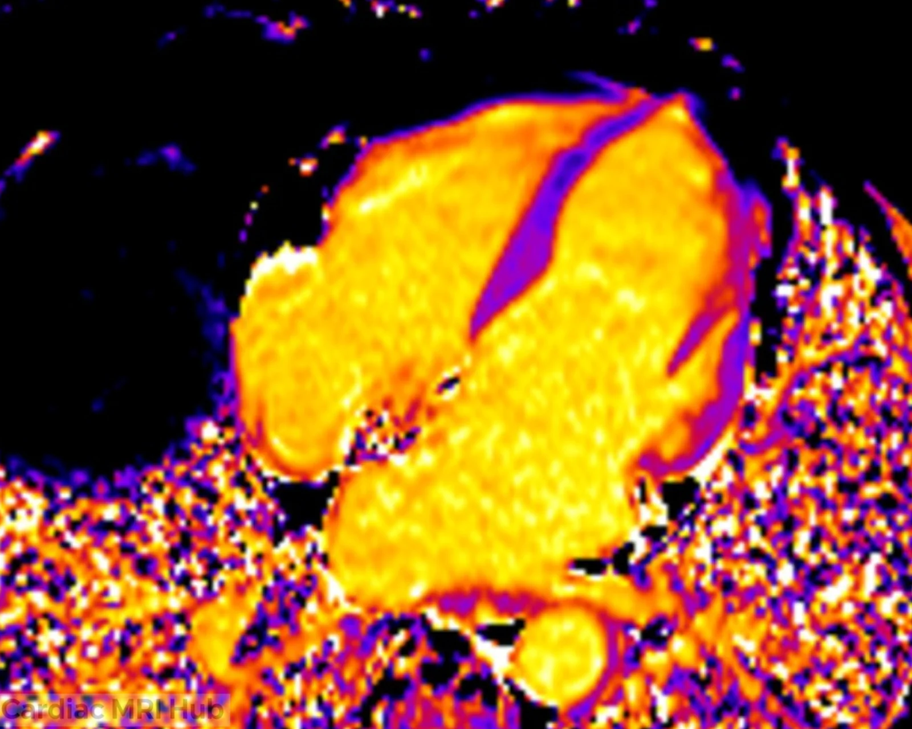
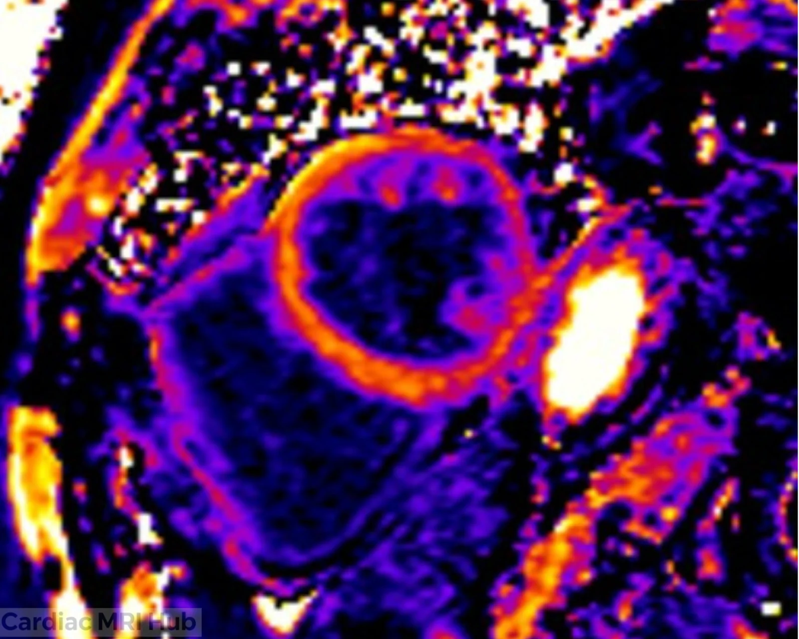

Cardiac MRI has become a vital tool for diagnosing and managing heart diseases. Among the various imaging techniques, MOLLI (Modified Look-Locker Inversion recovery) mapping stands out for its ability to provide detailed tissue characterization. But why do cardiac MRI technologists run MOLLI maps, and when might these maps not be needed? This post explores the purpose of MOLLI maps, their clinical value, and situations where skipping them makes sense.

# What Are MOLLI Maps and Why Are They Important?

MOLLI maps measure the T1 relaxation time of myocardial tissue. This quantitative data helps identify abnormalities such as fibrosis, edema, or infiltration that may not be visible on standard MRI sequences. By capturing T1 values before and after contrast administration, MOLLI maps allow clinicians to calculate extracellular volume (ECV), which reflects the amount of fibrosis or scarring in the heart muscle.

For cardiac MRI technologists, running MOLLI sequences is essential when the clinical question involves tissue characterization. For example:

- Detecting diffuse myocardial fibrosis in cardiomyopathies
- Assessing myocarditis or inflammatory changes
- Evaluating amyloidosis or other infiltrative diseases
- Monitoring treatment response in heart failure patients

The quantitative nature of MOLLI maps provides objective data that supports diagnosis and guides patient management. Without these maps, subtle changes in myocardial tissue might be missed, leading to incomplete assessments.

# How MOLLI Mapping Works in Practice

MOLLI sequences use a series of inversion recovery pulses to sample the longitudinal relaxation of myocardial tissue. The resulting images are processed to generate pixel-wise T1 maps. These maps display color-coded T1 values, making it easier to spot abnormal areas.

From a technologist’s perspective, acquiring MOLLI maps requires careful timing and patient cooperation. Breath-holding is often necessary to reduce motion artifacts. The technologist must also select the correct imaging planes, usually short-axis views of the left ventricle, to capture relevant myocardial segments.

The post-processing software then calculates native T1 values and, if contrast is used, post-contrast T1 and ECV. These numbers help cardiologists interpret the underlying pathology.

# Best Imaging Planes for MOLLI Maps

MOLLI maps are typically acquired in short-axis views of the left ventricle, which provide the most comprehensive myocardial coverage and are essential for accurate T1 mapping. The standard approach includes three short-axis slices:

- Basal slice (near the mitral valve)
- Mid-ventricular slice (at the papillary muscle level)
- Apical slice (beyond the papillary muscles)

These views match the standard cardiac imaging planes used for cine imaging, making it easier to correlate T1 mapping findings with functional assessments. However, while cine images show cardiac motion and function throughout the cardiac cycle, MOLLI maps provide static tissue characterization by measuring T1 relaxation times. This makes MOLLI maps particularly valuable for detecting diffuse myocardial changes like fibrosis or inflammation that may not alter wall motion visible on cine sequences.

In some cases, long-axis views (2-chamber, 3-chamber, or 4-chamber) may be added to evaluate specific regions of interest or to assess focal abnormalities identified on other sequences. The key is selecting views that capture the area of clinical concern while maintaining consistent slice positioning for pre- and post-contrast comparisons.

# Beyond T1: T2 and T2\* Mapping in Cardiac MRI

While T1 mapping with MOLLI is the most commonly used parametric mapping technique in cardiac MRI, T2 and T2\* mapping provide complementary information that's essential in certain clinical scenarios.

T2 mapping measures the transverse relaxation time and is particularly valuable for detecting myocardial edema, which appears as elevated T2 values. This makes T2 mapping crucial for:

- Diagnosing acute myocarditis or myocardial inflammation
- Identifying the area at risk in acute myocardial infarction
- Assessing active inflammation in cardiac sarcoidosis
- Evaluating transplant rejection

T2\* (T2-star) mapping is specialized for detecting iron deposition in the myocardium. Decreased T2\* values indicate iron overload, making this technique essential for monitoring patients with conditions such as thalassemia, hemochromatosis, or multiple blood transfusions. Iron overload cardiomyopathy is a serious complication that requires regular monitoring, and T2\* mapping at 1.5T is the gold standard for assessing cardiac iron.

Like MOLLI maps, both T2 and T2\* mapping are typically acquired in short-axis views matching the standard cardiac imaging planes. Technologists should be familiar with these additional mapping techniques as they complement T1 mapping to provide a comprehensive tissue characterization assessment when clinically indicated.

# When MOLLI Maps Are Not Needed

While MOLLI mapping offers valuable insights, it is not required in every cardiac MRI exam. Skipping MOLLI sequences can save time and reduce patient discomfort when tissue characterization is not the primary goal.

Situations where MOLLI maps may be unnecessary include:

- Routine assessment of cardiac function and morphology without suspicion of myocardial disease
- Evaluation of congenital heart defects where anatomy is the main focus
- Cases where late gadolinium enhancement (LGE) imaging alone provides sufficient information
- Patients unable to hold their breath or cooperate for MOLLI acquisition, leading to poor image quality

In these cases, technologists can prioritize other sequences such as cine imaging, perfusion, or LGE to answer the clinical question efficiently.

# Practical Tips for Cardiac MRI Technologists

To make the best use of MOLLI maps, technologists should:

- Confirm the clinical indication for MOLLI mapping before scanning
- Optimize patient positioning and breath-hold instructions to minimize motion artifacts
- Use standardized imaging planes to ensure reproducibility
- Communicate with radiologists or cardiologists about image quality and any challenges during acquisition
- Be aware of contraindications such as severe arrhythmias that may affect MOLLI accuracy

By following these practices, technologists can improve the diagnostic value of MOLLI maps and contribute to better patient outcomes.

# Summary

MOLLI maps play a crucial role in cardiac MRI by providing detailed tissue characterization through T1 mapping. They help detect fibrosis, inflammation, and infiltration that standard imaging might miss. Cardiac MRI technologists run MOLLI sequences when the clinical question requires this level of detail.

However, MOLLI maps are not always necessary. For exams focused on anatomy, function, or when patient cooperation is limited, skipping MOLLI can save time without compromising diagnostic quality. Understanding when to use MOLLI maps helps technologists tailor scans to each patient’s needs and supports accurate diagnosis.

For technologists, mastering MOLLI acquisition techniques and knowing when to apply them ensures cardiac MRI remains a powerful tool in heart disease evaluation. If you are involved in cardiac MRI, consider how MOLLI mapping fits into your workflow and discuss with your clinical team when it adds value.
