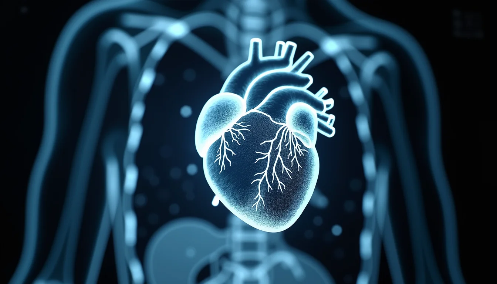

Cardiac MRI has become an essential tool in diagnosing and managing heart diseases. Its ability to provide detailed images of the heart’s structure and function makes it invaluable for detecting a wide range of cardiac pathologies. However, understanding and interpreting cardiac MRI requires access to reliable resources that explain the pathology clearly and comprehensively. This post guides you through the key resources that help medical professionals, students, and researchers grasp cardiac MRI pathology effectively.

# Understanding Cardiac MRI Pathology

Cardiac MRI pathology involves identifying abnormalities in heart tissues, such as scarring, inflammation, or abnormal blood flow. These abnormalities can indicate conditions like cardiomyopathy, myocarditis, ischemic heart disease, or congenital defects. Unlike other imaging methods, cardiac MRI offers high-resolution images without radiation, making it safer for repeated use.

To interpret these images accurately, one must understand the underlying pathology and how it appears on MRI scans. This requires a combination of theoretical knowledge and practical examples, which is why quality resources are critical.

# Textbooks and Reference Books

Several textbooks provide a solid foundation in cardiac MRI pathology. These books cover the basics of MRI physics, cardiac anatomy, and detailed pathology descriptions.

- **"Cardiovascular Magnetic Resonance" by Scott D. Flamm and Raymond J. Kim**

This book offers comprehensive coverage of cardiac MRI techniques and pathology. It includes case studies and image examples that help readers connect theory with practice.

- **"Clinical Cardiac MRI" by Robert M. Judd and Raymond J. Kim**

Focused on clinical applications, this book explains how to identify various cardiac diseases using MRI. It is useful for clinicians who want to improve diagnostic accuracy.

- **"MRI of the Heart" by Peter D. Gatehouse and David N. Firmin**

This resource dives into technical aspects and pathology interpretation, making it ideal for radiologists and cardiologists.

These books often include detailed images and explanations of common pathologies such as myocardial infarction, hypertrophic cardiomyopathy, and cardiac tumors.

# Online Educational Platforms

Online platforms offer interactive learning experiences and up-to-date information on cardiac MRI pathology. They are accessible and often include video lectures, quizzes, and case discussions.

- **Radiopaedia.org**

This free radiology resource has an extensive cardiac MRI section with annotated images and pathology explanations. It is regularly updated by experts worldwide.

- **American College of Cardiology (ACC) Learning Hub**

The ACC provides courses and webinars on cardiac imaging, including MRI. These resources focus on clinical relevance and recent advances.

- **Society for Cardiovascular Magnetic Resonance (SCMR)**

SCMR offers educational materials, guidelines, and case libraries that cover cardiac MRI pathology in detail.

Using these platforms allows learners to see real-world examples and test their knowledge, which enhances understanding.

# Research Articles and Journals

Staying current with research helps deepen knowledge of cardiac MRI pathology. Peer-reviewed journals publish studies on new imaging techniques, pathology findings, and clinical outcomes.

- **Journal of Cardiovascular Magnetic Resonance**

This journal specializes in cardiac MRI research, including pathology studies. Articles often include detailed imaging findings correlated with histopathology.

- **Circulation: Cardiovascular Imaging**

It covers a broad range of cardiovascular imaging topics, with many papers focusing on MRI pathology.

- **European Heart Journal – Cardiovascular Imaging**

This journal publishes clinical and research articles that explore cardiac diseases through imaging.

Accessing these journals through medical libraries or online databases like PubMed allows readers to explore the latest discoveries and evidence-based practices.

# Case Studies and Image Libraries

Practical examples are crucial for mastering cardiac MRI pathology. Case studies provide context and show how pathology appears in different patients.

- **Cardiac MRI Case Collections**

Many institutions and websites offer curated case collections with images and pathology descriptions. These cases often include clinical history, MRI findings, and follow-up data.

- **Teaching File Databases**

Teaching files from radiology departments or societies provide a wide range of pathology examples. They help learners recognize patterns and variations.

- **Interactive Image Atlases**

Atlases with annotated images allow users to explore cardiac anatomy and pathology in detail. They often include normal and abnormal examples side by side.

Using these resources helps bridge the gap between textbook knowledge and real-world application.

# Guidelines and Protocols

Understanding standardized imaging protocols and interpretation guidelines improves consistency and accuracy in diagnosing cardiac pathology.

- **SCMR Guidelines**

The Society for Cardiovascular Magnetic Resonance publishes protocols for image acquisition and interpretation. These guidelines ensure high-quality imaging and reliable pathology assessment.

- **American Heart Association (AHA) Recommendations**

AHA provides clinical guidelines that include cardiac MRI indications and interpretation criteria for various diseases.

- **European Society of Cardiology (ESC) Guidelines**

ESC guidelines integrate cardiac MRI findings into broader clinical management strategies.

Following these protocols helps clinicians produce reproducible results and make informed decisions based on MRI pathology.

# Software Tools for Image Analysis

Advanced software tools assist in analyzing cardiac MRI images, quantifying pathology, and improving diagnostic confidence.

- **Segment**

An open-source software that allows detailed analysis of cardiac MRI images, including tissue characterization and functional assessment.

- **Circle Cardiovascular Imaging**

This commercial software offers automated tools for detecting myocardial scar, edema, and other pathologies.

- **Medis Suite**

Provides comprehensive cardiac MRI analysis, including strain imaging and perfusion quantification.

These tools support clinicians and researchers by providing objective measurements and visualizations of cardiac pathology.

# Training Courses and Workshops

Hands-on training is essential for mastering cardiac MRI pathology interpretation.

- **SCMR Annual Scientific Sessions**

These conferences include workshops and courses focused on cardiac MRI pathology.

- **Radiology Society of North America (RSNA) Courses**

RSNA offers courses on cardiac imaging techniques and pathology interpretation.

- **University-Based Programs**

Many universities provide specialized training in cardiac MRI through fellowships or continuing education courses.

Participating in these programs helps build practical skills and stay updated with evolving imaging techniques.

# Summary of Key Resources

- **Resource Type:** Textbooks
  - Examples: "Cardiovascular Magnetic Resonance"
  - Benefits: In-depth theory and case studies
- **Resource Type:** Online Platforms
  - Examples: Radiopaedia, ACC Learning Hub, SCMR
  - Benefits: Engaging learning and current content
- **Resource Type:** Research Journals
  - Examples: Journal of Cardiovascular Magnetic Resonance
  - Benefits: Up-to-date research and evidence-based data
- **Resource Type:** Case Studies & Atlases
  - Examples: Teaching files, image libraries
  - Benefits: Real-world examples and pattern recognition
- **Resource Type:** Guidelines & Protocols
  - Examples: SCMR, AHA, ESC
  - Benefits: Consistent imaging and interpretation
- **Resource Type:** Software Tools
  - Examples: Segment, Circle Cardiovascular Imaging, Medis Suite
  - Benefits: Precise analysis and visualization
- **Resource Type:** Training Courses
  - Examples: SCMR sessions, RSNA courses, university programs
  - Benefits: Practical experience and skill enhancement

# Final Thoughts

Mastering cardiac MRI pathology requires a combination of solid theoretical knowledge, practical experience, and access to reliable resources. Textbooks provide foundational understanding, while online platforms and case studies offer interactive and real-world learning. Research articles keep you informed about the latest developments, and guidelines ensure consistent practice. Software tools and training courses further enhance your ability to interpret complex cardiac MRI images accurately.

Whether you are a medical student, radiologist, cardiologist, or researcher, using these key resources will strengthen your understanding and improve patient care through better diagnosis and management of cardiac diseases.

Explore these resources actively and integrate them into your learning routine to become proficient in cardiac MRI pathology interpretation.
