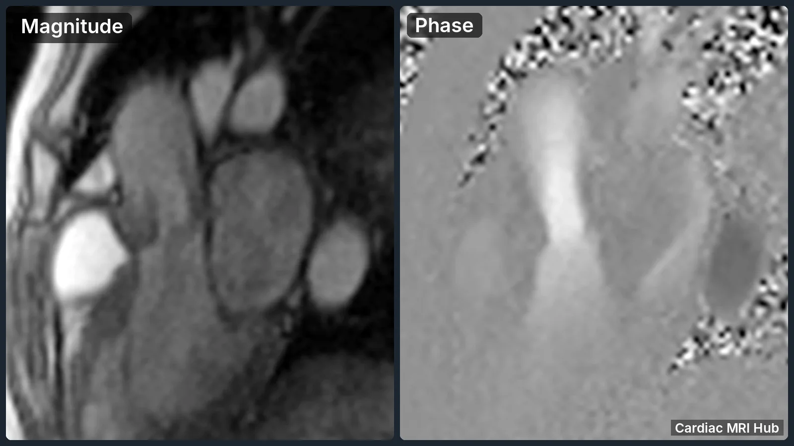
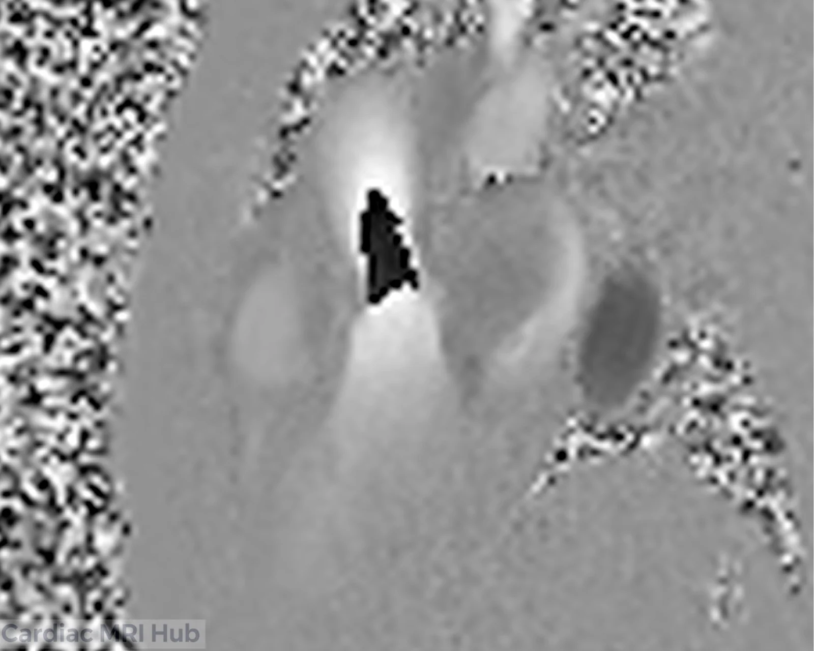
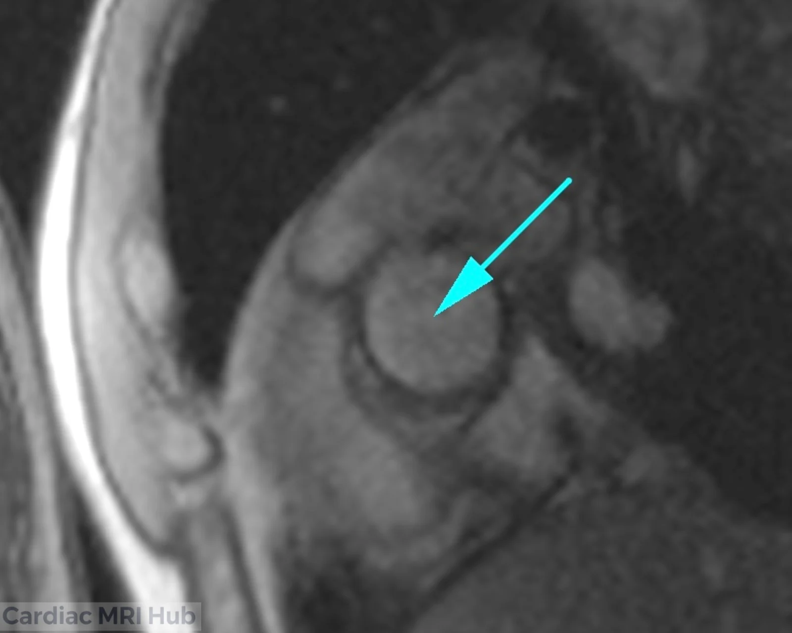

Phase contrast imaging measures blood flow and velocity in the heart and vessels. This guide covers what it is, how it differs from cines and mapping, when to add it, and where to place it.

# What Is Phase Contrast Imaging?

Phase contrast measures how fast fluid, mostly blood, is moving by encoding its velocity into the phase of the MR signal. Standard images show tissue structure; phase contrast shows flow: its pattern, direction and speed.

It works by applying bipolar gradients. Moving spins, such as flowing blood, pick up a phase shift in proportion to their velocity. Stationary tissue doesn't, so moving and still structures separate clearly.

# What it adds

Phase contrast gives you things no other sequence does:

- **Flow measurements:** flow volume and velocity, for valve function, shunts and whether vessels are open.
- **Flow direction:** cines show motion but not which way blood is going; phase contrast does, which shows regurgitation and abnormal flow.
- **Pressure gradients without a catheter:** flow measurements estimate gradients non-invasively.
- **It fills the gap:** cines show wall motion and function, mapping shows tissue, and phase contrast measures flow.

# Compared with cines and mapping

How phase contrast compares:

- **What it measures:** flow velocity and volume. Cines show wall motion and function; mapping measures tissue properties (T1, T2).
- **Flow direction:** only phase contrast shows it.
- **Numbers:** flow volume, velocity and regurgitant fraction. Cines give limited motion information, and mapping gives no flow data.
- **Hemodynamics:** pressure gradients and flow, which cines and mapping can't provide.
- **Valves:** phase contrast shows valve function through flow; cines show the valve itself.

So phase contrast works alongside cines and mapping, not instead of them.

It's especially useful for:

- How severe valve regurgitation is, by measuring backward flow.
- Shunts such as atrial or ventricular septal defects, by measuring flow across them.
- Vessel narrowing, from the change in velocity.
- Cardiac output, from flow in the ascending aorta or pulmonary artery.

# When to add it

Add phase contrast when the clinical question or the first images call for it:

- **Valve disease:** cines show an abnormal valve or regurgitation; phase contrast measures how severe it is.
- **Shunts or congenital heart disease:** a septal defect or abnormal connection is suspected; phase contrast measures the shunt.
- **Cardiac output:** to calculate stroke volume and cardiac output.
- **Vessel disease:** flow in the aorta, pulmonary arteries or veins, for stenosis or aneurysm.
- **Unexplained symptoms:** when the symptoms suggest abnormal flow that standard images don't show.

Check the cines and the clinical history before adding phase contrast. If you see abnormal flow or a valve problem, phase contrast gives the numbers.

# Where to place it

The location decides what you can measure. Common sites:

- **Ascending aorta:** cardiac output and aortic valve flow.
- **Pulmonary artery:** pulmonary blood flow and valve function.
- **Mitral and aortic valves:** regurgitation or stenosis.
- **Superior and inferior vena cava:** venous flow in complex congenital cases.
- **Descending aorta:** flow past a coarctation or other narrowing.

Set the plane perpendicular to the vessel or the direction of flow, planned from the localizers and cines, so the velocity is measured correctly.

# Tips

- **VENC:** choose it from the velocity you expect. Too low causes aliasing; too high loses sensitivity. Use the lowest VENC that doesn't alias, and raise it if the phase images alias.[\[SCMR 2020\]](https://pmc.ncbi.nlm.nih.gov/articles/PMC7038611/) Aim for about 10% above the fastest flow you expect, and no more than 25% above. Starting points from the 4D flow consensus:[\[Bissell 2023\]](https://pmc.ncbi.nlm.nih.gov/articles/PMC10357639/)
  - Aorta and pulmonary artery: 150 cm/s
  - Inside the heart: 100–150 cm/s
  - Veins: 50–80 cm/s
  - False lumen of a dissection: 50–150 cm/s
  - Suspected stenosis with no earlier flow study: start at 250 cm/s
- **Breath-holds:** use them when you can, to cut motion artifacts.
- **ECG gating:** gate to the heartbeat for accurate timing.
- **Check before you finish:** look for aliasing, misalignment and artifacts before the patient leaves.
- **Ask:** check with the radiologist or cardiologist when the flow question isn't clear.

# In short

Phase contrast measures blood flow: its speed, direction and volume. Cines show anatomy and motion, and mapping shows tissue; phase contrast adds the flow.

Use it for valve regurgitation, shunts, cardiac output and vessel disease. Choose the VENC for the velocity you expect (from 50–80 cm/s for veins to a 250 cm/s start for a suspected stenosis), keep the plane perpendicular to flow, use breath-holds and ECG gating, and check for aliasing before the patient leaves.

