Phase contrast measures how fast blood moves through a valve or vessel, and how much of it. It's used for valve regurgitation and stenosis, shunts and cardiac output.

# Plan it

For through-plane flow, place the slice across the middle of the vessel, square to the flow on two views at right angles. Set the VENC before you run it (see Key settings).

## Aorta (LVOT)

1. **On the 3-chamber,** place the line across the ascending aorta at the sinotubular junction (STJ), square to the aorta.

.")

2. **Fine-tune on the 3-chamber:** keep the line at the STJ and angle it square to the fastest flow. The cine shows where the jet runs.

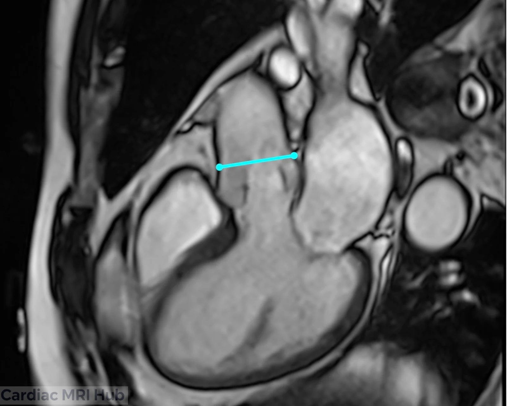

3. **On the coronal aorta (Cor Ao),** check that the line is at the STJ and square to the aorta.

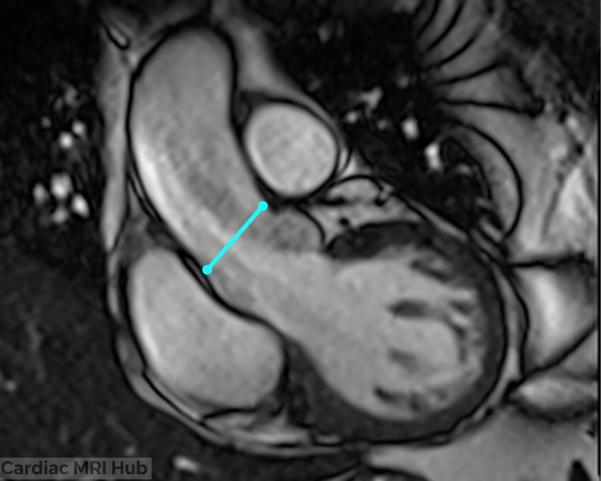

That gives this through-plane image. The aorta should be a circle:

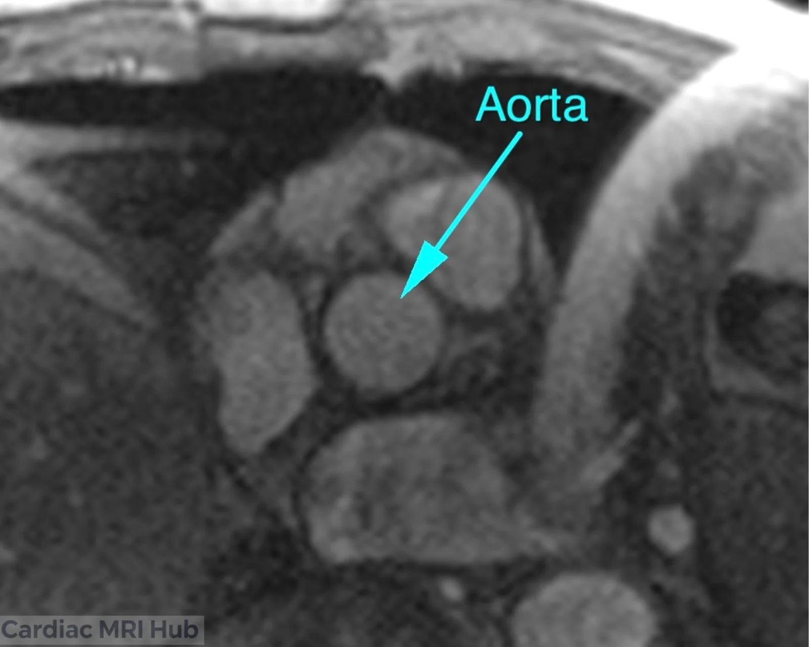

")

## Pulmonary artery (RVOT)

1. **On the coronal,** place the line across the main pulmonary artery, square to it.

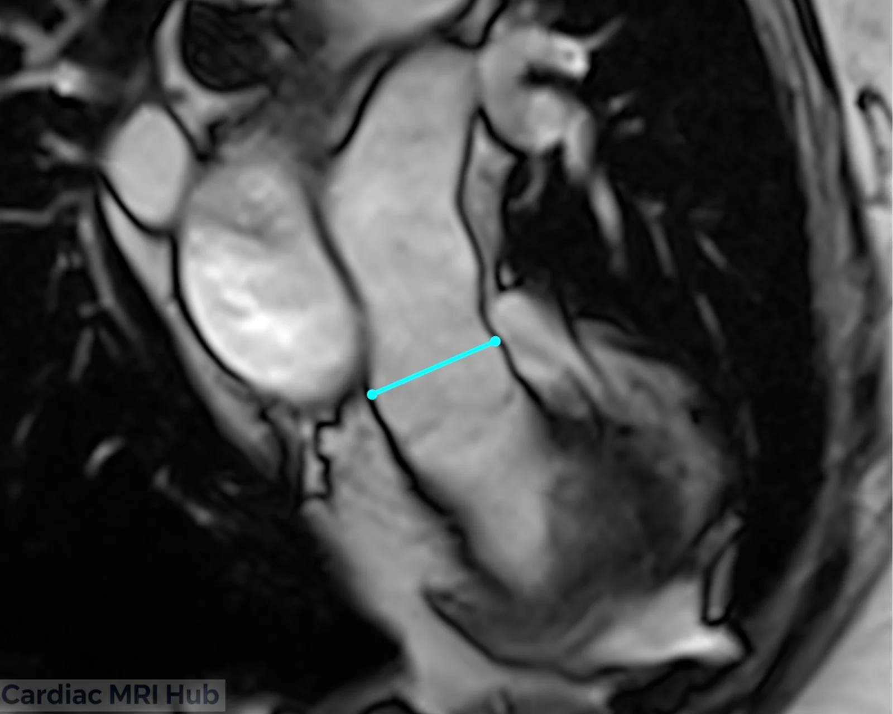

2. **On the sagittal RVOT,** place the line across the RVOT or main pulmonary artery, above the pulmonary valve and square to it.

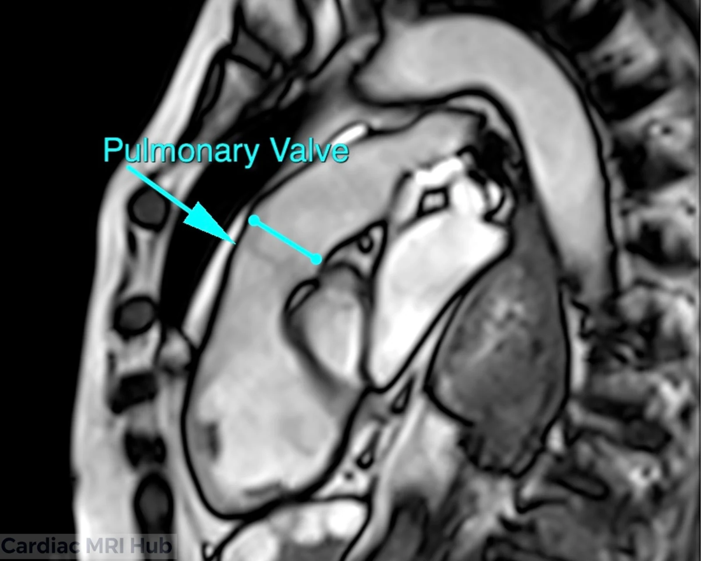

That gives this through-plane image:

")

")

## Branch pulmonary arteries

1. **On an axial through the main and right pulmonary arteries,** place a line across each one (MPA and RPA), square to the vessel.

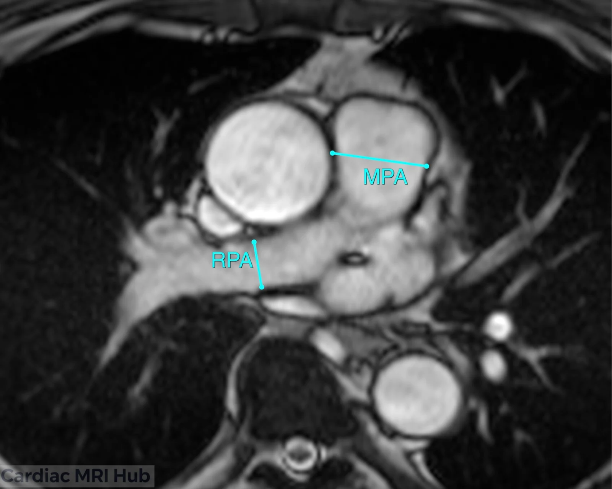

2. **On an axial through the left pulmonary artery,** place the line across the LPA.

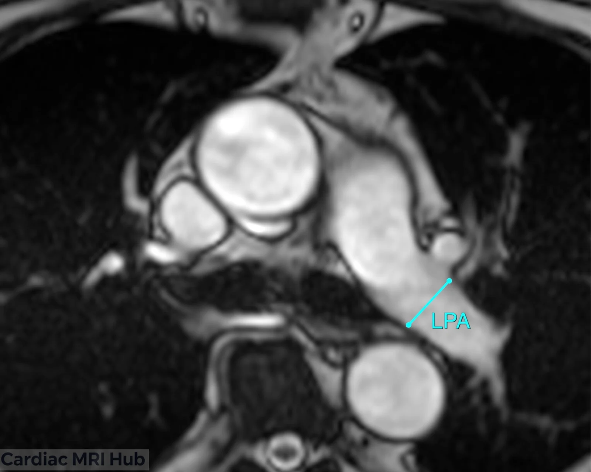

## Pulmonary veins

1. **On the axial stack,** place the line across the right inferior pulmonary vein, square to it.

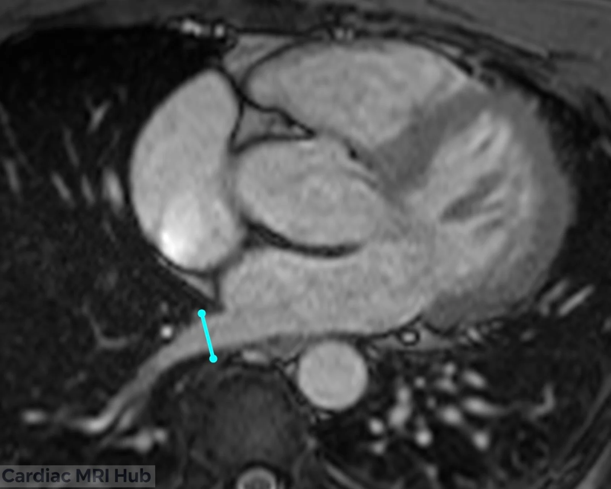

2. **On another axial,** place lines across the right superior pulmonary vein and the left pulmonary vein.

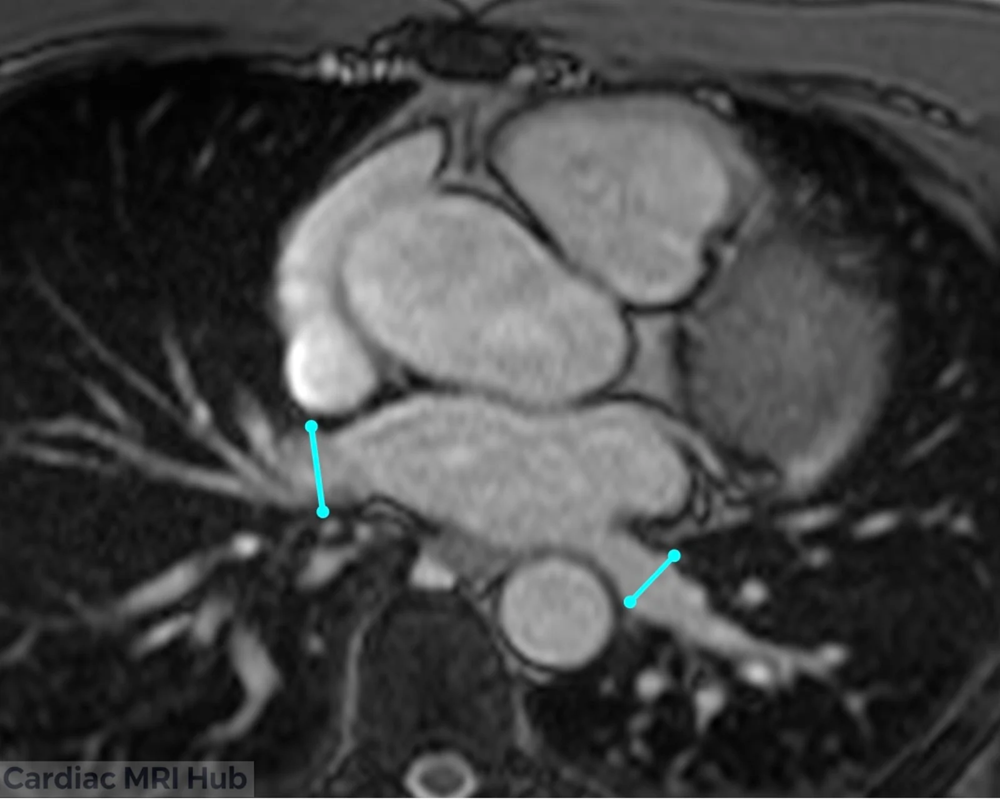

## Atrial septal defect

1. **On the 4-chamber,** plan the through-plane slices at the atrial septal defect (ASD).

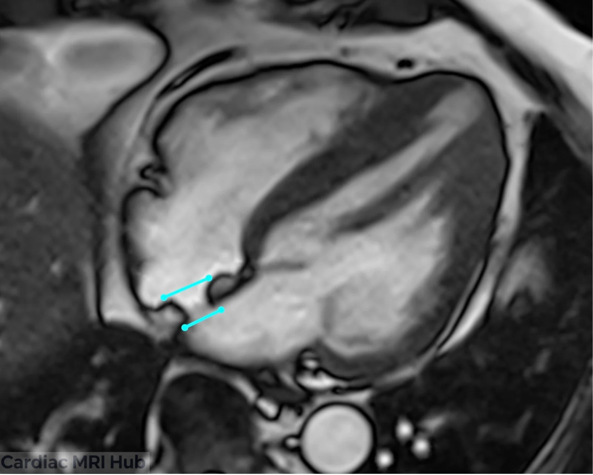

## SVC and IVC

1. **On the bicaval,** place one line across the SVC at the level of the right pulmonary artery, and one across the IVC just above the liver.

 and IVC (at level above liver).")

## Mitral and tricuspid valves

1. **On the 4-chamber,** place a line just above each valve.

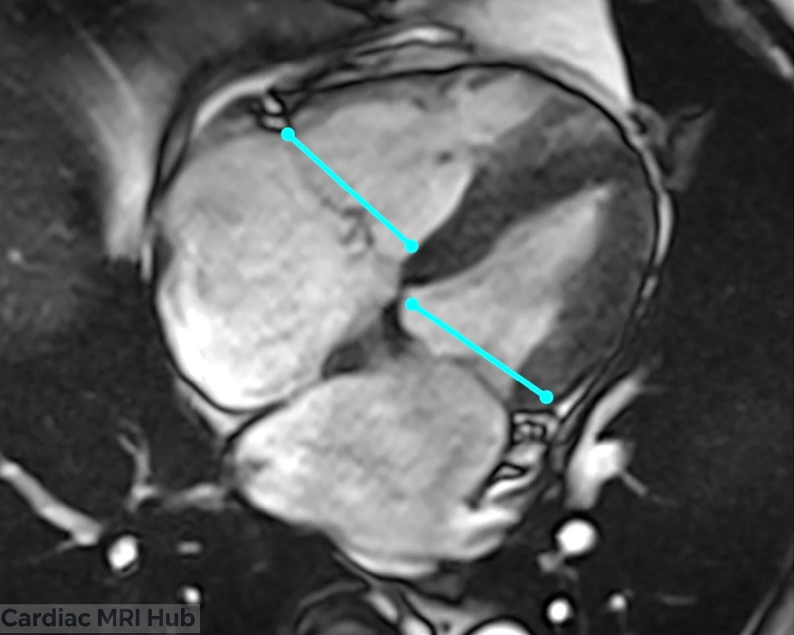

## In-plane flow

1. **On the cine you want flow in (here the 3-chamber),** copy its position and enter the VENC.

")

# Check it

- The vessel is a circle on the through-plane magnitude image. If it's an oval, the slice is tilted: angle it square to the vessel on both views.
- No aliasing on the phase image: at peak flow the vessel is one smooth shade. A dark core inside bright flow (or a bright core inside dark flow) means the VENC is too low: raise it and run it again.
- For flow just above a valve, the valve stays out of the slice through the whole heartbeat. If it moves into the slice, move the slice a little further up; SCMR places the aortic valve slice about 5 mm above the valve at end-diastole.

")

")

")

")

")

# Key settings

- **VENC:** just above the fastest flow you expect: about 10% above, and no more than 25%. Raise it if the phase image aliases.
- **Slice thickness:** 5–8 mm, with pixels small enough that at least 10 fit across the vessel.
- **Temporal resolution:** 50 ms or less, counting only the frames actually acquired, not interpolated ones.
- **Gating:** ECG gating; retrospective gating covers the whole heartbeat.
- **Breath-hold:** a breath-hold, or free breathing with several averages for patients who can't hold their breath.

Starting VENCs for each vessel are under More detail.

# More detail

# 1. How phase contrast works

Phase contrast imaging measures blood flow in the heart and great vessels. There are two kinds: through-plane, which measures flow volume, and in-plane, which shows flow patterns. Each answers different clinical questions.

Moving blood shifts the phase of the MR signal. Phase contrast measures that shift to show and measure blood flow, without contrast. It gives both a picture of the flow pattern and velocity measurements.

Planning matters more for flow than for most MRI: the heart moves constantly and the anatomy is complex. A poorly placed plane gives motion artifacts, misses part of the flow, or misses disease.

# 2. Choosing the VENC

The VENC (velocity encoding) is the highest velocity the sequence can measure correctly. Set it too low and fast flow aliases: it wraps around and shows as flow in the opposite direction. Set it too high and slow flow is measured less accurately, with more noise.

Use the lowest VENC that doesn't alias, and raise it if the phase images alias.[\[SCMR 2020\]](https://pmc.ncbi.nlm.nih.gov/articles/PMC7038611/) The 4D flow consensus aims for about 10% above the fastest velocity you expect, and no more than 25% above.[\[Bissell 2023\]](https://pmc.ncbi.nlm.nih.gov/articles/PMC10357639/)

Starting VENCs from the 4D flow consensus, when no stenosis is expected:[\[Bissell 2023\]](https://pmc.ncbi.nlm.nih.gov/articles/PMC10357639/)

- Aorta and pulmonary artery: 150 cm/s
- Inside the heart: 100–150 cm/s
- Veins: 50–80 cm/s
- False lumen of a dissection: 50–150 cm/s

If a stenosis is suspected and there's no earlier flow study, start at 250 cm/s.[\[Bissell 2023\]](https://pmc.ncbi.nlm.nih.gov/articles/PMC10357639/)

# 3. Through-plane flow

Through-plane flow measures blood passing through the slice, which gives flow volume and velocity. The slice sits across the vessel or valve, and flow is measured through the whole cardiac cycle. It's the most common use of phase contrast, and the one that gives the numbers used for clinical decisions. It measures:

- Flow across the valves, for regurgitation or stenosis.
- Forward flow out of the left and right ventricles, for stroke volume and cardiac output.
- Flow in the major arteries, including the aorta and pulmonary arteries.

# 4. In-plane flow

In-plane flow measures flow along the slice. It shows flow direction, vortices and complex patterns in the chambers and along vessel walls, rather than flow volume. It's useful for showing:

- Vortices in the left ventricle during diastole
- Jets from regurgitant or stenotic valves
- Complex flow in the ascending aorta and pulmonary artery
- Shunts and abnormal connections inside the heart
- Areas where flow separates or recirculates

Place the slice along the expected direction of flow. Several velocity directions can be encoded at once to capture all of the in-plane flow. In-plane flow is good for seeing patterns, but harder to measure than through-plane flow.

# 5. What it's used for

- Congenital heart disease, by showing abnormal flow.
- Following known heart and vessel disease over time.
- Treatment decisions, with measurements of flow and cardiac function.
