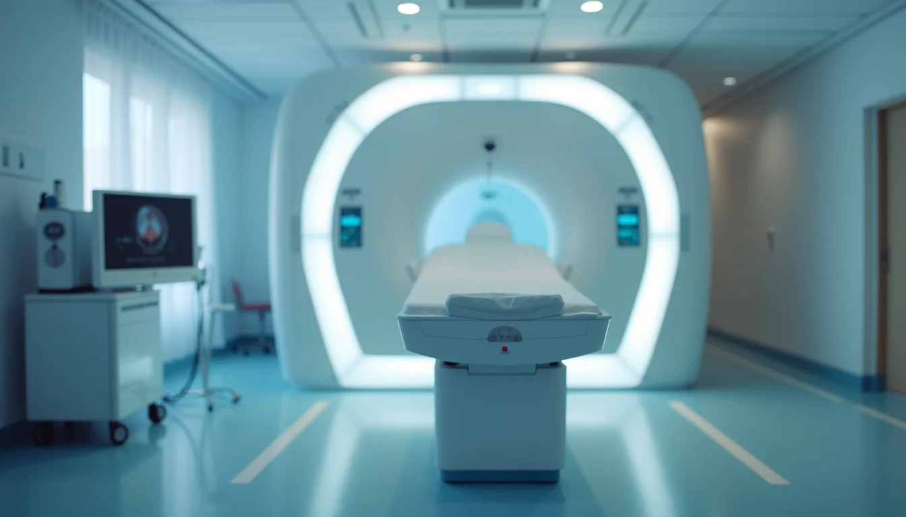

# Start with the clinical question

Know the clinical question before you set up the scan. Each condition needs different sequences and settings. For example:

- **Ischemic heart disease:** perfusion and viability, with stress imaging and delayed enhancement.
- **Cardiomyopathy:** tissue characterization, such as T1 and T2 mapping.
- **Valve disease:** flow measurements across the valves.

Matching the protocol to the question cuts sequences you don't need and shortens the scan.

# Choose the sequences

Pick the sequences that answer the question without padding the exam. The common ones:

- **Cines:** function and wall motion.
- **Late gadolinium enhancement (LGE):** scar and fibrosis.
- **T1 and T2 mapping:** tissue characterization.
- **Phase contrast:** blood flow and valve function.

Skip sequences that add time without adding information.

# Set the parameters

Slice thickness, field of view and temporal resolution all affect image quality and artifacts:

- **Slice thickness:** 6–8 mm for anatomy, balanced against signal-to-noise.
- **Field of view:** cover the whole heart without extra area that costs scan time.
- **Temporal resolution:** higher captures fast motion better but can lengthen the scan.

Adjust for patient size and heart rate; faster heart rates may need shorter acquisition windows.

# Control motion

Breathing and the heartbeat both blur images. Breath-holds and ECG gating control them:

- **Breath-holds:** usually 10–15 seconds per sequence.
- **ECG gating:** time the images to set phases of the cardiac cycle.

For patients who can't hold their breath, use free-breathing sequences with motion correction, or compressed sensing.

# Use contrast well

Gadolinium contrast shows fibrosis and inflammation. Use it when it's indicated, following safety guidelines and your site's policy:

- Check kidney function first.
- Use the lowest dose that works.
- Time the post-contrast sequences correctly.

Give contrast only when it adds something to the diagnosis.

# Keep the workflow moving

An efficient exam is easier on the patient and frees up the scanner:

- Give patients clear instructions before the scan.
- Use standard protocols to cut setup time.
- Train staff to place coils and ECG leads quickly and correctly.

Review protocols regularly against feedback and new research.

# Keep the patient comfortable

Movement ruins images, and comfortable patients stay still:

- Use cushions and supports.
- Keep the room calm and explain what's happening.
- Watch for discomfort or anxiety.

# Use newer technology

Newer scanners have features that help cardiac imaging:

- **Compressed sensing:** faster scans without losing quality.
- **AI reconstruction:** better images and fewer artifacts.
- **Real-time imaging:** scanning without breath-holds.

Use them where you have them.

# Review protocols regularly

Technology and guidelines change. Update protocols with:

- New research.
- Feedback from radiologists and technologists.
- New hardware and software.

Good protocols balance image quality, scan time and the patient's experience: start from the clinical question, choose the right sequences and settings, control motion, and keep them up to date.
