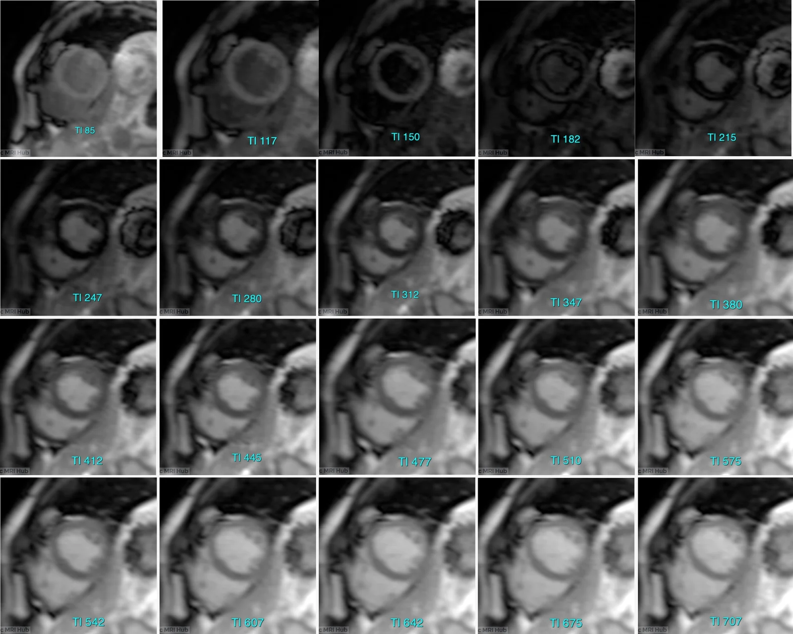
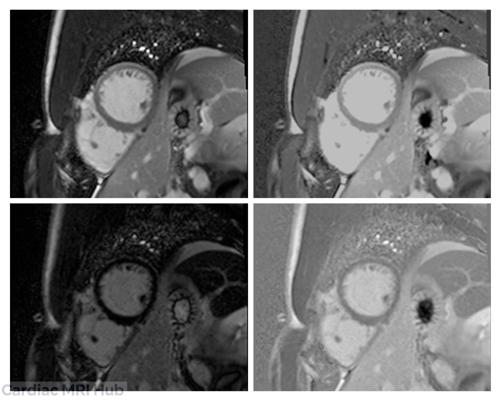
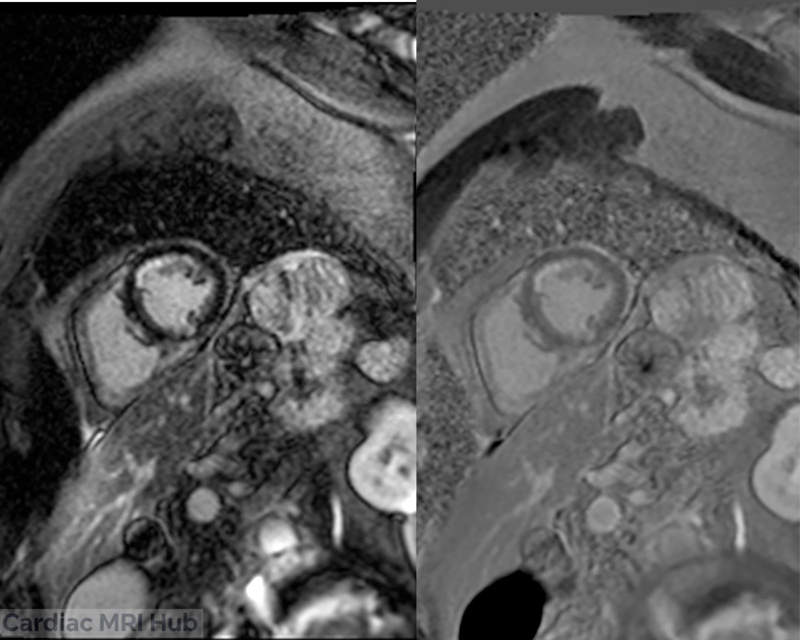

Cardiac MRI technologists face a critical challenge when performing late gadolinium enhancement (LGE) and early gadolinium enhancement (EGE) imaging: selecting the appropriate inversion time (TI) for phase-sensitive inversion recovery (PSIR) sequences. The TI time directly affects image quality and diagnostic accuracy, especially when identifying myocardial scar or fibrosis. This post explains how to choose the right TI time for PSIR imaging, clarifies the differences between LGE and EGE, and discusses why a TI of 600 ms can be used immediately after contrast injection.

# Understanding TI Time in Cardiac MRI

TI time is the delay between the inversion pulse and data acquisition in an inversion recovery sequence. It controls the nulling of specific tissues based on their T1 relaxation times. In cardiac MRI, TI is adjusted to null the signal from normal myocardium, making areas of fibrosis or scar stand out as bright regions.

- **Too short TI**: Normal myocardium appears bright, reducing contrast with scar tissue.
- **Too long TI**: Scar tissue signal may be suppressed, leading to missed pathology.

PSIR sequences improve image contrast by reconstructing phase information, making TI selection less sensitive but still important for optimal results.

# Differences Between LGE and EGE Imaging

## Late Gadolinium Enhancement (LGE)

LGE imaging is performed 10 to 20 minutes after gadolinium contrast injection. At this stage, gadolinium accumulates in areas of myocardial injury or fibrosis, which have increased extracellular space. The contrast agent shortens T1 relaxation times in these regions, causing them to appear bright on images.

- **Purpose**: Detect myocardial infarction, fibrosis, and scar.
- **TI selection**: TI is chosen to null normal myocardium, typically ranging from 250 to 350 ms depending on the scanner and patient.

## Early Gadolinium Enhancement (EGE)

EGE imaging occurs within the first few minutes after contrast injection, usually within 1 to 3 minutes. It captures the initial distribution of gadolinium in the blood pool and myocardium.

- **Purpose**: Assess myocardial perfusion and inflammation.
- **TI selection**: TI is often fixed around 600 ms immediately after injection to null blood pool signal and highlight areas of hyperemia or edema.

# Why Use TI 600 ms Right After Injection?

Immediately after gadolinium injection, the blood pool has a very short T1 due to high contrast concentration. Setting TI around 600 ms helps null the blood signal, which is crucial for EGE imaging to differentiate blood from myocardium.

- **Blood pool nulling**: TI 600 ms suppresses blood signal, improving visualization of myocardial enhancement.
- **Myocardial signal**: At this early stage, myocardium has longer T1 than blood, so it appears brighter relative to nulled blood.
- **Consistency**: Using a fixed TI of 600 ms simplifies protocol and reduces scan time during the critical early phase.
- **Thrombus and MVO detection: TI 600 ms is particularly valuable for identifying** acute thrombus and microvascular obstruction (MVO) in patients with recent myocardial infarction, as these appear dark (hypointense) against the bright blood pool and enhanced myocardium.

This approach contrasts with LGE imaging, where TI is adjusted individually to null normal myocardium after contrast has washed out from the blood pool.

# Practical Tips for Choosing TI Time in PSIR Imaging

1. **Start with Look-Locker or TI scout**  
   Use a TI scout sequence to find the optimal TI that nulls normal myocardium. This is especially important for LGE imaging.
   - For EGE (within 3 minutes), use TI ~600 ms to null blood pool.
   - For LGE (10-20 minutes post-injection), adjust TI to null myocardium, usually 250-350 ms.
2. **Adjust TI based on time after contrast injection**
3. **Consider patient-specific factors**
   - Renal function and contrast clearance affect T1 times.
   - Heart rate and rhythm may influence timing and image quality.
4. **Use PSIR sequences to reduce TI sensitivity**  
   PSIR imaging reconstructs phase information, making images less dependent on exact TI. This allows some flexibility but does not replace proper TI selection.
5. **Verify image quality immediately**  
   Check images for proper nulling of myocardium or blood pool. If needed, repeat TI scout or adjust TI manually.

# Summary

Selecting the optimal TI time in PSIR imaging is fundamental to achieving high-quality cardiac MRI images that clearly differentiate pathology from normal tissue. For LGE imaging performed 10-20 minutes post-contrast, TI should be individually adjusted (typically 250-350 ms) to null normal myocardium and highlight scar tissue. In contrast, EGE imaging within 1-3 minutes after injection uses a fixed TI of approximately 600 ms to null the blood pool, enabling visualization of early myocardial perfusion defects, inflammation, and importantly, acute thrombus and microvascular obstruction. By understanding these timing-dependent differences and applying proper TI scout techniques, cardiac MRI technologists can consistently produce diagnostic-quality images that support accurate clinical decision-making and improve patient outcomes.
