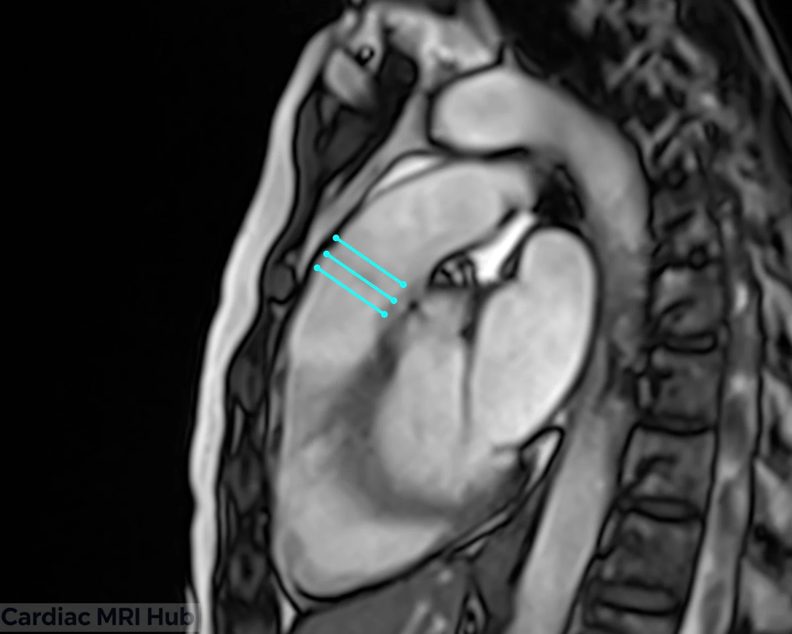
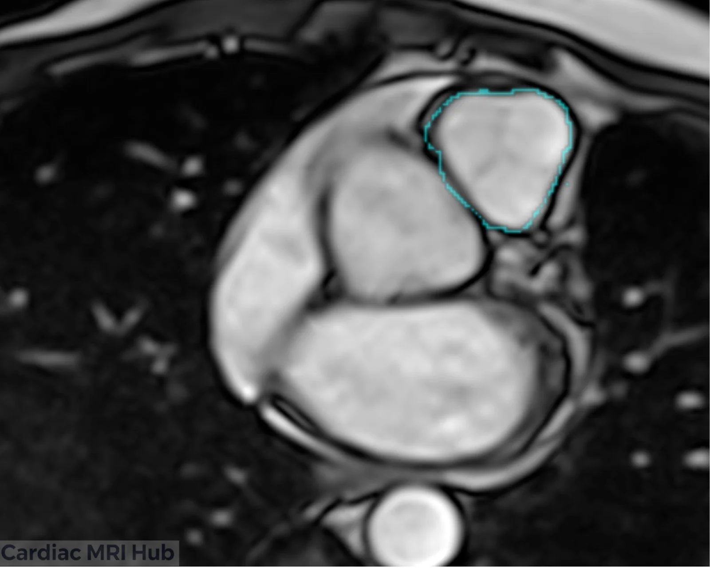

The pulmonary valve is one of the four cardiac valves that plays a critical role in the normal function of the heart. Located between the right ventricle and the pulmonary artery, this semilunar valve ensures unidirectional blood flow from the heart to the lungs for oxygenation. Accurate assessment of the pulmonary valve is essential for diagnosing and managing conditions such as pulmonary stenosis, regurgitation, and congenital heart defects.

Cardiac MRI has become the gold standard for evaluating pulmonary valve anatomy and function due to its superior soft tissue contrast, ability to quantify blood flow, and excellent visualization of valve morphology. Unlike echocardiography, MRI provides precise measurements of valve area, regurgitant fraction, and ventricular function without acoustic window limitations. This makes it particularly valuable for monitoring patients with repaired tetralogy of Fallot, pulmonary valve replacement, and other complex congenital conditions.

This guide will help MRI technologists understand the key principles and techniques for optimal pulmonary valve imaging, ensuring high-quality diagnostic images for accurate clinical assessment.

# Pulmonary Valve Planning

# Planning for Cardiac MRI of the Pulmonary Valve

Cardiac MRI is an essential tool for evaluating the pulmonary valve and its associated structures. This imaging modality provides comprehensive insights into the anatomy and function of the pulmonary valve, which is crucial for diagnosing various cardiac conditions.

## Key Considerations for Planning

- **Orientation:** Choose the imaging plane carefully to view the pulmonary valve en face, ensuring the best anatomical detail.
- **Slice Thickness:** Employing a thinner slice thickness is recommended to enhance spatial resolution and capture fine details of the valve structure.
- **Field of View:** The field of view must encompass the pulmonary valve and adjacent anatomical landmarks to ensure comprehensive evaluation.
- **Timing:** Image acquisition should be synchronized with the cardiac cycle, to provide clear visualization of the valve opening and closing dynamics.
- **Contrast Agents:** Utilizing contrast agents can enhance the visualization of the pulmonary valve and surrounding structures, improving diagnostic accuracy.

## Clinical Applications

- Assessment of pulmonary valve stenosis or regurgitation.
- Diagnosis and monitoring of congenital heart defects involving the pulmonary valve.
- Assessment of post-surgical changes in the pulmonary valve and surrounding structures.
- Evaluation of repaired tetralogy of Fallot (rTOF) with assessment of right ventricular function and pulmonary regurgitation fraction.
- Quantitative flow measurement using phase contrast MRI to determine regurgitant volume and fraction.
- Pre-operative planning for pulmonary valve replacement to assess timing of intervention.

## Key Features of the Pulmonary Valve View

- **Pulmonary Valve:** Detailed evaluation of valve morphology, including any signs of calcification or deformity.
- Valve Leaflets: Visualization of individual pulmonary valve leaflets (typically tricuspid) for assessment of thickening, restriction, or prolapse.
- Pulmonary Annulus: Measurement of the pulmonary valve annulus diameter for sizing considerations and assessment of annular dilation.
- Flow Dynamics: Assessment of flow patterns across the pulmonary valve during systole and diastole to identify turbulent or accelerated flow indicating stenosis or regurgitation.

## Conclusion

Proper planning and execution of pulmonary valve cardiac MRI views are essential for accurate diagnosis and clinical decision-making. By mastering imaging techniques and understanding valve anatomy, MRI technologists can deliver high-quality images that support optimal patient care in both congenital and acquired heart disease.
