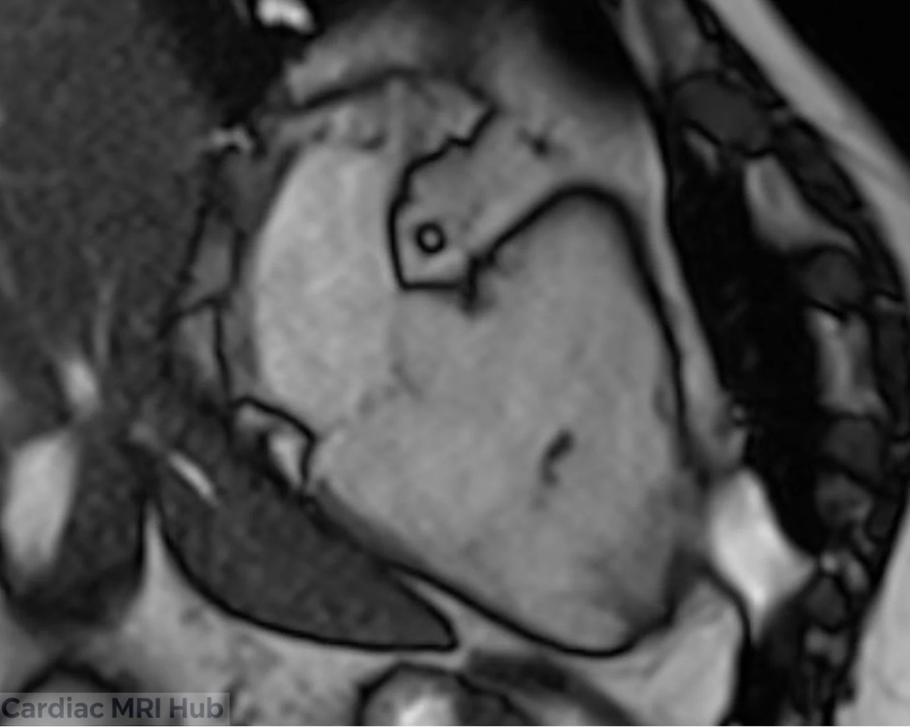
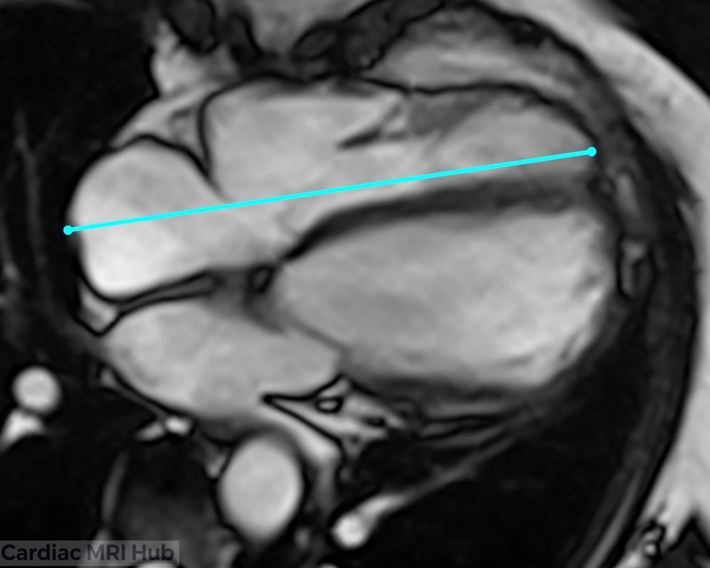
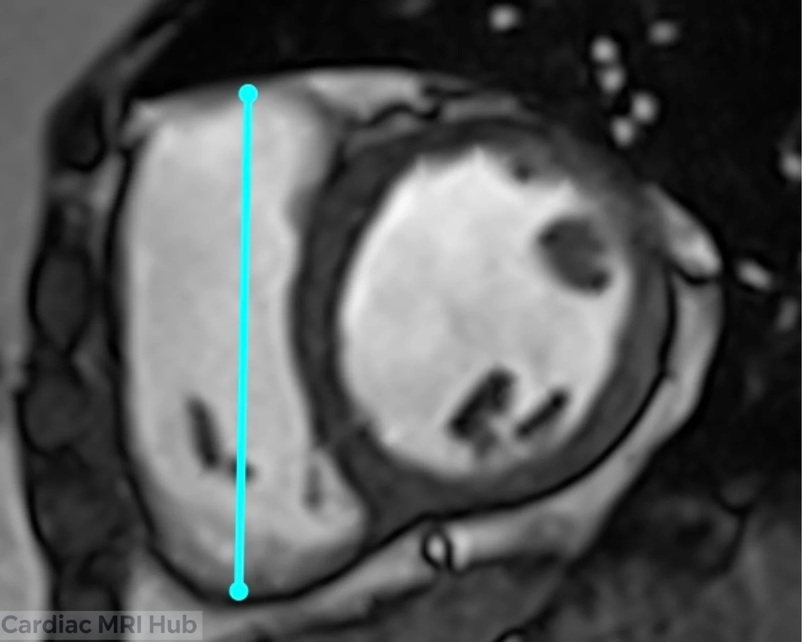

The right ventricle 2 chamber view provides a focused perspective for evaluating right heart anatomy and function. This guide covers the essential planning steps and clinical applications for acquiring this specialized cardiac MRI view.

# 2 Chamber Planning

# Right Ventricle 2 Chamber View Planning

The 2 chamber view of the right ventricle is a vital imaging perspective in cardiac MRI, providing essential insights into the heart's anatomy and functionality. This view primarily focuses on the right atrium and right ventricle, allowing for a detailed assessment of their structure and any potential abnormalities.

## Key Considerations for Planning

- **Orientation:** The 2 chamber view is typically acquired from a plane that slices through the right atrium and right ventricle, ensuring clear visualization of both chambers.
- **Field of View:** The field of view should adequately capture the right atrium and right ventricle, ensuring no critical structures are omitted.
- **Timing:** Image acquisition should be synchronized with the cardiac cycle, preferably during diastole, to optimize visualization of the chamber sizes and function.
- **Contrast Agents:** Consider the use of contrast agents to improve the delineation of myocardial tissue and enhance diagnostic precision.

## Clinical Applications

- Evaluation of right ventricular size and function.
- Assessment of right atrial dimensions and morphology.
- Identification of structural heart disease.
- Monitoring of right ventricular hypertrophy or dilation over time.

## Key Features of the 2 Chamber View

- **Right Atrium:** Detailed analysis of right atrial size and any structural abnormalities.
- **Right Ventricle:** Assessment of right ventricular volume, wall motion, and overall cardiac function.

## Conclusion

Mastering the right ventricle 2 chamber view requires careful attention to patient positioning, plane orientation, and timing. By following these planning guidelines, technologists can consistently obtain high-quality images that support accurate diagnosis and treatment of right heart conditions.
