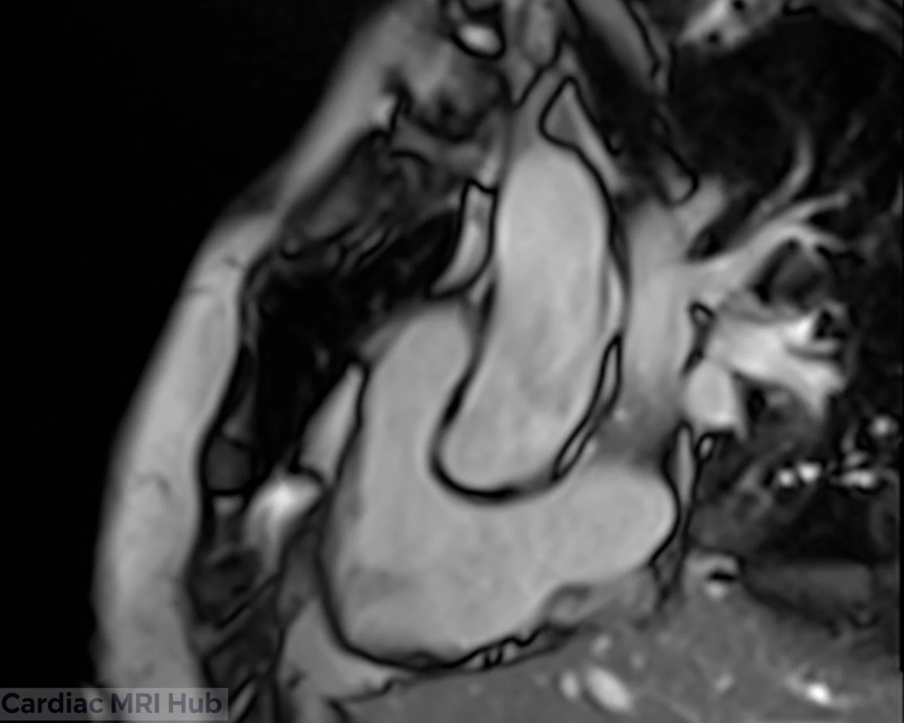
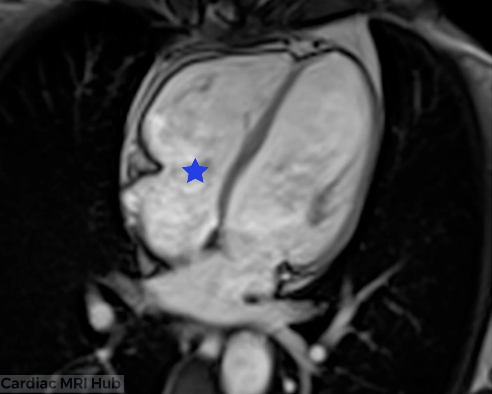
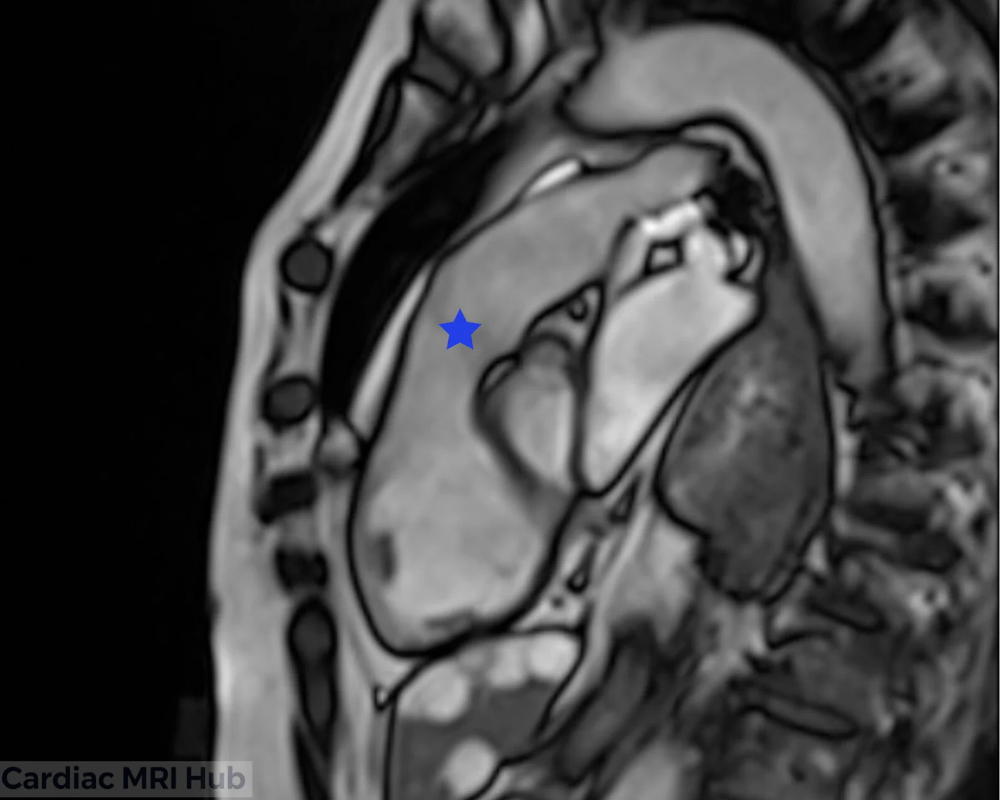
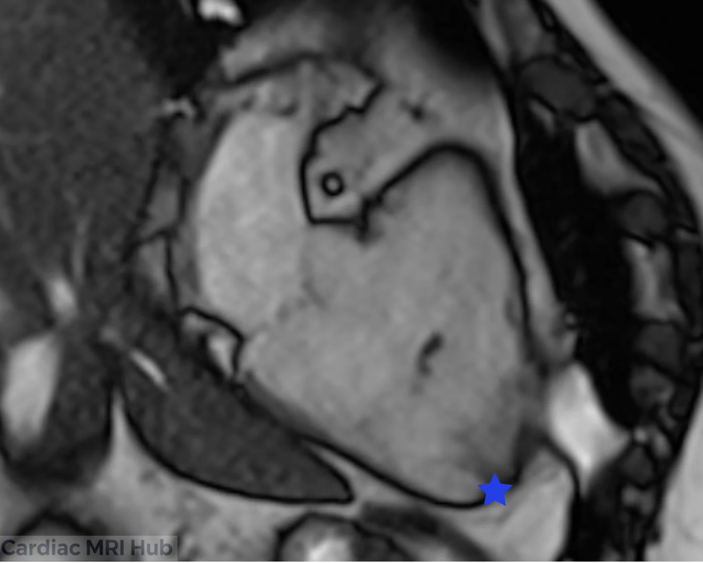

The right ventricle 3-chamber view shows the right atrium, right ventricle and pulmonary outflow tract in one plane.

## RV 3 Chamber Planning

# Right Ventricle 3 Chamber View Planning

The RV 3-chamber view shows the right atrium, right ventricle and outflow tract, for their shape and any abnormalities.

## Key Considerations for Planning

- **Orientation:** a plane through the right atrium, right ventricle and pulmonary outflow tract.
- **Field of view:** large enough for the right atrium, right ventricle and outflow tract.
- **Timing:** ECG-gated, ideally imaged in diastole, to show chamber size and function.
- **Contrast:** if it's part of the exam, contrast helps separate the myocardium from the blood.

## Clinical Applications

- Right ventricular size and function.
- Right atrial size and shape.
- Congenital heart defects.
- Follow-up of right ventricular hypertrophy or dilation.

## Key Features of the 3 Chamber View

- **Right atrium:** size and structural abnormalities.
- **Right ventricle:** volume, wall motion and function.
- **Outflow tract:** obstruction or other abnormalities of the pulmonary outflow tract.

