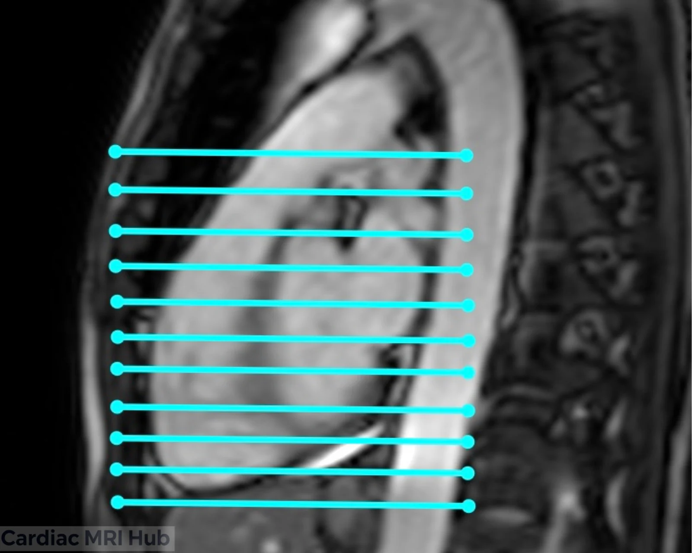

The right ventricle axial stack is a stack of straight axial cines through the whole right ventricle. It's used to measure RV volumes and function, as an alternative to the short-axis stack.

# Plan it

1. **On the sagittal localizer,** set a straight axial stack from above the pulmonary valve down through the bottom of the heart.
2. **On the sagittal RVOT,** check that the top slices reach the top of the heart, including the outflow tract.

# Check it

- The stack covers the whole right ventricle, from above the pulmonary valve to the bottom of the heart. Volumes need all of it.
- The slices are straight axials, with no angle.
- If the outflow tract or the bottom of the RV is missing, add slices at that end and check again on the sagittal RVOT.

# Key settings

- **Slice thickness:** the same as your short-axis cines (SCMR: 6–8 mm); 5–6 mm when the question is ARVC.
- **Coverage:** the whole RV, from above the pulmonary valve to the bottom of the heart.
- **Temporal resolution:** 45 ms or less (real time 60 ms or less).
- **Gating:** retrospective ECG gating, as for the LV cines.
- **Breath-hold:** in breath-holds, as for the short-axis stack; holding in expiration gives a more consistent position.

The LV cine settings are on the [LV parameters](/parameters/) page.

# More detail

# 1. Planning

- **Orientation:** axial slices through the right ventricle at every level, showing the chamber and how it sits against the rest of the heart.
- **Field of view:** the whole right ventricle and nearby structures.
- **Timing:** ECG-gated, to show chamber size and function.
- **Contrast:** if it's part of the exam, contrast helps separate the myocardium from the blood.

# 2. What it's used for

- Right ventricular size and function.
- Right ventricular wall motion abnormalities.
- Congenital heart defects.
- Follow-up of right ventricular hypertrophy or dilation.

# 3. What the view shows

- **Right ventricle:** volume, wall motion and function.
- **Interventricular septum:** whether it's intact, and anything abnormal that affects the right ventricle.
