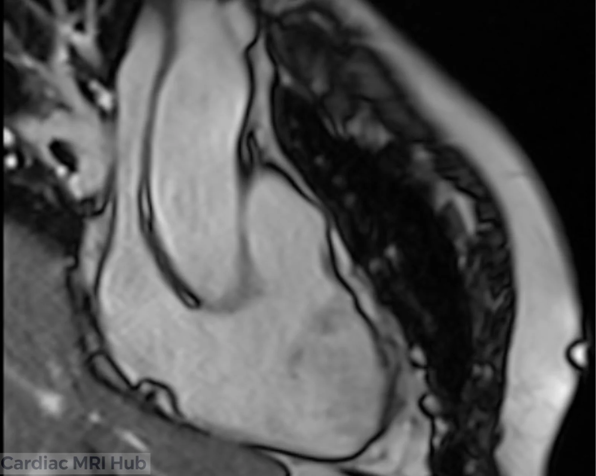
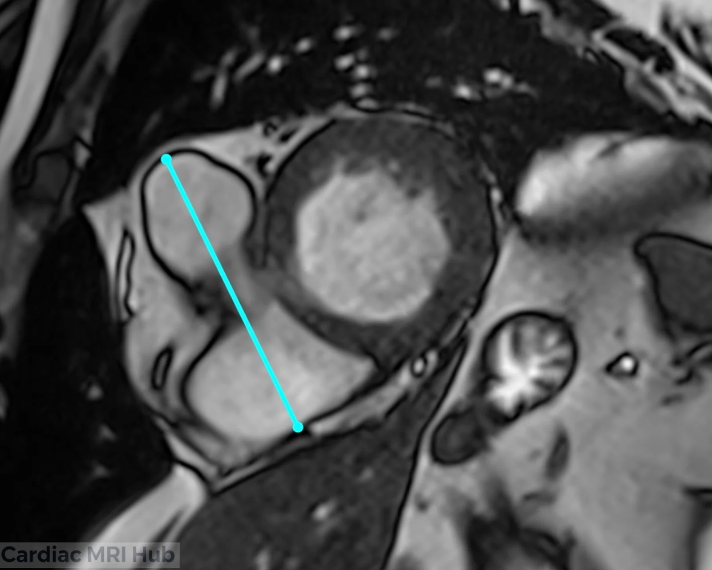
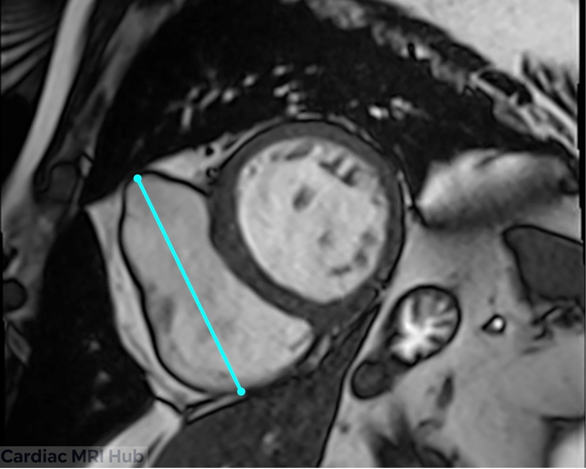

The right ventricle inflow view is a specialized cardiac MRI imaging plane that visualizes the right atrium, tricuspid valve, and right ventricular inflow tract. This view is essential for assessing right heart structure and function, particularly in patients with congenital heart disease, pulmonary hypertension, or right ventricular pathology.

# RV Inflow Planning

# Right Ventricle Inflow View Planning

## Key Considerations for Planning

- **Orientation:** The inflow view is generally acquired from a plane that intersects the right atrium and right ventricle, ensuring optimal visualization of both chambers. The right ventricular inflow view typically requires a short-axis and four-chamber view to visualize the inflow tract effectively. Careful alignment with the anatomical landmarks is crucial.
- **Field of View:** The field of view should be carefully selected to encompass the right atrium and right ventricle, ensuring that no essential structures are overlooked.
- **Timing:** Image acquisition should be synchronized with the cardiac cycle, to maximize visualization of chamber sizes and functions.
- **Contrast Agents:** The use of contrast agents may be beneficial to improve the differentiation of myocardial tissue and enhance diagnostic accuracy.

## Clinical Applications

- Evaluation of right ventricular size and function.
- Assessment of right atrial dimensions and morphology.
- Identification of right heart structural abnormalities.
- Monitoring of right ventricular hypertrophy or dilation over time.

## Key Features of the Inflow View

- **Right Atrium:** In-depth analysis of right atrial size and any structural irregularities.
- **Right Ventricle:** Assessment of right ventricular volume, wall motion, and overall cardiac function.

## Conclusion

Mastering the right ventricle inflow view is crucial for comprehensive cardiac MRI assessment. By following proper planning techniques and understanding key anatomical landmarks, technologists can consistently acquire high-quality images that provide valuable diagnostic information for right heart evaluation.
