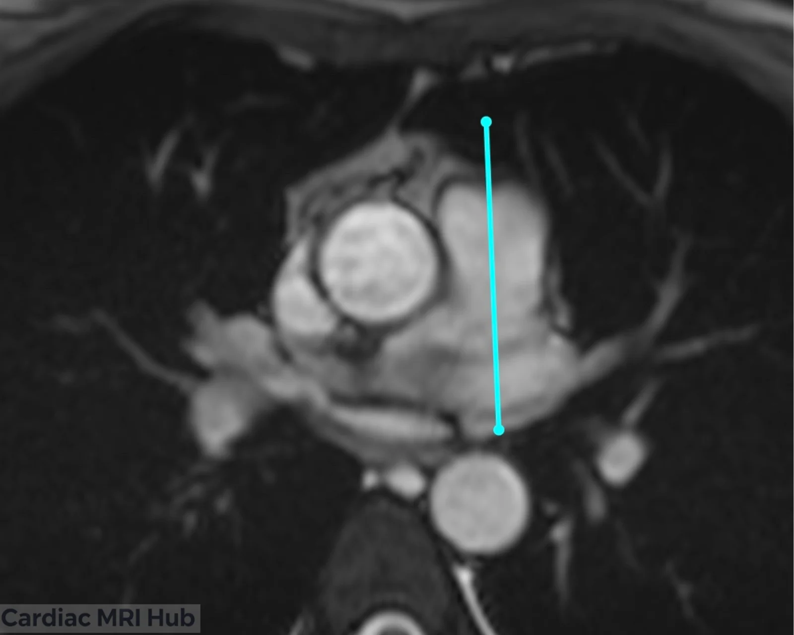
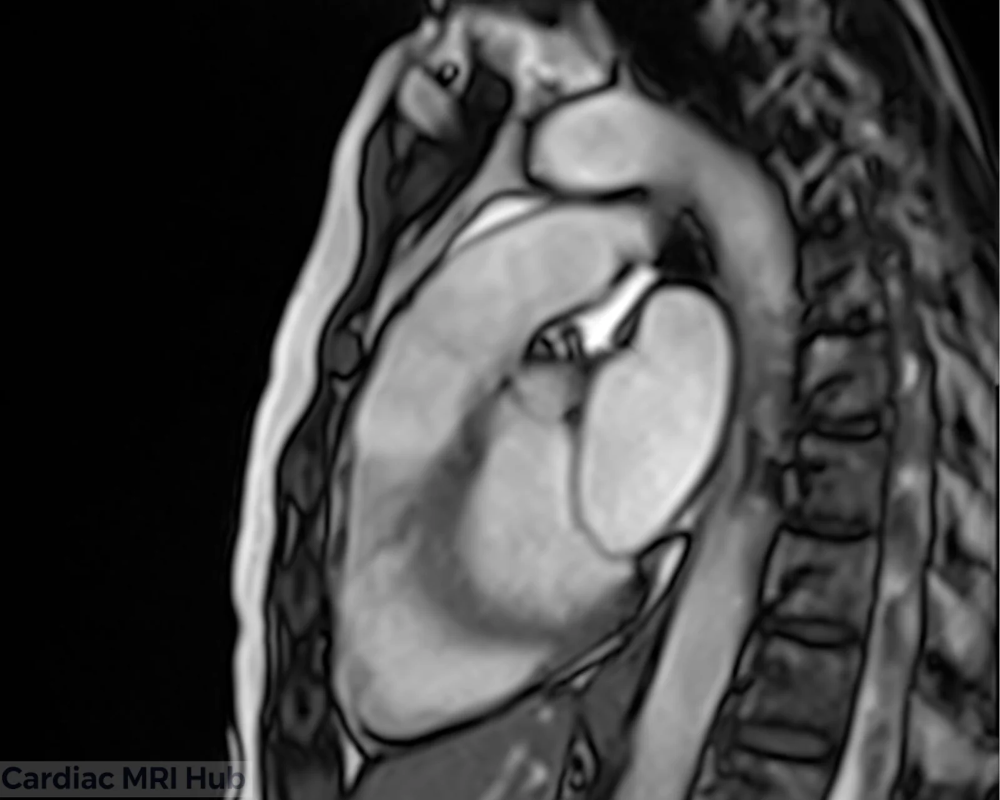
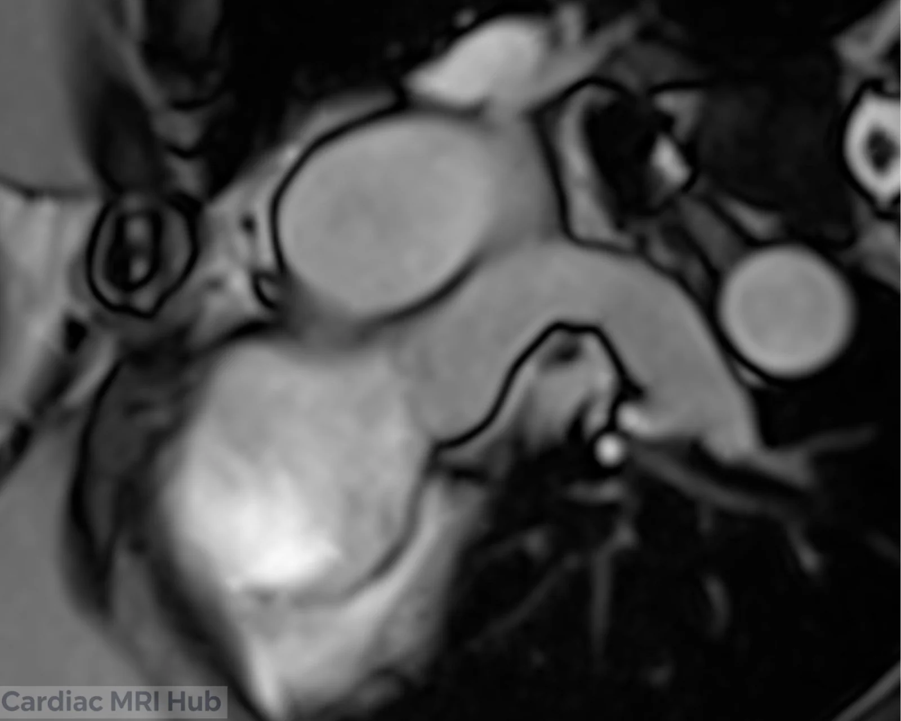
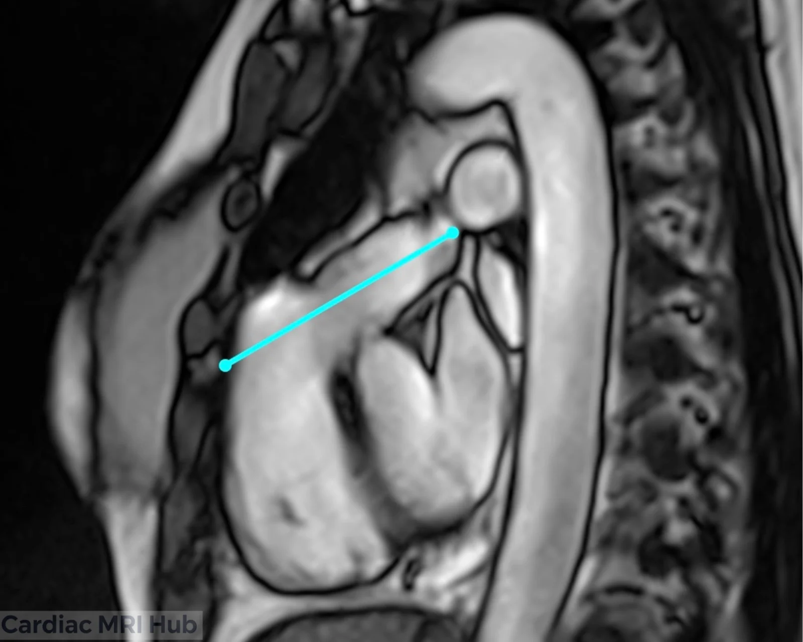
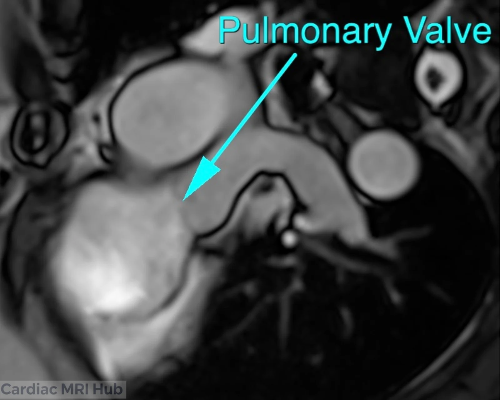

The right ventricular outflow tract (RVOT) is a critical anatomical region connecting the right ventricle to the pulmonary artery. Accurate visualization of this area is essential for evaluating right ventricular function, detecting outflow tract abnormalities, and assessing the pulmonary vasculature. In cardiac MRI, obtaining optimal sagittal and coronal views requires careful planning and precise positioning. This guide covers key planning techniques for both the sagittal RVOT view and the coronal pulmonary artery view to ensure comprehensive evaluation of right heart structures.

# Sag RVOT Planning

# Sagittal Right Ventricular Outflow View Planning

## Key Considerations for Planning

- **Orientation:** The sagittal right ventricular outflow view is typically obtained from a plane that intersects the right ventricle and its outflow tract, ensuring optimal visualization of these areas.
- **Field of View:** The field of view should encompass the entire right ventricle and outflow tract, ensuring that no critical anatomical structures are overlooked.
- **Timing:** Image acquisition should be aligned with the cardiac cycle, to enhance the visualization of the right ventricular outflow dynamics.
- **Contrast Agents:** The use of contrast agents may be beneficial for better differentiation of myocardial tissue and improved diagnostic accuracy.

## Clinical Applications

- Evaluation of right ventricular size and function.
- Assessment of the right ventricular outflow tract and pulmonary artery.
- Identification of congenital heart defects.
- Monitoring of right ventricular hypertrophy or dilation over time.

## Key Features of the Sagittal Right Ventricular Outflow View

- **Right Ventricle:** Detailed evaluation of right ventricular size, wall motion, and overall function.
- **Outflow Tract:** Assessment of the right ventricular outflow tract and its relationship with the pulmonary artery.

# Cardiac MRI Planning: Coronal Pulmonary Artery View

The coronal pulmonary artery view is essential for assessing the main pulmonary artery and its branches. This view provides valuable information regarding vascular anatomy and any potential anomalies or obstructions. Effective planning for the coronal view involves the following steps:

- Utilize preliminary imaging to locate the pulmonary artery and its branches.
- Position the imaging plane perpendicular to the main pulmonary artery to capture a comprehensive view.
- Synchronize the imaging with the cardiac cycle, to optimize clarity and minimize motion artifacts.
- Adjust imaging parameters, including spatial resolution and contrast, to enhance vascular detail.

## Conclusion

Proper planning of the sagittal right ventricular outflow tract and coronal pulmonary artery views is essential for comprehensive cardiac MRI evaluation. Accurate imaging plane positioning, synchronization with the cardiac cycle, and optimized parameters ensure precise assessment of right heart structures and pulmonary vasculature. These views are crucial for diagnosing congenital heart defects, evaluating right ventricular function, and detecting RVOT and pulmonary artery abnormalities. Mastering these techniques enhances diagnostic confidence and improves patient outcomes.
