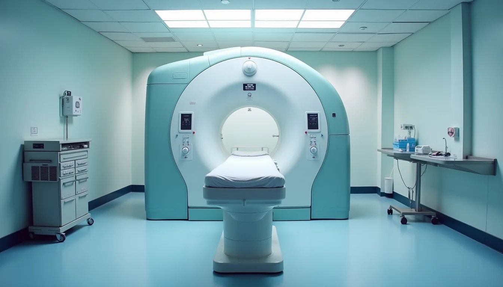

Cardiac MRI is a powerful tool that provides detailed images of the heart’s structure and function. Yet, if you work as a cardiac MRI technologist, you’ve likely noticed that the sequences used in one scan can differ significantly from those in another. Why do some sequences take priority over others? Why do protocols vary between patients or institutions? Understanding these differences is key to performing effective scans and delivering accurate diagnostic information.

This post explores the reasons behind the variability in cardiac MRI sequences and protocols, helping technologists grasp the factors that influence these choices.

# Why Cardiac MRI Sequences Vary

Cardiac MRI sequences are designed to highlight different aspects of the heart. Each sequence has strengths and limitations, and the choice depends on the clinical question, patient condition, and technical factors.

## Clinical Indications Drive Sequence Selection

The primary reason sequences vary is the clinical question. For example:

- **Assessing myocardial viability** often requires late gadolinium enhancement (LGE) sequences to detect scar tissue.
- **Evaluating cardiac function** typically uses cine sequences like balanced steady-state free precession (bSSFP) to visualize heart motion.
- **Detecting edema or inflammation** calls for T2-weighted sequences.
- **Characterizing tissue composition** may involve T1 mapping or fat suppression techniques.

Each sequence provides unique information, so the protocol adapts to what the physician needs to know.

## Patient Factors Influence Protocol Choice

Patient-specific factors also affect sequence selection:

- **Heart rate and rhythm**: Irregular rhythms may require sequences less sensitive to motion artifacts.
- **Breath-hold capability**: Some sequences demand longer breath-holds, which may not be feasible for all patients.
- **Presence of implants or devices**: Certain sequences may be contraindicated or produce artifacts.
- **Renal function**: Limits the use of gadolinium contrast, affecting the use of LGE sequences.

Technologists must adjust protocols to accommodate these factors, sometimes prioritizing sequences that are more robust or faster.

# Technical Considerations Affecting Sequence Choice

Beyond clinical and patient factors, technical aspects play a major role in sequence selection.

## Image Quality and Artifact Management

Some sequences are more prone to artifacts such as motion, flow, or susceptibility effects. For example:

- **bSSFP sequences** provide excellent contrast between blood and myocardium but are sensitive to off-resonance artifacts.
- **Spin echo sequences** are less sensitive to magnetic field inhomogeneities but have longer acquisition times.

Technologists may choose sequences that balance image quality with artifact reduction based on the scanner’s capabilities and patient cooperation.

## Scan Time and Workflow Efficiency

MRI scans can be lengthy, and patient comfort is crucial. Protocols often prioritize sequences that provide essential information quickly. For instance:

- Rapid cine sequences may be favored in patients who cannot hold their breath for long.
- Some centers use accelerated imaging techniques like parallel imaging or compressed sensing to shorten scan times.

Adjusting protocols to optimize scan duration helps reduce motion artifacts and improves patient experience.

# Why Protocols Differ Between Institutions

Protocols are not universal. Differences arise due to equipment, expertise, and institutional preferences.

## Scanner Hardware and Software

MRI scanners vary by manufacturer, field strength (1.5T vs 3T), and software versions. These differences affect:

- Available sequences and pulse programming options.
- Image resolution and signal-to-noise ratio.
- Compatibility with advanced techniques like T1/T2 mapping.

Institutions tailor protocols to their specific scanner capabilities to maximize image quality.

## Radiologist and Cardiologist Preferences

Physicians may have preferences based on their diagnostic focus or experience. Some may request additional sequences for detailed tissue characterization, while others prioritize functional assessment.

## Institutional Workflow and Resources

Centers with high patient volumes may streamline protocols to maintain throughput. Others with research focus may include advanced sequences for experimental purposes.

# Practical Tips for Technologists

Understanding why sequences and protocols vary helps technologists make informed decisions during scanning.

- **Communicate with the referring physician** to clarify the clinical question.
- **Review patient history and limitations** before the scan.
- **Familiarize yourself with your scanner’s sequence options** and their strengths.
- **Be ready to adapt protocols** if patient cooperation or image quality is suboptimal.
- **Document any protocol changes** and reasons for future reference.
