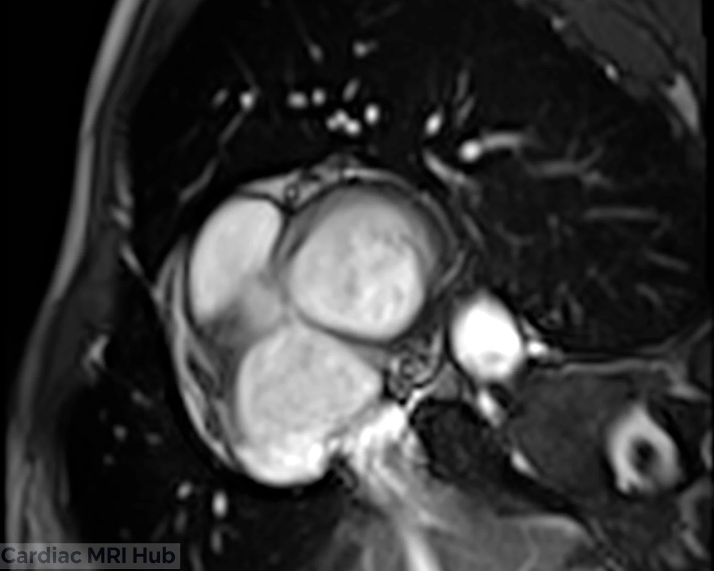
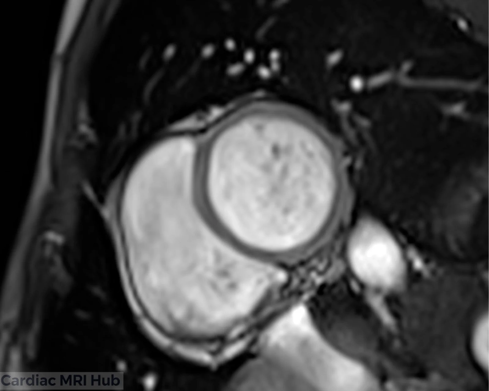

Stress perfusion shows blood flow to the heart muscle while a vasodilator opens up the coronary arteries, to look for ischemia. You image three short-axis slices every heartbeat as the contrast passes through the heart, once at stress and, at many sites, again at rest.

# Plan it

1. **On the 2-chamber,** place three short-axis slices at the base, mid and apex, perpendicular to the long axis of the LV, as for the [short-axis samples](/guide/lv-short-axis-samples/).[\[SCMR 2020\]](https://pmc.ncbi.nlm.nih.gov/articles/PMC7038611/)

 planned on the 2-chamber.")

2. **Base:** at the mitral annulus, with the LVOT out of the slice. **Mid:** on the papillary muscles. **Apex:** at the narrow end of the LV cavity, not overlapping the mid slice.
3. **In the sequence,** check that all three slices fit in each heartbeat at the heart rate you expect under stress. The heart speeds up with a vasodilator, and SCMR wants every slice imaged every heartbeat if possible.[\[SCMR 2020\]](https://pmc.ncbi.nlm.nih.gov/articles/PMC7038611/)
4. **Before the injection,** practice the breath-hold. It has to start before the contrast reaches the LV.[\[SCMR 2020\]](https://pmc.ncbi.nlm.nih.gov/articles/PMC7038611/)

# Check it

- **Base:** a full ring of myocardium, with no aortic root or LVOT in it. If the ring is broken, move the slice toward the apex.
- **Every slice, every beat:** count the images per slice. If heartbeats are skipped at the stress heart rate, the slices don't fit: shorten the readout before the rest run.
- **Steady heart, full first pass:** the heart shouldn't move through the slices while the contrast arrives (start the breath-hold earlier), and the run should go on until the contrast has passed through the myocardium, at least 50–60 heartbeats.[\[SCMR 2020\]](https://pmc.ncbi.nlm.nih.gov/articles/PMC7038611/)

The first basal slice is too close to the LVOT; the second has the full ring you want.

# Key settings

- **Slices:** at least 3 short-axis slices every heartbeat if possible, 8–10 mm thick.
- **Resolution:** in-plane about 3 mm or finer; readout about 100–125 ms or shorter; parallel imaging if you have it.
- **Sequence:** saturation recovery with a bSSFP, GRE or GRE-EPI readout.
- **Injector:** contrast 0.05–0.1 mmol/kg at 3–7 ml/s, then at least 30 ml of saline at 3–7 ml/s.
- **Breath-hold:** start it before the contrast reaches the LV, and image at least 50–60 heartbeats (more if cardiac output is low). Free breathing is an option if you have motion correction.

These are SCMR 2020's settings.[\[SCMR 2020\]](https://pmc.ncbi.nlm.nih.gov/articles/PMC7038611/) The stress-to-rest order, the stress agents and their doses, and patient prep are under More detail.

# More detail

# The exam in order

SCMR 2020's stress perfusion protocol runs rest perfusion before LGE:[\[SCMR 2020\]](https://pmc.ncbi.nlm.nih.gov/articles/PMC7038611/)

1. Localizers, then plan the perfusion slices. Cines can run here, or later while you wait between stress and rest.
2. Stress agent, then stress perfusion with the first contrast injection. When the contrast goes in depends on the agent (below).
3. Wait at least 10 minutes for the contrast to wash out. Run the cines (for example the long axes) during the wait.
4. Rest perfusion: the same slices and the same contrast dose, with no stress agent. Depending on your site's policy, rest perfusion can be left out; SCMR notes that more and more data show it adds little.
5. More contrast for LGE if needed, up to 0.1–0.2 mmol/kg in total.
6. LGE, at least 5 minutes after rest perfusion. See [choosing the TI time](/guide/psir-ti-time/).

# Stress agents and doses

These are SCMR 2020's reference doses. The agent, the dose and the monitoring follow your department's protocol and the supervising physician.[\[SCMR 2020\]](https://pmc.ncbi.nlm.nih.gov/articles/PMC7038611/)

- **Adenosine:** 140 μg/kg/min for 2–4 minutes. Inject the contrast during the last minute of the infusion. If after 2–3 minutes the heart rate hasn't risen by 10 bpm, or systolic blood pressure hasn't dropped by more than 10 mmHg, SCMR says to consider going up to 210 μg/kg/min. Ideally there are two IV lines, one in each arm: one for adenosine and one for contrast, with the blood pressure cuff on neither line. The infusion can be started with the patient outside the bore.
- **Regadenoson:** 0.4 mg as a single bolus. Inject the contrast about 45–60 seconds later. Many sites reverse regadenoson with aminophylline 100 mg IV after the stress images; aminophylline can cause arrhythmias, so it's used with caution.
- **Dipyridamole:** 0.142 mg/kg/min over 4 minutes (0.57 mg/kg in all),[\[Dipyridamole injection label\]](https://www.rxlist.com/dipyridamole-injection-drug.htm) with the contrast given the same way as for adenosine.[\[SCMR 2020\]](https://pmc.ncbi.nlm.nih.gov/articles/PMC7038611/) SCMR's text prints this dose in μg/kg/min; the drug label gives mg/kg/min.
- **ATP:** 140 μg/kg/min for 3–5 minutes, with the same optional increase to 210 μg/kg/min as adenosine.

# Before the scan

- **Caffeine:** the patient should avoid caffeine, theophylline and dipyridamole for 12–24 hours before the scan.
- **Food:** fasting isn't required, but it's often advised because the stress agents can cause nausea.
- **In the room:** blood pressure monitoring, at least a single-lead ECG for the rhythm, and the emergency drugs (including aminophylline) close at hand.

All from SCMR 2020.[\[SCMR 2020\]](https://pmc.ncbi.nlm.nih.gov/articles/PMC7038611/)

# Who shouldn't get a vasodilator

The supervising physician screens for these, which SCMR lists as contraindications to vasodilator stress:[\[SCMR 2020\]](https://pmc.ncbi.nlm.nih.gov/articles/PMC7038611/)

- Type 2 second-degree heart block, or complete heart block
- Systolic blood pressure under 90 mmHg
- Severe high blood pressure, over 220/120 mmHg
- Sinus bradycardia under 40 bpm
- Active bronchospastic disease with regular inhaler use
- Known hypersensitivity to the agent
