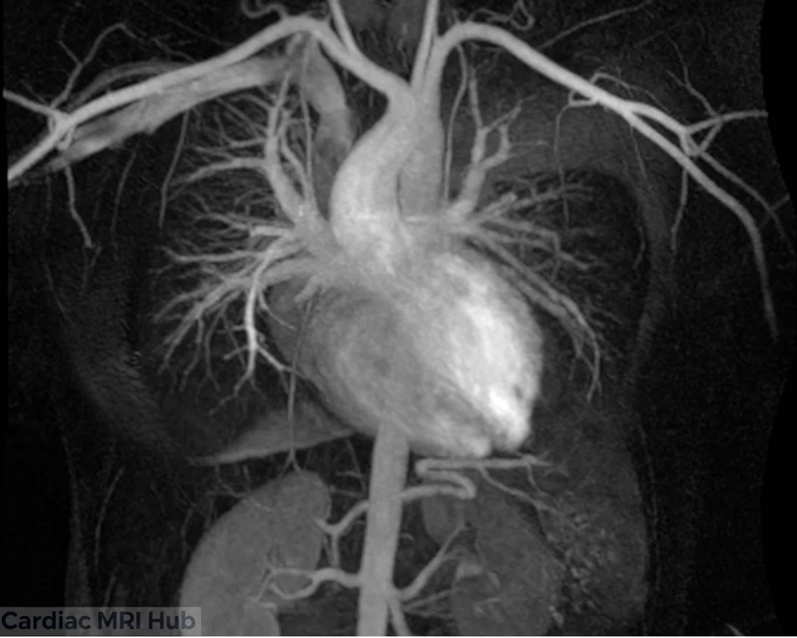
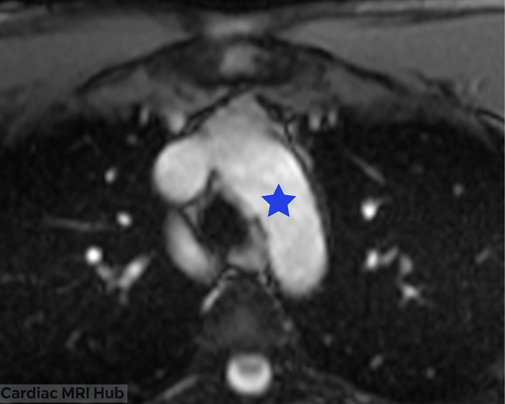
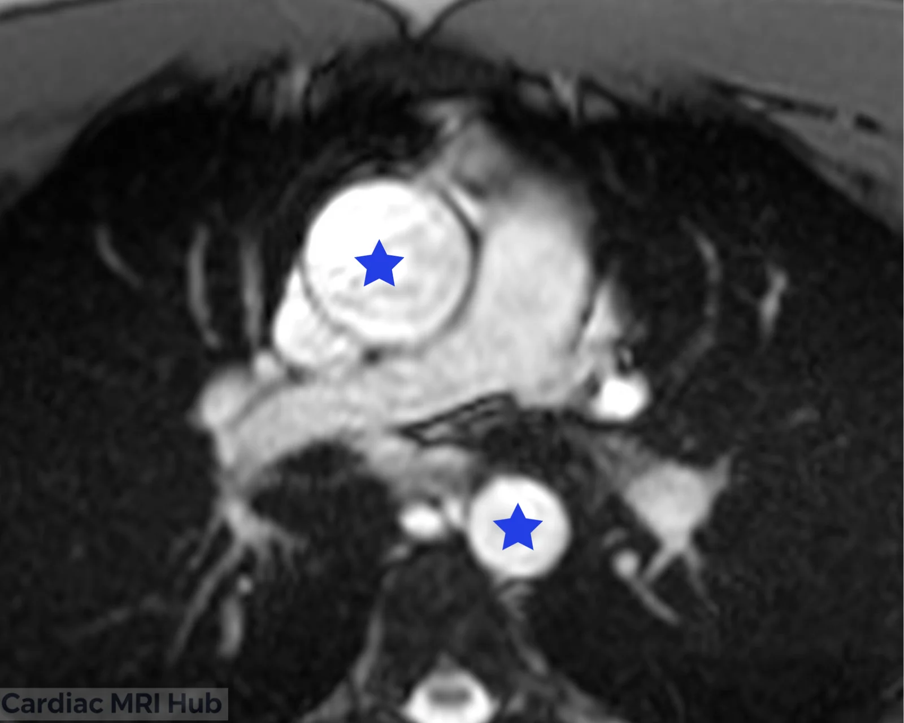
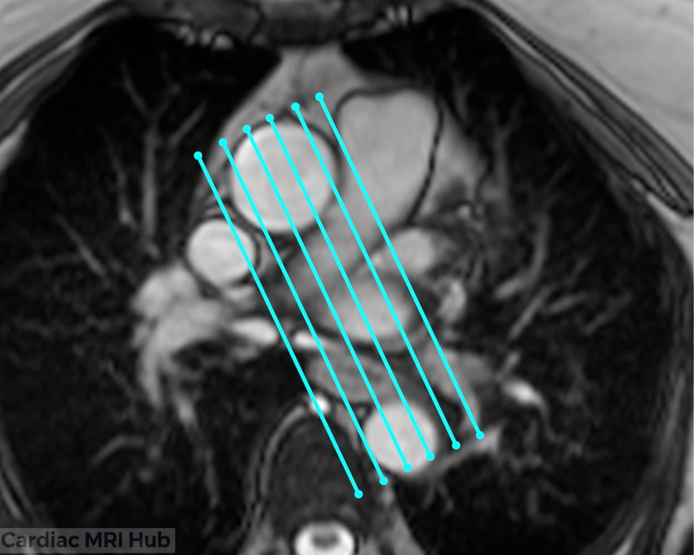

This guide covers imaging the thoracic aorta in cardiac MRI: planning, MRA, the sagittal oblique (candy cane) view and 4D flow. They're used to diagnose and follow aneurysms, dissections and congenital abnormalities.

# MRI Planning of the Thoracic Aorta

Good aorta images start with the right views, sequences and settings. The key points:

# Planning for Cardiac MRI of the Thoracic Aorta

## The views

The views that matter for the thoracic aorta:

- **Long axis:** the length and shape of the aorta, including dilation or other abnormalities.
- **Short axis:** at several levels (ascending, arch, descending), for the aortic wall and any lesions.
- **Oblique views:** how the aorta sits against nearby structures, and any compression or displacement.
- **Contrast-enhanced views:** contrast shows the lumen and makes dissections and aneurysms easier to see.

## Acquisition

- **Sequences:** T1-weighted images for anatomy and T2-weighted images for fluid.
- **Slice thickness and spacing:** cover the whole thoracic aorta while keeping partial volume low.
- **Timing:** ECG gating, to image at the right phase of the heartbeat.

## Planning steps

- **Patient preparation:** explain the exam and any instructions before the scan.
- **Positioning:** supine and comfortable, arms supported and out of the field of view.
- **Sequences:** choose the sequences for the aorta question.
- **Timing:** ECG-gated, usually imaged in diastole for the clearest view of the aorta.

# MRA Thoracic Aorta

# Sagital Oblique (Candy Cane) View

 image shown above.")

3-point planning for the sagittal oblique view of the thoracic aorta,

shown on the right and left.

")

# Sagittal Oblique Candy Cane View Planning for Cardiac MRI of the Thoracic Aorta

The sagittal oblique (candy cane) view shows the whole thoracic aorta in one plane, for its anatomy and any disease.

## Key Considerations for Planning

- **Orientation:** angle the plane along the thoracic aorta to show its whole length and its branches.
- **Slice thickness:** thinner slices to show small abnormalities.
- **Field of view:** the thoracic aorta and the structures around it.
- **Timing:** ECG-gated, ideally imaged in diastole, for the clearest picture of the aorta.
- **Contrast:** if it's part of the exam, contrast shows the lumen and surrounding tissue more clearly.

## What it's used for

- Aortic size and shape.
- Aneurysms and dissections.
- Aortic valve function and related abnormalities.
- Follow-up of aortic disease.

## What the view shows

- **Anatomy:** the whole thoracic aorta, from the root through the arch to the descending aorta, with its branches and any anomalies.
- **Disease:** structural changes, abnormal wall motion and other signs of aortic disease.

# MRA 4D Flow

MRA with 4D flow measures blood flow through the heart and vessels in three dimensions over the whole cardiac cycle.

## What 4D flow does

- **Four dimensions:** 3D coverage plus time, so you can see how blood moves through the cardiac cycle.
- **Non-invasive:** no catheter, and often no contrast, which avoids the risks of conventional angiography.
- **Flow analysis:** direction and speed of flow, including turbulence, wall shear stress and obstructions.

## What it's used for

- **Vascular disease:** diagnosing and following aneurysms, stenosis and arteriovenous malformations.
- **The heart:** flow in the chambers and across the valves, for congenital heart defects and other abnormalities.
- **Research:** studying how flow changes in disease.

## Advantages

- **Seeing flow:** shows how blood moves through the vessels.
- **Measurements:** flow values that help plan treatment and follow-up.
- **Lower risk:** non-invasive, so safer than conventional angiography.

## Limitations

- **Complexity:** needs advanced software and expertise that not every site has.
- **Motion:** patient movement causes artifacts.
- **Scan time:** longer than standard MRA, which some patients find hard.

