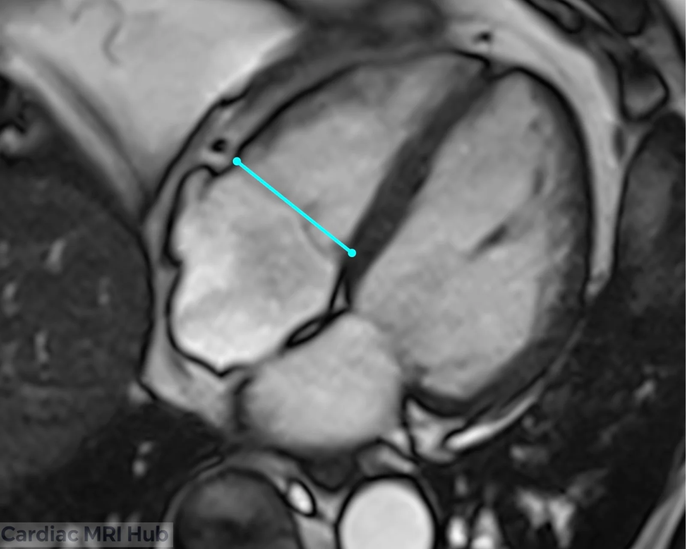
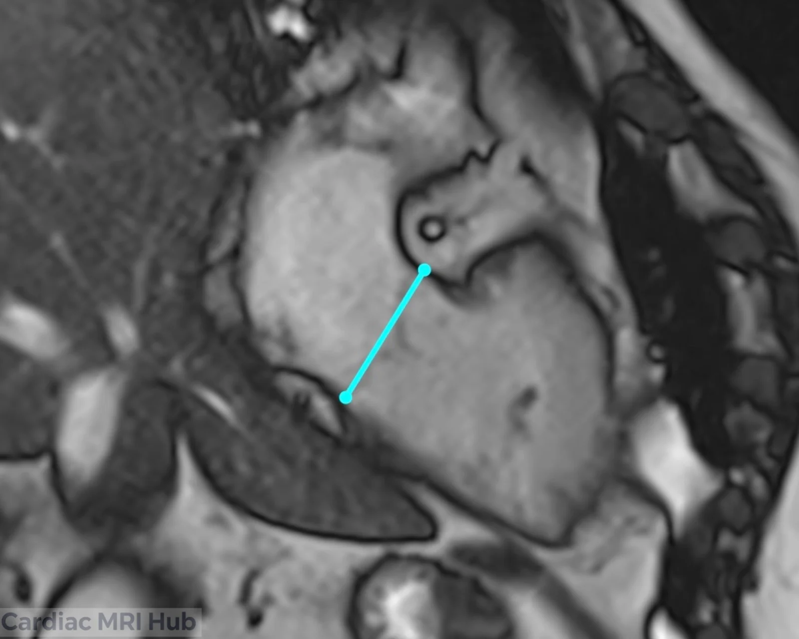

The tricuspid valve sits between the right atrium and right ventricle and keeps blood flowing one way through the right heart. Cardiac MRI shows the valve's shape and the effects of regurgitation, stenosis or structural abnormalities on the right heart. This guide covers how to plan it.

# Tricuspid Valve Planning

# Tricuspid Valve Cardiac MRI Planning

Tricuspid valve imaging shows the valve, the right atrium and the right ventricle.

## Key Considerations for Planning

- **Orientation:** line the plane up to show the leaflets and the structures around them.
- **Slice thickness:** thinner slices for more detail of the valve.
- **Field of view:** the tricuspid valve, right atrium and right ventricle.
- **Timing:** ECG-gated through the cardiac cycle, to show the valve opening and closing.
- **Contrast:** if it's part of the exam, contrast helps outline the valve and the myocardium around it.

## What it's used for

- Tricuspid valve shape and function.
- Right atrial and right ventricular size.
- Tricuspid regurgitation and other valve disease.
- Follow-up of the valve over time.

## What the view shows

- **Leaflets:** thickening, prolapse or other abnormalities.
- **Right atrium and ventricle:** size and function, which reflect how the valve is affecting the heart.

